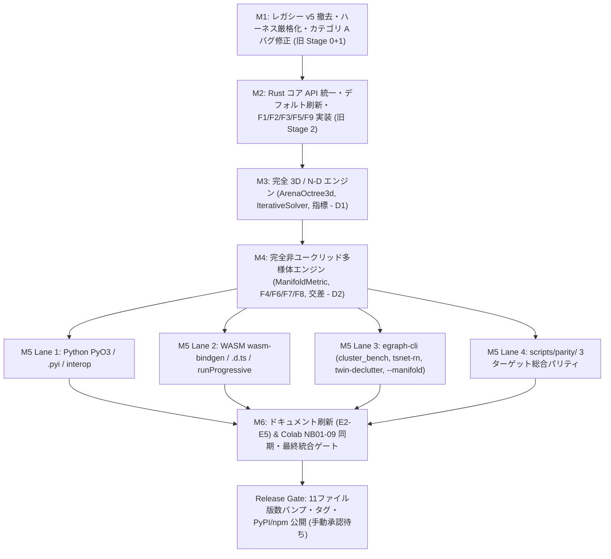

# `egraph` `v6.0.0-alpha.9` 統合修正・機能拡張・完全パリティ計画書

**策定日**: 2026-11-26（Step 0 サーベイ統合更新） / **ベースライン**: `v6.0.0-alpha.8`（`dcde13c`, 45 クレート構成）  
**目標マイルストーン**: **`v6.0.0-alpha.9`**（引き続き alpha チャネルを維持し、`beta` / `v6.0.0` GA 昇格および crates.io 公開は本計画完了後の次フェーズで別途判断する）  
**対象リポジトリ制約**: 編集・実装対象は **`/Users/likr/egraph-rs` のみ** とする（`diffusion-kernel-experiments` や `papers` 等は編集対象外とし、下流移行影響のみ第 6・7 節に記録する）。  
**実行環境制約**: Native Rust / Python (PyO3) / WebAssembly (`wasm-bindgen`) の 3 ターゲット完全パリティを維持し、**厳密にシングルスレッド・プレーン CPU 実行**（`rayon`・`std::thread`・Web Workers・`SharedArrayBuffer`・GPU/CUDA/WebGPU・C/Fortran FFI 非使用）および **決定的明示シード RNG** を厳守する。

> [!IMPORTANT]
> 本計画書は `v6.0.0-alpha.8` に対する全コードベース監査（51 件: `A1`–`E5`）に加え、関連研究・技術サーベイ 3 会話（`69ca7611`, `54552acb`, `0b8a0477`）および Step 0 コードベース精査で特定された **追加カテゴリ F（9 件: `F1`–`F9`）** を統合した **全 60 件（カテゴリ A: 8, B: 13, C: 14, D: 11, E: 5, F: 9）** の設計・実装計画である（なお `0b8a0477` 由来の汎用 2D 連成制約射影 `LinearConstraintProjector` は `v6.0.0-beta.1` へ明示的に繰り延べる）。バージョン番号の一括更新（11 ファイル群）・リリースタグ発行・PyPI/npm 公開は全検証ゲート通過後の別途承認ステップとして扱う。

---

## 1. エグゼクティブサマリー & 確定設計方針一覧（D1–D11）

インタビュー（`/grill-me`）、コードベース精査、および Step 0 サーベイ裁定により確定した 11 項目の設計方針を以下に固定する。

| No. | 決定領域 | 確定方針 |
|---|---|---|
| **D1** | **修正スコープ（全 60 件網羅 + 明示的繰延）** | カテゴリ **A（明確なバグ 8 件）**・**B（インターフェース統一 13 件）**・**C（数値／計算量／エルゴノミクスの罠 14 件）**・**D（3D/N-D・多様体・Rust 露出 11 件）**・**E（ドキュメント・Colab 同期 5 件）**・**F（RN-tsNET P0・非ユークリッド統一サイズ最適化・DAG 簡約 9 件 `F1`–`F9`）** の全 60 件を単一計画に統合して実施する。汎用 2D 連成線形制約ソルバ `LinearConstraintProjector`（`0b-1`）は `beta.1` へ明示的に繰り延べる。 |
| **D2** | **3 ターゲット完全パリティ & チュートリアル同期** | Native Rust・Python (`crates/python`)・WebAssembly/TypeScript (`crates/wasm`)・CLI (`crates/cli`)・クロスターゲット検証 (`scripts/parity_harness.py`) のすべてで 100% パリティを維持し、さらに [`notebooks/01..09_*.ipynb`](../notebooks/README.md) と [`notebooks/README.md`](../notebooks/README.md) を最終仕様へ同期して Google Colab 実機再検証まで完了させる。 |
| **D3** | **alpha 段階でのクリーンブレイク一本化** | 互換エイリアス負債を GA へ持ち越さず、正規 API へクリーンブレイクで一本化する（Rust / Python / WASM / CLI / `.pyi` / `.d.ts` / `notebooks/` を一括更新）。編集対象は `egraph-rs` に限定し、下流リポジトリ `diffusion-kernel-experiments` 向けの移行チェックリスト（第 7 節）を提供する。 |
| **D4** | **レガシー v5 クレート群・`legacy` feature の完全撤去** | ワークスペース上のレガシー v5 `petgraph-*` 18 クレート（`crates/algorithm/*`, `crates/clustering`, `crates/drawing`, `crates/edge-bundling/fdeb`, `crates/layout/*`, `crates/linalg/kernel`, `crates/quality-metrics`）を完全削除し、`crates/wasm` の `legacy` feature および `crates/python` の旧モジュール群・旧テスト・Sphinx 旧 doctest を撤去する。純 v6 アダプタ `crates/petgraph`（`egraph-petgraph`）のみ維持し、全 `*_v6` 関数名を無印正規名へ昇格させる（45 クレート $\to$ 27 クレート）。 |
| **D5** | **反復回数パラメータ名の 2 系統＋構造化統一（B2）** | 単一予算ソルバは **固定反復系を `iterations`**（`SgdSolver.*`, `TFdpSolver`, `IbUmapSolver`, `GuMapSolver`, `ForceAtlas2Solver`, `FruchtermanReingoldSolver`, `LinLogSolver`, `SelLayoutSolver`, `BackboneSolver`, `SpatialIntruderRefiner`, `ScreenedPoissonRefiner`, `TwinDeclutterer`）、**収束判定ありを `max_iterations`**（`StressMajorizationSolver`, `KamadaKawaiSolver`, `GemSolver`, `ClusterRefineSolver`, `PrismOverlapRemoval`, `GTreeOverlapRemoval`, `AmgPcgSolver`, `kmeans_plus_plus`, `label_propagation`, `spectral_clustering`）の 2 系統に統一し、多段階・階層ソルバは明確な構造化名（`stage_iterations`, `phase_iterations`, `max_iterations_per_level`, `stages`/`steps_per_stage`, `rounds_min`/`rounds_max`, `max_scale_iters`/`sgd_iterations`, `cycles`/`steps_per_cycle`, `intra_iterations`/`fd_iterations`）に整理する。 |
| **D6** | **クラスタラベル引数名とゼロコピー Result クラス統一（B6）** | 全 API のラベル引数名を **`labels`** へ統一する（`community_labels`, `cluster_labels`, `cluster_ids` を廃止）。コミュニティ検出／クラスタリング系 5 関数（`louvain_communities`, `leiden_communities`, `kmeans_plus_plus`, `label_propagation`, `spectral_clustering`）の戻り値を 3 ターゲット共通のゼロコピー Result クラス（`LouvainResult`, `LeidenResult`, `KMeansResult`, `LabelPropagationResult`, `SpectralClusteringResult`）に統一し、Python は `Py<PyArray1<u32>>` 所有で $O(1)$ ゼロコピー、WASM は `labelsView()` を追加して二重コピーを解消する（`crates/cli/src/cluster_bench.rs` も追従更新）。 |
| **D7** | **`MetricReport` 3 ターゲット統一 & キー正規化（B12 & D7, F7）** | Python `evaluate_metrics` も Rust / WASM と揃えて **`MetricReport` クラス** を返すよう統一する。出力属性および `to_dict()` / `report["key"]` / WASM `toRecord()` はすべてスタンドアロン関数名と一致する完全正規名（WASM は対応 camelCase）とし、未要求指標は `None` / `undefined`（`to_dict()` は要求分のみ）。入力パーサは空白 `' '` も除去して短縮エイリアスを引き続き受理し、未統合指標（`nor_metrics`, `prism_distortion`, `crossing_edges`, `torus_crossing_number`, `crossing_edges_torus`, `geodesic_distortion`）と `sprawlter_half_widths`/`sprawlter_half_heights`、`LayoutDegeneracy` 拡張指標を統合する。 |
| **D8** | **品質・安全性優先デフォルト刷新 & RN-tsNET P0 統合（カテゴリ C & F1–F3）** | 安全性・精度優先で既定値を刷新する：C1 **`ManifoldLayout2d` 上の `ManifoldMetric { scale, aspect }`** による統一スケール管理（`SgdSolver::distance_scale` 案は廃止）、C3 **`Spherical` `mu <= 0.1` クランプ厳禁**（`1.0` 維持、`max_mu: Option<f64> = None`）、C4 `EffectiveResistanceConfig::exact_max_nodes = 256, jl_dim = 128` ＋ `torus_std_threshold` JL 校正・`deg_cv < 0.02`・閉曲面 $O(|E|)$ 位相チェック、C7 `TsNetSolver` `"fft"` `interpolation_order = 3`＋`TFdpSolver` `"ibfft"` スパンガード、C9 `ScreenedPoissonConfig::grid_size = 512`＋`density_grid()`、C10 `ForbidConfig::variant = SparseForbid`＋`GemConfig::max_rounds = min(4*N, 400)`。さらに **F1 (`TsNetBackend::Auto` + `learning_rate_divisor=3.0`)**, **F2 (`TwoStepRandomWalk` + 葉フィルタ)**, **F3 (`TwinDeclutterer`)** を既存の FFT 小規模 $N$ テストおよび `extract_sparse_1hop_2hop_pairs` を壊さずに追加する。 |
| **D9** | **完全 3D / N-D エンジン & `IterativeSolver` 汎用化（D1, B3）** | 単一スレッドゼロアロケーション **`ArenaOctree3d<S>`** を `crates/spatial-trees` に新設し、3D/N-D (`LayoutNd`) 反復ソルバ 11 種と N-D 評価指標一式を対応させる。さらに **`IterativeSolver<S, L = Layout2d<S>>`** へトレイトを汎用化（後方互換デフォルト `L = Layout2d<S>`）して `Layout2d` / `LayoutNd` / `ManifoldLayout2d` を単一トレイトへ統合し、WASM `runProgressive` も `coordsView()` を介して 3 座標型を多相駆動できるようにする。 |
| **D10** | **完全非ユークリッド多様体エンジン（D2, F4–F8）** | 双曲（ポアンカレ円盤＋新規 **`HyperbolicLorentz` [F4]**）・球面 $S^2$・2D トーラス $T^2$ に対し、`ManifoldMetric { scale, aspect }`（`set_scale`, `set_torus_extents`, `rescale_geodesic`）を備えた `ManifoldLayout2d` 上で `SgdSolver`（全 17 モード + `reset_schedule` / `run_schedule_window` [F5]）および 5 種ソルバ（`StressMajorizationSolver`, `KamadaKawaiSolver`, `TsNetSolver`, `GuMapSolver`, `FruchtermanReingoldSolver`）を実装する。測地線品質指標（**`GeodesicDistortion` [F7]** 含む）、球面大円弧・双曲ポアンカレ円盤測地線弧交差判定、**`TorusCrossing` 拡張（端点・交差角・矩形 $(L_x, L_y)$）＋ `torus_edge_segments` 露出 ＋ `torus_auto_pan` [F6]**、および **`torus_spectral_phase_init` [F8]** を実装・統合する。 |
| **D11** | **Rust プリミティブ露出・DAG 簡約・CLI・文書・リリース位置づけ（D3–D11, E1–E5, F8–F9）** | `DijkstraWorkspace`、未露出 MDS/Laplacian/Chebyshev プリミティブ、`from_probabilities_with_stages`、`from_packed_symmetric`、評価詳細・単体指標、厳密 DAG **`transitive_reduction` [F9]**、`CsrGraph` メソッド・`f32` 重み、`Layout2d.copy()`、`KnnGraph`/`SparseProbabilities` `indptr: Vec<u32>` 統一＋`from_csr`、`to_igraph`＋3D/Manifold `to_networkx`、`list_datasets()`＋手続生成ベンチマーク、`egraph-cli` 拡張（`tsnet-rn`, `twin-declutter`, `--manifold` 等 [F8]）を追加する。ルート `README.md`・Sphinx・`MIGRATION_V6.md`・`notebooks/` を刷新し、`v6.0.0-alpha.9` 準備ゲートを構成する（PyPI 安定版 `0.3.1` $\to$ `6.0.0` GA 昇格 E1 は次フェーズ）。 |

---

## 2. 全 60 項目トレーサビリティ・マトリクス

| ID | 概要 | 対応マイルストーン | 主な対象クレート / ファイル | 解決仕様サマリー |
|---|---|---|---|---|
| **A1** | `inspect.signature(eg.FdebSolver)` `ValueError` | M1 | `crates/python/src/solvers/edge_bundling.rs` | `text_signature` の `2.0/3.0` を数値リテラル化し、併せて全 `.py` / `.rs` で非リテラル `text_signature` をテストで自動検出 |
| **A2** | `leiden_communities(..., objective="cpm")` の `"modularity"` 水増し | M1 | `crates/cluster/src/leiden/solver.rs` | `LeidenResult::modularity` を常に標準 $\gamma = 1.0$ で算出し、`LeidenResult::quality` に目的関数別スコア（Modularity / CPM）を保持 |
| **A3** | `AmgPcgSolver.from_graph_laplacian(..., kind="random_walk")` 偽陽性 | M1 | `crates/python/src/linalg/amg_helpers.rs` | Python/WASM 側の専用パーサを対称ラプラシアン限定（`"combinatorial"` / `"symmetric_normalized"`）へ絞り不正値を即拒否 |
| **A4** | `SgdSolver.from_pairs_with_hinges` の `= None` 欠落 | M1 | `crates/python/src/solvers/sgd.rs` | シグネチャ整理し `hinge_*` を必須位置引数、`spring_dji`, `spring_wij`, `spring_wji` をキーワード専用デフォルト `None` 化 |
| **A5** | `crossing_angle_with_crossing_edges` docstring と実装矛盾 | M1 | `crates/metrics-geometry/src/crossings/`, `crates/python/src/metrics/stress_crossings.rs` | レガシー `crates/quality-metrics` 削除（M1）に合わせ、$\sum \cos^2 \theta$ 集計仕様と一致した docstring／`crossing_angle_from_pairs` を整備 |
| **A6** | `evaluate_metrics(..., ideal_edge_length=...)` 重み付きグラフで黙殺 | M1 | `crates/metrics/src/dispatcher/evaluate.rs` | 重み付きグラフかつ `ideal_edge_length` 明示指定時は、エッジ重み×単位スケールとして反映するか明示的なエラー／設定分離を導入（重みスケーリング対応） |
| **A7** | `compute_knn_probabilities` が 0D `np.array(15.0)` を拒否 | M1 | `crates/python/src/array_extract.rs` | `ndim() == 0` の NumPy 配列からスカラー値を抽出して `extract_perplexities` で受理 |
| **A8** | `GTreeOverlapRemoval(..., compact_t_max=1.0)` 未記載制約 | M1 | `crates/layout-constraints/src/gtree/config.rs`, `crates/python/src/solvers/overlap_tree_forbid.rs`, `.pyi`/`.d.ts` | `compact_t_max > 1.0` の境界条件を全 docstring / `.pyi` / `.d.ts` に明記 |
| **B1** | ソルバ構築形式の分裂（`__new__` vs `@staticmethod`）と `seed=` 欠落 | M2, M5 | `crates/python/src/solvers/*.rs`, `crates/wasm/src/*.rs` | 全グラフソルバへ標準 `__new__(graph, ...)` コンストラクタと `seed=42` を整備し、`from_*` ファクトリと両立 |
| **B2** | 反復回数パラメータ名の乱立（14 種類以上） | M2, M5 | `crates/layout-*`, `crates/python`, `crates/wasm` | 固定反復 `iterations`・収束判定 `max_iterations`・構造化多段階名の統一規約へ全面整理（D5） |
| **B3** | 協調ステッピング・`IterativeSolver` トレイト非対称（`FdebSolver`, N-D, 多様体, `runProgressive`） | M2, M3, M4, M5 | `crates/core/src/solver.rs`, `crates/layout-*`, `crates/python`, `crates/wasm` (`js_wrappers.mjs`) | **`IterativeSolver<S, L = Layout2d<S>>`** へ汎用化（既定型引数 `L = Layout2d<S>` で後方互換を維持）し、`Layout2d`・`LayoutNd`・`ManifoldLayout2d` ソルバすべてを単一トレイトへ統合。`FdebSolver` も `FdebSolver(graph)` + `IterativeSolver` 規約へ統一し、WASM `runProgressive` が `coordsView()` 経由で 3 座標型すべてを多相駆動できるよう更新 |
| **B4** | `Layout2d` / `LayoutNd` / `ManifoldLayout2d` のバッファ API 非対称 | M2, M5 | `crates/core/src/{layout,manifold}`, `crates/python`, `crates/wasm` | `LayoutNd.{init,copy,get,set,normalize_std,coordsView}`、`Layout2d.copy()`、`ManifoldLayout2d.{init,copy,coords(copy=False)/coordsView(),__len__}` 統一（`len()` 重複や `kind`/`manifold` 揺れ解消） |
| **B5** | バックエンド・FFT オプション命名不整合 | M2, M5 | `crates/layout-neighbor`, `crates/layout-force`, `crates/python`, `crates/wasm` | `TFdpSolver`/`IbUmapSolver`/`TsNetSolver` の FFT パラメータを `interpolation_order`, `intervals`, `min_grid_dim`, `max_grid_dim` + `last_fft_stats()` へ統一。力学系を `backend="barnes_hut"|"exact"` へ統一 |
| **B6** | クラスタラベル引数名・コミュニティ検出戻り値型の分裂 | M2, M5 | `crates/cluster`, `crates/metrics*`, `crates/layout*`, `crates/cli/src/cluster_bench.rs`, `crates/python`, `crates/wasm` | 引数名を `labels` へ統一し、5 関数すべて 3 ターゲット共通ゼロコピー Result クラスを返却（D6）。`crates/cli/src/cluster_bench.rs` も追従 |
| **B7** | CSR `indptr` dtype 不一致と `SparseProbabilities.from_csr` 欠落 | M2, M5 | `crates/neighborhood`, `crates/python`, `crates/wasm` | `KnnGraph` / `SparseProbabilities` の `indptr` を `Vec<u32>`（`uint32`）へ統一し、`SparseProbabilities.from_csr` を追加 |
| **B8** | 関連クラス間の引数・ゲッタ非対称（7 項目） | M2, M5 | `crates/layout-*`, `crates/linalg-mds`, `crates/neighborhood`, `crates/python`, `crates/wasm` | `sigma_tolerance` / `max_2hop_per_node=32` / `dims` 統一、`GuMapSolver.{a,b,ab}` 完備、`ForceAtlas2Solver`/`YifanHuSolver` 全設定ゲッタ露出、`min_degree` 追加、`RhghLandmarks` 専用結果型分離 |
| **B9** | `np.ndarray` 限定入力（`Layout2d`/`LayoutNd` 非対応） | M2, M5 | `crates/python/src/{neighborhood/knn.rs,solvers/sgd_core.rs,solvers/sgd_pacmap.rs}` | `extract_coords_any` 共通ヘルパで `Layout2d` / `LayoutNd` / 2D `np.ndarray` を透過受理 |
| **B10** | DAG・分離制約 API 非一貫性 | M1, M2, M5 | `crates/layout-constraints`, `crates/python/src/constraints_layering.rs`, `crates/wasm` | 旧 `remove_cycle` 撤去、`generate_layered_constraints` が無向 `CsrGraph` を拒否するよう統一、`project_1d` は `project_layout_axis` と揃えて in-place + `None` 返却（DAG 簡約は **F9** 参照） |
| **B11** | `*_v6` 二重関数名と `stress` 互換罠 | M1, M5 | `crates/python`, `crates/wasm`, `crates/python/docs`, `scripts/parity/` | レガシー撤去（M1）に伴い `*_v6` 接尾辞を全廃し無印名へ昇格。`stress` 削除し `scale_normalized_stress` へ一本化 |
| **B12** | `evaluate_metrics` とスタンドアロン指標のキー・型不一致 | M2, M5 | `crates/metrics`, `crates/python/src/metrics/`, `crates/wasm/src/metrics_*.rs` | Python も `MetricReport` クラスへ統一（完全正規名属性＋`to_dict()`）、空白除去パーサ、`sprawlter_half_widths/heights` 対応、`LayoutDegeneracy` 統一（D7、`MetricTarget` に `#[non_exhaustive]` 検討） |
| **B13** | `ClusterRefineSolver` vs `refine_cluster_layout` / `from_igraph` vs `from_networkx` | M2, M5 | `crates/layout-multilevel/src/cluster_refine/`, `crates/python/python/egraph/interop.py` | `refine_cluster_layout` に `graph=None` を追加し統計辞書/カウント整合化、`from_igraph` 戻り値や `to_igraph` との対称性を明示設計 |
| **C1** | `ManifoldLayout2d` メトリック所有権（旧 `SgdSolver::distance_scale` 案の改定） & `exponential` 分岐 | M4, M5 | `crates/core/src/manifold`, `crates/layout-sgd/src/sgd/update.rs`, `crates/layout-*`, `crates/python`, `crates/wasm` | `SgdSolver::distance_scale` を廃止し、**`ManifoldMetric { scale: f64, aspect: f64 }`**（既定 `scale=1.0, aspect=1.0`）を **`ManifoldLayout2d<S>`** に直接保持（`scale()`, `aspect()`, `set_scale()`, `set_torus_extents(lx, ly)`, $\mathbb{H}^2$ Einstein 中点動径リスケーリングによる `rescale_geodesic(&mut self, new_scale)`）。`clamp_manifold_tangent_step` の `max_step`（`update.rs:126-130`）を `layout.scale()` 倍にスケールし、`SgdSolver` は非スケール化 $D_{ij}$ と `eta_min`/`eta_max` を 1 回だけ構築する |
| **C2** | `SgdSolver.from_pairs` 位置引数 `dji=None` 誤束縛 | M2, M5 | `crates/python/src/solvers/sgd.rs` | `(num_nodes, src, tgt, dij, *, dji=None, wij=None, wji=None, ...)` のキーワード専用化 |
| **C3** | `SgdSolver` 8 コンストラクタ実行時失敗・双曲原点デッドロック & `Spherical` `mu` ガード | M4, M5 | `crates/layout-sgd`, `crates/core/src/manifold`, `crates/python`, `crates/wasm` | 17 コンストラクタ全モードを多様体対応化＋`supports_manifold` プロパティ追加、双曲原点ガード実装。**ガードレール**: `Spherical` での `mu <= 0.1` クランプは**厳禁**（`1.0` 既定を維持し、`SgdScheduleConfig` に `max_mu: Option<f64>` を追加する場合も既定は必ず `None`）。公開設定・列挙型（`SgdScheduleConfig`, `MetricTarget`, `ManifoldKind`）へ `#[non_exhaustive]` を付与 |
| **C4** | `resistance_curvature_flow` JL ノイズによるトーラス誤判定 | M2 | `crates/linalg-amg/src/resistance_curvature/config.rs` | `EffectiveResistanceConfig::exact_max_nodes` を `64 -> 256`、`jl_dim` を `64 -> 128` へ引き上げ。さらに `classify_geometry_from_curvature` の `torus_std_threshold` を `used_exact`/`jl_dim` に応じて校正し、Rule B に基づき `deg_cv < 0.02` へ厳格化するとともに、`can_96` 等の閉曲面向けに高速 $O(|E|)$ 位相チェック（`mean_link_curvature` 等）を追加 |
| **C5** | `adjusted_patch_nig` 疎/小グラフの黙示的 `0.0` | M2 | `crates/metrics-cluster/src/community/`, `crates/python`, `crates/wasm` | 既定の適応グリッドまたは空虚パッチ率過剰時の診断情報・詳細関数（`adjusted_patch_nig_detail`）を追加 |
| **C6** | `GripSolver.run(layout)` の初期座標無言上書き | M2, M5 | `crates/layout-multilevel/src/grip/`, `crates/python`, `crates/wasm` | MIS ベース構造上初期配置を使わない旨を明記し、空/未初期化ガードと API ドキュメントを明確化 |
| **C7** | `TFdpSolver` `"ibfft"` グリッド肥大化 & `TsNetSolver` `"fft"` 次数 1 | M2 | `crates/layout-neighbor/src/{ts_net,field_layout}/`, `crates/spatial-fft/src/ibfft/` | `TsNetSolver` `"fft"` (`FftInterpolation`) 既定 `interpolation_order=3` 化、`TFdpSolver` の座標スパン正規化／適応グリッド暴走抑止ガードを追加（注: 既存の `"fft"`/`"linear_fft"` 小規模 $N$ での FFT 実行挙動は不変維持し、自動切替は **F1** `"auto"` が担う） |
| **C8** | `bfs` `np.inf` $\to$ `u32::MAX` 変換罠（RTA） | M1, M5 | `crates/python/src/metrics/cluster_eval.rs` | `landmark_stratified_rta_from_landmarks` が `float64`（`np.inf` 含む）を直接受理し内部で安全に `u32::MAX` マッピング |
| **C9** | `ScreenedPoisson` 68 MB 既定 & 密度格子非返却 | M2, M5 | `crates/spatial-fft/src/screened_poisson/`, `crates/python`, `crates/wasm` | 既定 `grid_size = 512` 化、`density_grid()`（2D 密度配列）追加、`evaluate_in_bounds(min_x, min_y, max_x, max_y)` 統一 |
| **C10** | `GemSolver` / `ForbidOverlapRemoval` / `classical_mds` 計算量デフォルト罠 | M2 | `crates/layout-force/src/gem/`, `crates/layout-constraints/src/forbid/`, `crates/linalg-mds` | `ForbidConfig` 既定を `SparseForbid` 化、`GemConfig` 既定 `max_rounds = min(4*N, 400)` 上限設定、`classical_mds` 計算量明記 |
| **C11** | `parse_csr_csv` 無重み 2 列限定 | M1, M2 | `crates/dataset/src/lib.rs`, `crates/python`, `crates/wasm` | ヘッダ後に `u,v` および重み付き `u,v,w`（`Scalar` パース）を双方サポート |
| **C12** | 有向グラフ・辺重み無視・`SelLayoutSolver` 内部固定 | M2, M5 | `crates/layout-multilevel/src/{backbone,sel}/`, `crates/layout-sgd/src/coarse_backbone/` | `extract_quadrilateral_backbone` の辺重み対応（最小全域木/U-MST 重みモード）、`SelLayoutSolver` 内部ソルバ設定公開、有向グラフ制約エラー整備 |
| **C13** | `GroupInABoxSolver("force_directed")` 枠はみ出し & `squarified_treemap` 形式 | M2, M5 | `crates/layout-multilevel/src/group_in_a_box/` | `fit_bounds: bool = True` オプション追加で `[0, total_width] x [0, total_height]` 内への任意収容を実現、`GibBox` 属性名明確化 |
| **C14** | `normalize_std` 定義・`omega` 推奨・`sns_from_distances` 非対称未検証 | M1, M2 | `crates/core/src/layout.rs`, `crates/metrics-geometry/src/stress/sns.rs` | `scale_normalized_stress_from_distances` に行列対称性検証を追加、`normalize_std` の軸別 vs 全体仕様を明確化 |
| **D1** | `LayoutNd`（3D/N-D）反復ソルバ・評価指標 0 件 | M3, M5 | `crates/spatial-trees`, `crates/layout-*`, `crates/metrics*`, `crates/python`, `crates/wasm` | `ArenaOctree3d` 新設＋全主要ソルバ 3D/N-D 対応（`IterativeSolver<S, LayoutNd<S>>`）＋N-D 品質指標一式＆`evaluate_metrics` 統合（D9） |
| **D2** | `ManifoldLayout2d` 測地線品質指標 0 件・`SgdSolver` のみ | M4, M5 | `crates/core/src/manifold`, `crates/layout-*`, `crates/metrics*`, `crates/python`, `crates/wasm` | 6 ソルバ群の多様体対応（`IterativeSolver<S, ManifoldLayout2d<S>>`）＋測地線指標一式＋球面大円弧・双曲ポアンカレ弧交差判定＆トーラス直接対応（D10） |
| **D3** | Python v6 重み付き最短経路（`DijkstraWorkspace`）未露出 | M2, M5 | `crates/python/src/metrics/`, `crates/wasm/src/` | `dijkstra_single_source` / `all_pairs_dijkstra` を Python / WASM 双方に露出 |
| **D4** | Rust MDS・線形代数プリミティブ未露出 | M2, M5 | `crates/python/src/linalg/`, `crates/wasm/src/linalg_*.rs` | `classical_mds` (N-D), `classical_mds_from_distances`, `pivot_mds_with_pivots`, `pivot_mds_from_distances`, 各種 Laplacian `CsrMatrix` ビルダー、`ChebyshevDogKernel`, `adaptive_chebyshev_degree*`, `build_regularized_dog_terms`, `symmetric_eigen_jacobi` を露出 |
| **D5** | 未露出ソルバコンストラクタ（`from_probabilities_with_stages`, `from_packed_symmetric`） | M2, M5 | `crates/python/src/solvers/{tsnet,sgd}.rs`, `crates/wasm/src/{tsnet,sgd}.rs` | `TsNetStage` 構造体・オブジェクト配列と共に Python / WASM へ露出 |
| **D6** | 未露出 Rust 評価詳細・単体指標 | M2, M5 | `crates/metrics-cluster`, `crates/python/src/metrics/`, `crates/wasm/src/` | `scale_normalized_stress*_detail` ($s^*$ 返却), `ideal_edge_lengths_from_distances`, `scale_normalized_stress_from_pairs`, `crosslessness_from_count`, `max_crossing_pairs`, `histogram_density_measure` を露出 |
| **D7** | `evaluate_metrics` 一部指標未統合 | M2, M5 | `crates/metrics/src/dispatcher/`, `crates/python`, `crates/wasm` | `nor_metrics`（4 指標展開）, `prism_distortion`（`original_layout` 指定時）, `crossing_edges`, `torus_crossing_number`, `crossing_edges_torus` を統合 |
| **D8** | `CsrGraph` Pythonic/WASM メソッド & `f32` 重み不足 | M2, M5 | `crates/core/src/csr/`, `crates/python/src/csr_graph.rs`, `crates/wasm/src/csr_graph.rs` | `__len__`, `edges()`, `has_edge(u, v)`, `edge_weight(u, v)`, `is_connected()`, `dtype="float32"` 重みバッファ対応 |
| **D9** | `Layout2d.copy()` & `SparseProbabilities.from_csr()` 欠如 | M2, M5 | `crates/python`, `crates/wasm` | `Layout2d.copy()` / `LayoutNd.copy()` / `ManifoldLayout2d.copy()` および `SparseProbabilities.from_csr` を実装 |
| **D10** | `egraph.interop.to_igraph` 欠如 & `to_networkx` N-D/Manifold 非対応 | M5 | `crates/python/python/egraph/interop.py` | `to_igraph` 実装、および `to_networkx(graph, layout=...)` で `Layout2d` / `LayoutNd` / `ManifoldLayout2d` を全サポート |
| **D11** | 組込データセット拡充 & `list_datasets()` 不在 | M2, M5 | `crates/dataset`, `crates/python`, `crates/wasm` | `list_datasets()` 追加＋決定的手続生成による重み付き・DAG・SBM クラスタ正解付き・多様体メッシュデータセットを追加 |
| **E1** | PyPI 安定版 `0.3.1` vs v6 プレリリース | M6 (承認ゲート) | `pyproject.toml`, `docs/V6_RELEASE_PLAN.md` | 本計画では `v6.0.0-alpha.9`（`--pre`）として検証完了させ、安定版 `6.0.0` GA 昇格判断は次フェーズへ記録 |
| **E2** | ルート `README.md` のレガシー v5 Quick Start | M6 | `README.md` | v6 準拠のインストール・Quick Start・クレート構成（27 クレート）・特徴一覧（`InfoMap` 削除）へ全面改訂 |
| **E3** | Sphinx チュートリアル（`tutorial/01..03.rst`）のレガシー v5 残留 | M1, M6 | `crates/python/docs/source/tutorial/*.rst` | M1 でレガシー doctest 破損を除去後、M6 で `CsrGraph`, `Layout2d`, `LayoutNd`, `ManifoldLayout2d`, `egraph.interop`, 全主要ソルバ, `evaluate_metrics` ベースへ全面改訂 |
| **E4** | Sphinx API リファレンス（`layout.rst`, `quality_metrics.rst`）欠落 | M1, M6 | `crates/python/docs/source/api/{layout,quality_metrics,clustering,linalg,manifold}.rst` | 新規ソルバ・17 クラスタ/NOR 指標・3D/多様体 API・`MetricReport`・Result クラス・F1–F9 を全掲載し `*_v6` / legacy 記載を撤去 |
| **E5** | Sphinx から `notebooks/` への導線 & ノートブック再同期 | M6 | `crates/python/docs/source/examples/index.rst`, `notebooks/01..09_*.ipynb`, `notebooks/README.md` | Sphinx からの Colab/ノートブック相互リンクを整備し、`notebooks/01..09` を `alpha.9` API へ同期＋Colab 実機再検証 |
| **F1** | `TsNetBackend::Auto` + 滑らかな学習率スケーリング（`69-1`） | M2, M5 | `crates/layout-neighbor/src/ts_net/{config,config_and_constructors,jacobi_and_lr}.rs`, Py, WASM, CLI | **`TsNetBackend::Auto`**（構築時に $N \le 256 \to \mathrm{Exact}$、$N > 256 \to \mathrm{LinearFft}$ [$p=1$] へ解決）＋ `TsNetConfig::learning_rate_divisor: f64`（既定 `3.0`）と `resolve_learning_rate(n) = 10.0_f64.max(n as f64 / divisor)` を実装（$N \le 4$ と明示 `Some(lr)` 向け `compute_stage_lr` の `min(2.0 * n)` は維持）。`FftInterpolation`/`LinearFft` の小規模 $N$ 挙動は不変維持 |
| **F2** | `TwoStepRandomWalk` 2-hop サンプリング＋デッドエンド葉フィルタ（`69-3`） | M2, M5 | `crates/neighborhood/src/knn/{capped_2hop,row_normalized_12hop}.rs`, `crates/layout-neighbor/src/ts_net/`, Py, WASM, CLI | `TwoHopSamplingMode::{DegreeOrderedHubSuppressed, TwoStepRandomWalk}` ＋ `max_bridge_degree: Option<usize>` を `extract_sparse_1hop_2hop_pairs_with_mode` / `graph_12hop_row_normalized_probabilities_with_options` へ追加（`deg(w) > 1` 非葉フィルタ、`pot <= cap` 厳密全採用、`4 * cap` 試行＋`VisitStamp`）。`TsNetSolver::from_graph_row_normalized*` へ接続（既定 `TwoStepRandomWalk`, `None`、適宜 `Auto` 併用、明示的 FFT テストは維持）。既存 `extract_sparse_1hop_2hop_pairs` は完全不変 |
| **F3** | `TwinDeclutterer` / `declutter_twins_2d` 重複ノード精密解消（`69-4`） | M2, M5 | `crates/layout-constraints/src/twin_declutter/`, `crates/layout`, `crates/egraph`, Py, WASM, CLI | feature gate なしで `TwinDeclutterer`（`IterativeSolver<S>`）＋ `declutter_twins_2d` を新設。`-0.0 -> +0.0` 正規化、`n <= 1`/`diag <= 1e-12` 非パニックガード、辞書順完全重複除去 $\to$ 3×3 空間ハッシュ Union-Find $\to$ クラスタ重心 `StaticKdTree::<2, f64>` $\to$ 極角ソート $\to$ 黄金角 Vogel スパイラル（`min_pair_rel = 5e-7`, `max_passes = 4`）を全ターゲットへ露出 |
| **F4** | `ManifoldKind::HyperbolicLorentz` 2D Gans モデル（`54-3`） | M4, M5 | `crates/core/src/manifold/`, `crates/layout-*`, `crates/metrics*`, Py, WASM | 双曲ポアンカレ円盤クランプ上限（`POINCARE_EPS_F64=1e-5` 最大直径 `24.412`）を回避する 2D Gans 空間座標 $(x, y)$ モデル `ManifoldKind::HyperbolicLorentz` と `to_poincare_layout()` 変換を Rust / Python / WASM に実装 |
| **F5** | `SgdSolver` スケジュール再初期化 & ウィンドウ実行（`54-5`） | M2, M4, M5 | `crates/layout-sgd/src/sgd/{solver,stepping}.rs`, Py, WASM | `SgdSolver::reset_schedule(&mut self, cfg, seed)` および `run_schedule_window(&mut self, layout, start_iter, count)` を追加し、多様体サイズ最適化等における $O(N^2)$ `pairs` 再利用を実現 |
| **F6** | `TorusCrossing` 拡張・`torus_edge_segments` 露出・`torus_auto_pan`（`54-6`） | M4, M5 | `crates/spatial-crossings/src/crossings/torus.rs`, `crates/metrics-geometry`, `crates/core/src/manifold`, Py, WASM | `TorusCrossing` へ `(u1, v1, u2, v2, angle_rad, cos_sq)` と `&ManifoldLayout2d<S>` 経由の矩形 $(L_x, L_y)$ 物理アスペクト比を追加。`torus_edge_segments` を Py/WASM へ露出し、`torus_auto_pan`（最適トーラス切断）を Rust / Python / WASM で実装 |
| **F7** | `GeodesicDistortion` & `LayoutDegeneracy` 拡張（`54-7`, `69-5`） | M2, M4, M5 | `crates/metrics/src/dispatcher/report.rs`, `crates/metrics-geometry/src/geometry/angles_degeneracy.rs`, Py, WASM | `GeodesicDistortion`（Miller et al. 2024 Eq. 2）を `MetricTarget` / `MetricReport`・多様体指標に追加。`LayoutDegeneracy` に `excess_duplicate_ratio` と `near_collision_ratio`（$\tau = 10^{-7}\cdot\mathrm{diag}$）を追加 |
| **F8** | `torus_spectral_phase_init` & `egraph-cli` 拡張（`54-8`, `69-5`） | M4, M5 | `crates/core/src/manifold/`, `crates/cli/src/{args,cluster_bench,metrics_exec,...}.rs`, Py, WASM | `ManifoldLayout2d::torus_spectral_phase_init`（4 モード `atan2` 位相初期化）を Rust / Py / WASM に追加。`crates/cli` に `tsnet-rn`, `twin-declutter`, `--manifold` / サイズ最適化フラグと D6 Result 対応を実装 |
| **F9** | 厳密 DAG `transitive_reduction`（`0b-2`） | M2, M5 | `crates/layout-constraints/src/`, Py, WASM, `scripts/parity/` | 実行可能領域を不変のまま DAG 階層制約の冗長辺（8.5%–56.3%）を除去する厳密 `transitive_reduction` を実装し、Python / WASM / パリティハーネスへ露出 |

### 2.1 スコープ外・次期マイルストーン（`v6.0.0-beta.1`）への明示的繰延項目

- **`0b-1`: 汎用 2D 連成線形制約射影ソルバ `LinearConstraintProjector`（`0b8a0477` 由来）**
  - 単一スレッド Rust CSR Diag-PDHG ＋ Restarted Dual-FISTA ＋ Farkas 実行不可能性検出による汎用 2D 連成線形制約射影（直交八方向、$C_k/D_k$ 対称、切断方向錐、自由境界凸多角形等）は、`v6.0.0-alpha.9` のスコープには含めず **Post-`alpha.9`（`v6.0.0-beta.1` 以降）へ明示的に繰り延べる**。
  - `alpha.9` における `crates/layout-constraints` の作業は既存 1D VPSC 統一（B10）、`TwinDeclutterer`（F3）、および厳密 DAG `transitive_reduction`（F9）に集中させる。

---

## 3. アーキテクチャ & 詳細設計仕様

### 3.1 レガシー v5 完全撤去 & 隠れた結合の同期修正（D4）

ワークスペースから `petgraph-*` レガシー 18 クレートおよび `crates/wasm` の `legacy` feature・`crates/python` の旧 v5 モジュールを完全に撤去し、純 v6 の単一アーキテクチャへ統合する。

- **削除対象 Rust クレート（18 クレート）**:
  - `crates/algorithm/connected-components`
  - `crates/algorithm/layering`
  - `crates/algorithm/shortest-path`
  - `crates/algorithm/triangulation`
  - `crates/clustering`
  - `crates/drawing`
  - `crates/edge-bundling/fdeb`
  - `crates/layout/gumap`, `kamada-kawai`, `mds`, `omega`, `overwrap-removal`, `separation-constraints`, `sgd`, `stress-majorization`, `ts-net`
  - `crates/linalg/kernel`
  - `crates/quality-metrics`
- **維持対象**: `crates/petgraph`（`egraph-petgraph` クレート、Pure Rust v6 `CsrGraph` $\leftrightarrow$ `petgraph` 変換アダプタ）。
- **削除・移行対象 Python モジュール & ドキュメント**:
  - `crates/python/src/{algorithm.rs, array.rs, clustering.rs, distance_matrix.rs, drawing/, drawing.rs, graph/, layout/, layout.rs, quality_metrics.rs, rng.rs}`
  - `crates/python/python/egraph/{_core_distance_matrix.*, _core_diffusion_kernels.*, _core_legacy_*.*}`
  - `crates/python/Cargo.toml` 内の `petgraph` / `petgraph-*` / `rand` 直接依存。
  - `crates/python/tests/` のレガシー専用テスト（約 42 ファイル）を削除し、混在ファイル（`test_geometry_and_stress_metrics.py`, `test_rta_crosslessness_and_metric_errors.py`）の v6 部分を `CsrGraph`/`Layout2d`・無印関数名へ移行。
  - **Sphinx 旧 doctest 同期整理（隠れた結合）**: `crates/python/docs/source/{tutorial/01..03.rst, api/*.rst, examples/*.rst}` および `crates/python/examples/` に残存する旧 API（`DrawingEuclidean2d`, `FullSgd`, `SparseSgd`, `eg.Graph()`, `OverwrapRemoval`, `DistanceMatrix`, `Rng.seed_from`）の参照・doctest 群を M1 時点で撤去または最小 v6 化しておき、`sphinx -b doctest` の連鎖失敗を防ぐ。
- **削除・同期対象 WASM / CLI / 検証ハーネス要素（隠れた結合）**:
  - `crates/wasm/Cargo.toml` の `legacy` feature および `optional = true` の旧 `petgraph-*` / `serde` / `getrandom` / `ndarray` / `rand` 依存、22 本の `required-features = ["legacy"]` 統合テスト、`crates/wasm/src/{clustering,distance_matrix,drawing,edge_bundling,graph,layout,quality_metrics,rng}.rs`（`tests/esm_smoke/core_buffers.mjs` の `runLegacyAbsenceSmoke` へ `eg.Graph === undefined` 検証を追加）。
  - **`scripts/verify.sh`**: `petgraph-algorithm-connected-components` / `petgraph-linalg-kernel` 除外ロジック（lines 186, 202, 219-223）、`test_legacy_drawing_compat.py`（line 285）、`wasm_test_legacy`（line 317）を削除。
  - **`scripts/check_invariants.sh`**: `warn_legacy` / `check_cargo_tree_legacy_crate` / `LEGACY_WARNS` 免除経路（lines 58-69, 118-164, 225-232, 269-275, 295, 411）を撤去し、`egraph-python` を含む全 27 クレートで `check_cargo_tree_crate ... "hard"`（`getrandom`/`thread_rng`/`rayon`/`linfa`/`wgpu` 厳格拒否）を適用。
  - **`scripts/parity/`**: `scripts/parity/py_legacy.py` を削除し、`scripts/parity/__init__.py` の呼出除去、`py_core_and_metrics.py` の `*_v6` および `py_force_overlap_layering.py` の `remove_cycles` 参照を更新。
  - **`.github/workflows/{ci,release}.yml`**: `petgraph-linalg-kernel` 除外、`petgraph-quality-metrics` 検査、`test_legacy_drawing_compat.py`、`wasm-pack test --features legacy` を削除し、27 クレート・26 `WASM_MINIMAL_TARGETS` に同期。
  - **`crates/cli/src/cluster_bench.rs`（隠れた結合）**: `egraph::prelude` のクラスタリング結果型変更（D6）により破壊されるため、M2/M5 で `Result` 構造体（`.labels` 等）へ同期修正する。

### 3.2 統一命名・コンストラクタ・バッファ・Result 契約（B1–B13, D3–D11）

1. **コンストラクタ & `IterativeSolver` 汎用トレイト規約（B1, B3）**:
   - すべてのグラフソルバが `Solver(graph, ...)` による直接構築（`__new__`）と `seed: int = 42` をサポートする。特殊入力向けには `@staticmethod` ファクトリ（`from_knn`, `from_probabilities`, `from_probabilities_with_stages`, `from_pairs`, `from_pairs_with_hinges`, `from_packed_symmetric`, `from_landmarks`, `from_radii`, `from_graph`）を併設する。
   - **Rust `IterativeSolver<S, L = Layout2d<S>>` の汎用化**: `crates/core/src/solver.rs` の `IterativeSolver` を型パラメータ `L = Layout2d<S>` 付きへ拡張し（既定型引数により既存の 2D 呼び出しと後方互換性を維持）、N-D ソルバ（`L = LayoutNd<S>`）および多様体ソルバ（`L = ManifoldLayout2d<S>`）がすべて同一トレイトを実装する。
   - `FdebSolver` も `FdebSolver(graph, ...)` + 協調的 `IterativeSolver` 規約（`step(layout)` / `run_steps(layout, steps)` / `run(layout)`）へ統一し、`dtype="float64"` 既定・`num_nodes`・`num_edges`・`edge_offsets(layout)`・`points(layout)` を提供する。
   - **WASM `runProgressive` 多相駆動（`js_wrappers.mjs`）**: `crates/wasm/scripts/assemble/js_wrappers.mjs` の `runProgressive` を更新し、`Layout2d`・`LayoutNd`・`ManifoldLayout2d` の全 3 座標型が共通して提供する `coordsView()` を介して単一インタフェースで多相駆動する。
   - `AmgPcgSolver` は線形方程式ソルバとして `solve(b)` / `solve_batch(B)` / `start_solve(b)` + `step()` を維持しつつ、`kind="random_walk"` 等の非対応列挙値を Python/WASM 層でも即拒否する（A3）。

2. **反復パラメータ名規約（B2）**:
   - **固定反復（`iterations`）**: `SgdSolver`（`full`, `from_pairs`, `from_pairs_with_hinges`, `from_packed_symmetric`, `sparse_barrier_*`, `random_pair`, `omega`, `streaming_negatives`, `sgd2`, `snap_t_fdp`, `ortmann_sparse_stress`, `largevis`, `drgraph`, `graph_cne`）, `TFdpSolver`, `IbUmapSolver`, `GuMapSolver`, `ForceAtlas2Solver`, `FruchtermanReingoldSolver`, `LinLogSolver`, `SelLayoutSolver`, `BackboneSolver`, `SpatialIntruderRefiner`, `ScreenedPoissonRefiner`, `TwinDeclutterer`。
   - **収束判定付き最大反復（`max_iterations`）**: `StressMajorizationSolver`, `KamadaKawaiSolver`, `GemSolver`, `ClusterRefineSolver`, `PrismOverlapRemoval`, `GTreeOverlapRemoval`, `AmgPcgSolver`, `kmeans_plus_plus`, `label_propagation`, `spectral_clustering`。
   - **多段階・階層系（構造化名）**: `TsNetSolver` (`stage_iterations=(250, 250, 500)`), `SgdSolver.pacmap_graph*` (`phase_iterations=(100, 100, 250)`), `YifanHuSolver` (`max_iterations_per_level`), `MaxentStressSolver` (`stages`, `steps_per_stage`), `GripSolver` (`rounds_min`, `rounds_max`), `ForbidOverlapRemoval` (`max_scale_iters`, `sgd_iterations`), `FdebSolver` (`cycles`, `steps_per_cycle`), `GroupInABoxSolver` (`intra_iterations`, `fd_iterations`)。

3. **ゼロコピー座標バッファ・`ManifoldMetric`・CSR コンテナ（B4, B7, B9, C1, D8, D9, F4, F8）**:
   - `CsrGraph`: `__len__()`, `edges()`（`uint32` `(M, 2)` 配列）, `has_edge(u, v)`, `edge_weight(u, v)`, `is_connected()`, 構築時 `weight_dtype="float64"|"float32"` サポート（Python/WASM）。
   - `Layout2d` / `LayoutNd` / `ManifoldLayout2d` 共通インタフェース：`zeros(...)`, `from_coords(...)`, `init(seed=42, scale=1.0)`, `copy()`, `__len__()`, `coords(copy=False)`（WASM は全 3 型で `coordsView()`）, `normalize_std()`（さらに `LayoutNd` は `get(i, d)` / `set(i, d, val)`、`ManifoldLayout2d` は `x(i)` / `y(i)` / `set_point(i, x, y)`）。`ManifoldLayout2d` の重複 `len()`・`manifold` 別名は整理して `kind`＋`__len__` に一本化する。
   - **`ManifoldLayout2d<S>` メトリック所有（C1）**: `ManifoldMetric { scale: f64, aspect: f64 }`（既定 `scale = 1.0, aspect = 1.0`）を `ManifoldLayout2d<S>` に直接持たせ、`scale()`, `aspect()`, `set_scale(scale)`, `set_torus_extents(lx, ly)`, および $\mathbb{H}^2$ Einstein 中点動径リスケーリングを行う `rescale_geodesic(&mut self, new_scale)` を提供する。また `ManifoldLayout2d::torus_spectral_phase_init`（F8）および `ManifoldKind::HyperbolicLorentz`（F4、#[non_exhaustive] 付与）を追加する。
   - `KnnGraph` と `SparseProbabilities` の `indptr` を `CsrGraph`/`CsrMatrix` と同じく `Vec<u32>`（NumPy `uint32` / WASM `Uint32Array`）に統一し、`SparseProbabilities.from_csr(num_nodes, indptr, indices, probabilities)` を追加。
   - `build_hybrid_adaptive_knn`, `build_rerank_knn`, `SgdSolver.omega`, `SgdSolver.pacmap_graph_with_landmarks` は `Layout2d | LayoutNd | np.ndarray` を透過受理。

4. **ゼロコピー Community Result クラス & `MetricReport` 統一（B6, B12, D7, F7）**:
   - 5 つのクラスタリング関数すべてが共通属性 `.labels` を持つ専用 Result クラスを返す：
     - `LouvainResult` (`.labels`, `.num_communities`, `.modularity`, `.passes`)
     - `LeidenResult` (`.labels`, `.num_communities`, `.quality`, `.modularity`, `.passes`) — A2 修正により `.modularity` は常に標準 $\gamma=1.0$。
     - `KMeansResult` (`.labels`, `.centroids`, `.inertia`, `.iterations`, `.converged`, `.k`, `.dims`)
     - `LabelPropagationResult` (`.labels`, `.num_communities`, `.iterations`, `.converged`)
     - `SpectralClusteringResult` (`.labels`, `.num_clusters`, `.eigen_iterations`)
   - Python では `Py<PyArray1<u32>>` / `Py<PyArray2<f64>>` を保持してアクセス毎の $O(N)$ コピーを完全に排除。WASM では `labelsView()` / `centroidsView()`（`Uint32Array` / `Float64Array`）と `toRecord()` を提供する。`crates/cli/src/cluster_bench.rs` も Result 構造体に合わせて更新する。
   - Python `evaluate_metrics` は **`MetricReport`** を返し、属性アクセス（`report.scale_normalized_stress`, `report.distance_consistency`, `report.geodesic_distortion` 等）、マッピングプロトコル（`report["scale_normalized_stress"]`, `keys()`, `to_dict()`）の両方を提供する。`MetricTarget` に `GeodesicDistortion`（F7）と `#[non_exhaustive]` を追加し、`LayoutDegeneracy`（`angles_degeneracy.rs`）を `excess_duplicate_ratio` / `near_collision_ratio`（$\tau = 10^{-7}\cdot\mathrm{diag}$）で拡張する。WASM `MetricReport` も `toRecord()` 含め完全正規名 camelCase に一致させる。

### 3.3 カテゴリ C デフォルト刷新 & 安全性強化（D8）

| 項目 | 変更内容（Rust コア / Python / WASM 共通） |
|---|---|
| **C1** | 旧 `SgdSolver::distance_scale` 案を撤回し、**`ManifoldMetric { scale: f64, aspect: f64 }`（既定 `1.0, 1.0`）を `ManifoldLayout2d<S>` に直接保持**（`scale()`, `aspect()`, `set_scale()`, `set_torus_extents(lx, ly)`, `rescale_geodesic`）。`clamp_manifold_tangent_step` の `max_step`（`update.rs:126-130`）を `layout.scale()` 倍にスケールし、`SgdSolver` は非スケール化 $D_{ij}$ と `eta_min`/`eta_max` を 1 回だけ構築する。 |
| **C2** | `SgdSolver.from_pairs(num_nodes, src, tgt, dij, *, dji=None, wij=None, wji=None, ...)` で逆方向・重み引数をキーワード専用化。 |
| **C3** | `SgdSolver.supports_manifold` 属性を追加（M4 で全 17 モード対応後も契約維持）。`ManifoldLayout2d` 双曲原点ガードを実装。**必須ガードレール**: `Spherical` での `mu <= 0.1` クランプを**明示禁止**（`1.0` 既定を維持し、`SgdScheduleConfig` へ `max_mu: Option<f64>` を追加する場合も既定は必ず `None`）。公開設定・列挙型（`SgdScheduleConfig`, `MetricTarget`, `ManifoldKind`）へ `#[non_exhaustive]` を付与。 |
| **C4** | `EffectiveResistanceConfig` の既定を `exact_max_nodes = 256`, `jl_dim = 128` へ引き上げ。さらに `classify_geometry_from_curvature` の `torus_std_threshold` を `used_exact` / `jl_dim` に応じて動的校正し、Rule B に従い `deg_cv < 0.02` へ厳格化するとともに、`can_96` 等の閉曲面向けに高速 $O(|E|)$ 位相チェック（`mean_link_curvature` 等）を追加。 |
| **C5** | `adjusted_patch_nig` に非縮退チェック付き詳細関数 `adjusted_patch_nig_detail`（孤立パッチ率・推奨パッチ半径返却）を追加し、縮退時のサイレント `0.0` を明示診断可能にする。 |
| **C7** | `TsNetSolver` の `backend="fft"`（`FftInterpolation`）既定を `interpolation_order = 3` に引き上げ（`"linear_fft"` は `interpolation_order = 1` 固定）。**回帰ガードレール**: `FftInterpolation` と `LinearFft` は小規模 $N$ でも厳密に FFT を実行し続け、既存の `total_fft_2d_calls` テスト 4 件を保護する（自動切替は **F1** `TsNetBackend::Auto` が担当）。`TFdpSolver` `"ibfft"` は協調的スパン正規化＋グリッド暴走抑止を導入し、全 FFT ソルバのオプション名と `last_fft_stats()` を統一。 |
| **C8** | `landmark_stratified_rta_from_landmarks` が `float64` 距離配列（`np.inf` 含む）を直接受け取り、内部で安全に到達不能センチネルへ変換する。 |
| **C9** | `ScreenedPoissonConfig` の既定を `grid_size = 512`（`padding_factor = 2`、メモリ約 4 MB）へ軽量化。`ScreenedPoissonField2d` に `density_grid()`（2D `float64`/`float32` 配列）を追加し、`evaluate_in_bounds(coords, min_x, min_y, max_x, max_y)` 順へ統一。 |
| **C10** | `ForbidConfig` 既定 `variant = ForbidVariant::SparseForbid`（$O(N \log N)$）。`GemConfig` は `max_rounds = None` 時に `min(4 * N, 400)` 上限を適用（明示指定で任意延長可能）。 |
| **C11** | `parse_csr_csv` がヘッダ後の `u,v`（無重み）および `u,v,w`（重み付き `Scalar`）の双方をパースできるよう拡張。 |
| **C12–C14** | `extract_quadrilateral_backbone` に `use_weights: bool = True` を追加、`SelLayoutSolver` の内部ソルバ設定を公開、`GroupInABoxSolver` に `fit_bounds: bool = True` を追加、`scale_normalized_stress_from_distances` に対称性チェックを追加。 |

### 3.4 完全 3D / N-D エンジン設計（D1 / D9, B3）

- **空間インデックス新設 (`crates/spatial-trees/src/octree/`)**:
  - 厳密シングルスレッド・アリーナ型 **`ArenaOctree3d<S>`**（3D Barnes-Hut 用、ゼロアロケーション再利用バッファ付き）を新設。
- **反復ソルバ 3D / N-D 対応 & 統一トレイト**:
  - **任意 $D$ 次元 (`LayoutNd`) 対応**: `SgdSolver`（全 17 モード：空間距離計算を汎用 $D$ 次元ユークリッドノルムへ抽象化）、`StressMajorizationSolver`, `KamadaKawaiSolver`, `GuMapSolver`（N-D `StaticKdTree` 連携・N-D 斥力）。
  - **3D (`dims == 3`) + 任意 $D$ 次元 `exact` 対応**: `ForceAtlas2Solver`, `FruchtermanReingoldSolver`, `LinLogSolver`, `YifanHuSolver`, `MaxentStressSolver`, `TsNetSolver`（`exact` 全 $D$ 次元、`barnes_hut` 2D Quadtree / 3D `ArenaOctree3d`）、`FdebSolver`（3D 曲線エッジバンドリング）。
  - **全ターゲット統一ステッピング**: Rust コアでは 11 ソルバすべてが **`IterativeSolver<S, LayoutNd<S>>`** を実装し、Python では `step(layout)` / `run_steps(layout, steps)` / `run(layout)` が `Layout2d | LayoutNd` を透過ディスパッチし、WASM では `runProgressive`（`js_wrappers.mjs`）が `coordsView()` を通じて `Layout2d` / `LayoutNd` / `ManifoldLayout2d` を多相駆動する。
- **N-D 品質指標 & `evaluate_metrics` 統合**:
  - 距離・近傍ベースの全指標を汎用座標次元 $D$ で評価可能にする：`scale_normalized_stress`, `sampled_scale_normalized_stress`, `scale_normalized_stress_from_distances`, `ideal_edge_lengths`, `ideal_edge_lengths_with_unit`, `node_resolution`, `neighborhood_preservation_1hop`, `neighborhood_preservation_2hop`, `sampled_np1`, `sampled_np2`, `drng_preservation`, `dgg_preservation`, `landmark_stratified_rta`, `layout_degeneracy`, および距離ベースクラスタ指標（`distance_consistency`, `distribution_consistency`, `neighborhood_hit`, `silhouette_score`, `calinski_harabasz_score`, `davies_bouldin_score`, `cq_kmeans`, `cq_hac`, `pairwise_distance_overlap_error`, `sepme_*`）。

### 3.5 完全非ユークリッド多様体エンジン設計（D2 / D10, C1, C3, F4–F8）

- **`ManifoldLayout2d` 表現拡張（`crates/core/src/manifold`）**:
  - **`ManifoldMetric { scale: f64, aspect: f64 }`**（C1: `scale=1.0, aspect=1.0`）を保持し、`set_scale()`, `set_torus_extents(lx, ly)`, および $\mathbb{H}^2$ Einstein 中点動径リスケーリング `rescale_geodesic(&mut self, new_scale)` を提供。
  - **`ManifoldKind::HyperbolicLorentz`（F4）**: 2D Gans 空間座標 $(x, y) \in \mathbb{R}^2$（$t = \sqrt{1 + x^2 + y^2}$）を保持してポアンカレ円盤クランプ限界を回避し、`to_poincare_layout()` 変換を提供（`ManifoldKind` に `#[non_exhaustive]` を付与）。
  - **`ManifoldLayout2d::torus_spectral_phase_init`（F8）**: 4 モード `atan2` スペクトル位相初期化を Rust / Python / WASM へ実装。
- **全主要ソルバの多様体対応 (`IterativeSolver<S, ManifoldLayout2d<S>>`)**:
  - `SgdSolver`: 未対応だった 8 モード（`snap_t_fdp`, `pacmap_graph*`, `sgd2`, `largevis`, `drgraph`, `graph_cne`）を含む全 17 モードを多様体対応化。`SgdSolver` 自体は非スケール化 $D_{ij}$ と `eta_min`/`eta_max` を 1 回のみ構築し、`clamp_manifold_tangent_step` の `max_step`（`update.rs:126-130`）を `layout.scale()` 倍にスケールする。**`Spherical` での `mu <= 0.1` クランプは厳禁**（`1.0` 既定維持、`max_mu: Option<f64> = None`）。サイズ最適化の反復ウィンドウ再利用向けに **`reset_schedule(&mut self, cfg, seed)`** と **`run_schedule_window(&mut self, layout, start_iter, count)`**（F5）を Rust / Python / WASM へ露出する。
  - `StressMajorizationSolver`, `KamadaKawaiSolver`, `TsNetSolver`, `GuMapSolver`, `FruchtermanReingoldSolver`: 各多様体の測地線距離 $d_{\mathcal{M}}(x_i, x_j)$（Poincaré 距離・Lorentz 双曲距離・球面大円角距離・2D 矩形 $(L_x, L_y)$ トーラス最小イメージ距離）と接空間 `log_map`/`exp_map` によるリーマン最適化を実装。
- **多様体測地線品質指標（`GeodesicDistortion` 統合含む, F7）**:
  - 測地線版 `scale_normalized_stress`（$s^* = \frac{\sum w_{ij} d_{\mathcal{M}}(x_i,x_j) d_{ij}}{\sum w_{ij} d_{ij}^2}$）、`sampled_scale_normalized_stress`, **`GeodesicDistortion`（Miller et al. 2024 Eq. 2, `MetricTarget` / `MetricReport` 統合）**、`ideal_edge_lengths`, `node_resolution`, `neighborhood_preservation_1hop`/`2hop`, `sampled_np1`/`sampled_np2`, `drng_preservation`, `dgg_preservation`, `landmark_stratified_rta`, `layout_degeneracy`, 距離ベースクラスタ指標を `ManifoldLayout2d` に対応させ、`evaluate_metrics` へ統合する。
- **非ユークリッド幾何交差・トーラス表示最適化（`crates/spatial-crossings` + `crates/metrics-geometry`, F6）**:
  - **2D トーラス $T^2$（F6 拡張）**: `TorusCrossing` 構造体を端点 ID・交差角 **`(u1, v1, u2, v2, angle_rad, cos_sq)`** へ拡張し、`&ManifoldLayout2d<S>` を通じて矩形トーラス $(L_x, L_y)$ 物理アスペクト比を厳密反映する。さらに現在 Rust 専用である **`torus_edge_segments`** を Python / WASM へ露出し、最適トーラス切断を求める **`torus_auto_pan`** を Rust / Python / WASM で実装する（`evaluate_metrics` の多様体パスでも統合）。
  - **球面 $S^2$ 大円弧交差判定（`spherical_crossing_number` / `crossing_edges_spherical`）**: 法線ベクトル外積 $c = (u_1 \times u_2) \times (v_1 \times v_2)$ による短大円弧交差判定（隣接端点除外・対蹠点退化・同一大円重複ガード付き）。
  - **双曲ポアンカレ円盤 $\mathbb{D}^2$ 測地線弧交差判定（`hyperbolic_crossing_number` / `crossing_edges_hyperbolic`）**: 等長メビウス変換 $T_{-u_1}$ による厳密交差判定（隣接端点除外・境界飽和ガード付き、`HyperbolicLorentz` は `to_poincare_layout()` 経由または直接変換で対応）。

### 3.6 新規カテゴリ F 仕様（RN-tsNET・TwinDeclutter・DAG 簡約・CLI 拡張, F1–F9）

1. **`TsNetBackend::Auto` & 滑らかな学習率（F1, `69-1`）**:
   - `crates/layout-neighbor/src/ts_net/config.rs` に **`TsNetBackend::Auto`** を追加し、ソルバ構築時に $N \le 256 \to \mathrm{Exact}$、$N > 256 \to \mathrm{LinearFft}$（$p=1$）へ解決する。既存の `FftInterpolation` と `LinearFft` は小規模 $N$ でも強制的に FFT を使い続け、`convergence_and_backends.rs:280` 等の `total_fft_2d_calls` テスト 4 件を壊さない。
   - `TsNetConfig` に `learning_rate_divisor: f64`（既定 `3.0`）を追加し、`resolve_learning_rate(n)` を `10.0_f64.max(n as f64 / divisor)` へ改定して $N \in [34, 419]$ の `200.0` 下限・`n < 100` 不連続によるスパン爆発と遅延を解消する（$N \le 4$ と明示 `Some(lr)` 向けの `compute_stage_lr` 内 `min(2.0 * n)` ガードは維持）。
2. **`TwoStepRandomWalk` 2-hop サンプリング＋デッドエンド葉フィルタ（F2, `69-3`）**:
   - **不変性ガードレール**: 既存の `extract_sparse_1hop_2hop_pairs`（5 箇所の呼び出し元 `PaCMAP-Graph`, `SpatialIntruderRefiner`, `GuMap` と 3 件のスーパーハブ抑止テスト）は**一切変更しない**。
   - `crates/neighborhood/src/knn/` に `TwoHopSamplingMode::{DegreeOrderedHubSuppressed, TwoStepRandomWalk}` と `max_bridge_degree: Option<usize>` を追加し、`extract_sparse_1hop_2hop_pairs_with_mode` / `graph_12hop_row_normalized_probabilities_with_options` を新設する。
   - `TwoStepRandomWalk` の仕様：(1) `non_leaf = {w ∈ N_1(u) : deg(w) > 1}` によるデッドエンド葉フィルタ（star+branch ハブでの 0 ペア化防止）、(2) 候補数 $\mathrm{pot} \le \mathrm{cap}$ 時は厳密全ペア採用、(3) それ以外は頂点別決定シード RNG ＋ `VisitStamp` で **`4 * cap` 回** の 2-step RW 抽出を実施。`TsNetSolver::from_graph_row_normalized*` へ接続し、既定を `TwoStepRandomWalk`, `max_bridge_degree = None` とする（`Auto` バックエンド併用時も明示 `LinearFft`/`FftInterpolation` テストは不変）。
3. **`TwinDeclutterer` & `declutter_twins_2d`（F3, `69-4`）**:
   - feature gate なしで `crates/layout-constraints/src/twin_declutter/{mod.rs,config.rs,solver.rs,tests.rs}` を新設し、`IterativeSolver<S>`（`iterations` 契約）および関数 `declutter_twins_2d` を実装、`egraph-layout` / `egraph` / Python / WASM / CLI へ露出する。
   - 検証済みアルゴリズム仕様：`-0.0 -> +0.0` 正規化、`n <= 1` / `diag <= 1e-12` 非パニックガード（単位半径 Vogel フォールバック） $\to$ 辞書順完全重複除去 $\to$ 3×3 空間ハッシュ Union-Find（`eps_rel = 1e-6`）$\to$ **クラスタ重心 `StaticKdTree::<2, f64>`**（`query.rs:82` の `nearest_excluding_self` が単一点しか除外できない制約への対策）$\to$ 極角ソート `(atan2, r^2, vid)` $\to$ 黄金角 Vogel スパイラル（`r_frac = 0.35`, `r_cap_rel = 3e-3`, **`min_pair_rel = 5e-7`** [`f32` `web-ND` 互換必須値], **`max_passes = 4`** 早期終了付き）。
4. **`LayoutDegeneracy` 拡張 & `egraph-cli` 統合（F7, F8, `69-5`）**:
   - `crates/metrics-geometry/src/geometry/angles_degeneracy.rs` の `LayoutDegeneracy` に `excess_duplicate_ratio`（$1 - n_{\mathrm{uniq}}/N$）と `near_collision_ratio`（$\tau = 10^{-7}\cdot\mathrm{diag}$）を追加し、`MetricReport` へ統合する。
   - `crates/cli/src/args.rs` 等に `LayoutMethod::TsnetRn` (`tsnet-rn`)、`OverlapRemovalArg::TwinDeclutter` (`twin-declutter`)、および `--manifold` / サイズ最適化フラグを追加する。
5. **厳密 DAG `transitive_reduction`（F9, `0b-2`）**:
   - `crates/layout-constraints` に厳密 DAG 推移簡約 `transitive_reduction` を実装し、実行可能領域 $C$ を完全に保ったまま冗長な階層制約辺を除去する（Rust / Python / WASM / `scripts/parity/` 全対応）。

### 3.7 ファイル粒度・命名規律（全マイルストーン共通）

- `egraph-rs` の設計規範に従い、手書きファイル（`.rs`, `.py`, `.js`/`.ts`）は **1 ファイル概ね 500 行以内** を維持し、巨大ファイルは責務単位のサブモジュール（例: `twin_declutter/`, `sgd/manifold.rs`, `sgd/nd.rs`, `crossings/spherical.rs`, `crossings/hyperbolic.rs`, `tests.rs`）へ分割する。
- クレート名・型名・関数名・テスト名・コードコメントには実装工程やバージョン番号（`alpha9_*`, `stage*`, `phase*`, `m1_*` 等）を一切含めず、ドメイン・アルゴリズム名のみで記述する。

---

## 4. マイルストーン別実装ロードマップ（M1–M6 + E2E テストトラック）

すべての実装は **Rust コア先行（Rust-Core-First）** 原則に従い、M1–M4 で Rust コアの全 API と検証（`--fast`, `--rust`, `--invariants`）を凍結してから、M5 で Python / WASM / CLI / Parity の 4 レーンを並列実装する。共有統合ファイル（`Cargo.toml`, `Cargo.lock`, `crates/egraph/src/lib.rs`, `crates/metrics/src/dispatcher/`, `scripts/*`, `.github/workflows/*`）はコーディネータが直列管理し、各レーンは `egraph-rs-parallel-dev` に従い disjoint worktree で実施する。

### M1: レガシー v5 完全撤去・検証ハーネス厳格化 & カテゴリ A バグ修正（旧 Stage 0 + Stage 1）
- **対象スコープ**: `D4`, `A1`–`A8`, `B10(a)`, `B11`, `C8`, `C11`, `E3/E4`（旧 doctest 除去）。
- **対象**: ルート `Cargo.toml`（45 $\to$ 27 クレート）、レガシー 18 `petgraph-*` クレート削除、`crates/python/{Cargo.toml,src/,python/,tests/,docs/source/}`, `crates/wasm/{Cargo.toml,src/,tests/}`, `scripts/{verify.sh,check_invariants.sh,parity_harness.py,parity/}`, `.github/workflows/{ci,release}.yml`, およびカテゴリ A バグ修正対象クレート（`cluster/leiden`, `linalg-amg`, `metrics*`, `layout-constraints/gtree`, `dataset`）。
- **並列化・所有権**: 単一コーディネータ／直列 worktree で実施し、末尾で `cargo metadata --format-version 1 >/dev/null` により `Cargo.lock` を更新する。
- **内容**:
  - 18 の `petgraph-*` クレートと Python/WASM 側のレガシーモジュール・テストを一括撤去（`crates/petgraph` は維持）。混在テスト（`test_geometry_and_stress_metrics.py`, `test_rta_crosslessness_and_metric_errors.py`）は v6 へ移行。
  - 隠れた結合（`verify.sh`, `check_invariants.sh` の `warn_legacy` 撤去と `egraph-python` ハード検査化、`ci.yml` / `release.yml`, `scripts/parity/` の `py_legacy.py` / `*_v6` / `remove_cycles`, `crates/python/docs/source/*.rst` の旧 doctest ページ整理）を同時同期。
  - A1–A8・C8・C11 のバグ修正＆リグレッションテスト追加。
- **ゲート**: `./scripts/verify.sh --all --build-wasm --docs` ＋ `./scripts/check_invariants.sh --mode strict` 全通過。

### M2: Rust コア API 統一・デフォルト刷新・プリミティブ & F1/F2/F3/F5/F9 実装（旧 Stage 2）
- **対象スコープ**: `B1`–`B13` コア, `C2`/`C4`–`C7`/`C9`–`C14` コア, `D3`–`D11` コア, `F1`, `F2`, `F3`, `F5`, `F7`(部分), `F9`。
- **2 段階ウェーブ並列化**:
  1. **Step 1（コーディネータ先行）**: `crates/core`（**`IterativeSolver<S, L = Layout2d<S>>` 汎用トレイト**、`LayoutNd` 補完、`CsrGraph` メソッド/`f32` 重み、`ManifoldLayout2d` 整理・原点ガード）を確定。
  2. **Step 2（4 並列レーン, disjoint worktree）**:
     - **Lane A (`cluster`)**: 5 つのゼロコピー互換 Result 構造体統一（`LouvainResult` 等）＋ A2 整合。
     - **Lane B (`linalg*`, `neighborhood`, `dataset`)**: `u32` `indptr`、`SparseProbabilities::from_csr`、C4（`exact_max_nodes=256`, `jl_dim=128`, `classify_geometry_from_curvature` の `torus_std_threshold` JL 校正 + `deg_cv < 0.02` + 閉曲面 $O(|E|)$ 位相チェック）、**F2（`TwoStepRandomWalk` + 葉フィルタ, `extract_sparse_1hop_2hop_pairs` は不変維持）**、`list_datasets` + 手続生成データセット、D3/D4 プリミティブ。
     - **Lane C (`spatial-fft`, `metrics*`)**: `MetricReport` 完全正規名統一、`MetricTarget` `#[non_exhaustive]`、未統合指標（`nor_metrics`, `prism_distortion`, `crossing_edges*`）＋ `sprawlter` 配列、`adjusted_patch_nig_detail`、`grid_size=512` ＋ `density_grid()`、**F7（`LayoutDegeneracy` の `excess_duplicate_ratio` / `near_collision_ratio`）**。
     - **Lane D (`layout-*`)**: D5 反復パラメータ統一、`FdebSolver(graph)` `IterativeSolver` 化、C7/C10/C12/C13、`TsNet::from_probabilities_with_stages`、`Sgd::from_packed_symmetric`、**F1（`TsNetBackend::Auto` + `learning_rate_divisor=3.0`, 小規模 $N$ での FFT テスト 4 件維持）**、**F2（`TsNetSolver::from_graph_row_normalized*` 接続）**、**F3（`TwinDeclutterer` + `declutter_twins_2d` in `twin_declutter/`）**、**F5（`SgdSolver::reset_schedule` / `run_schedule_window`）**、**F9（厳密 DAG `transitive_reduction`）**。
  3. **Step 3（コーディネータ統合）**: `crates/egraph` ファサードおよび `crates/layout` 再エクスポートを更新。
- **ゲート**: `./scripts/verify.sh --rust` ＋ `./scripts/check_invariants.sh --mode strict` 通過。

### M3: 完全 3D / N-D エンジン実装（旧 Stage 3: D1, D9, B3）
- **対象**: `crates/spatial-trees` (`ArenaOctree3d`), `crates/layout-{sgd,stress,neighbor,force,multilevel}`, `crates/metrics-{geometry,cluster}`, `crates/metrics`, `crates/egraph`。
- **並列化単位**: (1) `spatial-trees` (`ArenaOctree3d<S>`) $\to$ (2) `layout-*` の `nd.rs`（11 ソルバの `IterativeSolver<S, LayoutNd<S>>` 実装）と `metrics-*` N-D 指標群を並列実装 $\to$ (3) コーディネータが `metrics/dispatcher` と `egraph` を統合。
- **ゲート**: `./scripts/verify.sh --rust` ＋ `./scripts/check_invariants.sh --mode strict`（`ArenaOctree3d` 対 `exact` 精度検証・3D 決定性テスト含む）。

### M4: 完全非ユークリッド多様体エンジン実装（旧 Stage 4: D2, D10, C1, C3, F4, F6, F7, F8）
- **対象**: `crates/core/src/manifold`, `crates/spatial-crossings`, `crates/layout-{sgd,stress,neighbor,force}`, `crates/metrics-{geometry,cluster}`, `crates/metrics`, `crates/egraph`。
- **実装手順（M3 の後で直列実行、または `nd.rs`/`manifold.rs` 完全分離）**:
  1. **Step 1（`core/manifold` + `spatial-crossings`）**:
     - `ManifoldMetric { scale, aspect }`（C1: `set_scale`, `set_torus_extents`, `rescale_geodesic` H² Einstein 中点）＋ `ManifoldKind::HyperbolicLorentz`（F4 + `to_poincare_layout()`, `#[non_exhaustive]`）＋ `torus_spectral_phase_init`（F8）＋ `POINCARE_EPS_F64=1e-5`/`F32=1e-4` 境界・原点ガード。
     - 球面大円弧・双曲ポアンカレ弧交差判定、**`TorusCrossing`（`(u1, v1, u2, v2, angle_rad, cos_sq)` & `&ManifoldLayout2d<S>` 矩形 $(L_x, L_y)$）＋ `torus_edge_segments` ＋ `torus_auto_pan`（F6）**。
  2. **Step 2（並列 `layout-*` & `metrics-*`）**:
     - `SgdSolver` 全 17 モード＋5 ソルバの `IterativeSolver<S, ManifoldLayout2d<S>>` 実装。`clamp_manifold_tangent_step` の `max_step` を `layout.scale()` 倍にスケールし、**`Spherical` `mu <= 0.1` クランプ厳禁（`max_mu: Option<f64> = None`, `SgdScheduleConfig` に `#[non_exhaustive]`）** を徹底。
     - 測地線品質指標一式および **`GeodesicDistortion`（F7）** を実装。
  3. **Step 3（コーディネータ統合）**: `metrics/dispatcher` と `egraph` ファサードを統合し、**M5 開始前に Rust 公開 API を 100% 凍結**する。
- **ゲート**: `./scripts/verify.sh --rust` ＋ `./scripts/check_invariants.sh --mode strict`（球面対蹠点・ポアンカレ境界・トーラス周期境界の敵対的テスト全緑）。

### M5: Stage 2 バインディング・CLI・3 ターゲットパリティ並列実装（旧 Stage 5A + 5B + Stage 6）
- **Rust API 凍結後、コーディネータが `(Rust / Python snake_case / WASM camelCase)` シグネチャ契約を固定し、完全独立の 4 レーンを並列実行**:
  - **Lane 1 (`crates/python`)**: 全 PyO3 バインディング（各 `#[pyclass]` 単一 `#[pymethods]` 厳守）、`__new__`/keyword-only/`iterations`/`max_iterations`/`labels` 統一、`MetricReport`・ゼロコピー Result クラス（`Py<PyArray1>`）、`ManifoldMetric`/`HyperbolicLorentz`/`TsNetBackend::Auto`/`TwoStepRandomWalk`/`TwinDeclutterer`/`torus_edge_segments`/`torus_auto_pan`/`torus_spectral_phase_init`/`GeodesicDistortion`/`transitive_reduction`/`reset_schedule`/`run_schedule_window`、N-D/Manifold ディスパッチ、`DijkstraWorkspace`・MDS/Laplacian/Chebyshev、`CsrGraph` メソッド、`egraph.interop.to_igraph`・`to_networkx` N-D/Manifold 対応、全 `.pyi` 型スタブ再構築、`mypy --strict`・`stubtest`・`pytest`。
  - **Lane 2 (`crates/wasm`)**: 全 `wasm-bindgen` バインディング、CamelCase 統一、`MetricReport.toRecord()`、`labelsView()`・全 3 座標型 `coordsView()`、**`runProgressive`（`js_wrappers.mjs`）の `Layout2d`/`LayoutNd`/`ManifoldLayout2d` 多相駆動**、F1–F9 全露出、`assemble/*.mjs` / `index.{js,d.ts}` / `esm_smoke/*.mjs` / `js/examples` 更新。
  - **Lane 3 (`crates/cli`)**: **`cluster_bench.rs`（D6 Result 構造体追従）**、`args.rs`/`metrics_exec.rs` の `labels`・新評価指標対応、および **`tsnet-rn`・`twin-declutter`・`--manifold` / サイズ最適化フラグ（F8）** 追加。
  - **Lane 4 (`scripts/parity/`)**: 3D/N-D・多様体・球面/双曲/拡張トーラス交差・`MetricReport`・Result・`Dijkstra`・F1–F9（`TwinDeclutterer` `f32`/`f64`, `TwoStepRandomWalk`, `HyperbolicLorentz`, `torus_auto_pan`, `transitive_reduction`, `GeodesicDistortion`）のゴールデンフィクスチャ＆敵対的入力契約を追加・検証。
- **ゲート**: `./scripts/verify.sh --all --build-wasm` ＋ `node crates/wasm/tests/playwright_smoke.mjs` 全通過。

### M6: ドキュメント刷新・Colab ノートブック同期 & リリース準備ゲート（旧 Stage 7 + Stage 8 prep）
- **対象**: ルート `README.md`, `docs/MIGRATION_V6.md`, `crates/python/docs/source/{index.rst,tutorial/*.rst,api/*.rst,examples/index.rst}`, `crates/python/README.md`, `crates/wasm/README.md`, `notebooks/README.md`, `notebooks/01..09_*.ipynb`。
- **内容**:
  - E2–E5 全面更新：ルート `README.md`（27 クレート構成・`InfoMap` 削除）、Sphinx `tutorial/01..03.rst` & `api/*.rst`（F1–F9・3D/N-D・多様体・`MetricReport`・Result 網羅）、`docs/MIGRATION_V6.md`（`alpha.8` $\to$ `alpha.9` 破壊的変更一覧）、`notebooks/01..09_*.ipynb` 同期。
  - **Colab 実機検証（2 段階）**: (1) リリース前はビルド済み pre-release wheel を用いて Colab (`T4`/`L4` via `colab-cli`) 上で全 9 ノートブックをエラー 0・フォント警告 0 で検証、(2) `6.0.0a9` PyPI 公開直後に `!pip install -q --pre "egraph==6.0.0a9" matplotlib-fontja` で本番セル出力を埋め込み確定。
- **事前ゲート & 承認必須リリースゲート（E1 含む）**:
  - クリーンな `HEAD` 上で `./scripts/verify.sh --all --build-wasm --docs --json-summary <path>` および Playwright スモーク全緑を確認。
  - 11 ファイル横断バージョンバンプ（`6.0.0-alpha.8` $\to$ `6.0.0-alpha.9`）、`v6.0.0-alpha.9` タグ発行、PyPI (`6.0.0a9`) / npm (`6.0.0-alpha.9 --tag next`) 公開は **別途ユーザーの明示承認を得てから** `egraph-rs-release` 手順で実行する（PyPI 安定版 `0.3.1` $\to$ `6.0.0` GA 昇格 E1 は次フェーズ）。

### M1–M6 通期 E2E テストトラック（Dedicated E2E Testing Track）
1. **マイルストーン別 Rust コアゲート（M1–M4）**: 各レーンで `./scripts/verify.sh --fast --crate <crate>`、統合後に `./scripts/verify.sh --rust --invariants --mode strict`（`no-default-features`, `all-features`, `baselines`, `delaunay`, `wasm32-unknown-unknown`, `rayon`/`linfa`/`getrandom`/`wgpu`/`thread_rng`=0、500 行上限確認）。
2. **クロスターゲット結合 & ブラウザゲート（M5）**: Python (`maturin develop --release`, `pytest`, `mypy --strict`, `stubtest egraph`, 全公開シンボル `inspect.signature` 自動検査)、WASM/Browser (`wasm-pack test --node` default/`--no-default-features`, `assemble_pkg.mjs`, `wasm-opt -Oz`, `node_esm_smoke.mjs`, `tsc --noEmit`, `js/examples` Vite ビルド, `playwright_smoke.mjs` の `memory.grow` detach 回復 & `N=5,000 <= 10 ms/frame` & 13 ルート検査)、3 者パリティ (`scripts/parity_harness.py --wasm-pkg crates/wasm/pkg`)。
3. **最終統合 & Colab E2E ゲート（M6）**: 同一 `HEAD` SHA に紐づく単一 `./scripts/verify.sh --all --build-wasm --docs --json-summary <path>`（Sphinx HTML/`doctest`・TypeDoc・相対リンク検査含む）、Playwright スモーク、および Colab `notebooks/01..09_*.ipynb` 全セル `error=0` 完了。

---

## 5. 検証コマンド・品質ゲート一覧

| 検証段階 | 実行コマンド（`/Users/likr/egraph-rs` 内） | 合格基準 |
|---|---|---|
| **高速コア確認** | `./scripts/verify.sh --fast` | `cargo fmt --check`, `egraph-core` / `egraph-ffi` テスト緑 |
| **Rust 全体** | `./scripts/verify.sh --rust` | 27 クレート全 `clippy -D warnings`・`nextest` 全緑 |
| **不変条件検査** | `./scripts/verify.sh --invariants` / `./scripts/check_invariants.sh --mode strict` | `rayon`/`linfa`/`wgpu`=0、`std::thread`/`thread_rng`/`from_entropy`=0、WASM ビルド通過、**legacy 警告 0** |
| **Python 総合** | `./scripts/verify.sh --python` | `maturin build` + `pytest` + `mypy --strict` + `stubtest` 全緑 |
| **WASM 総合** | `./scripts/verify.sh --wasm --build-wasm` | `wasm-pack test --node` + `assemble_pkg.mjs` + `npm run test:smoke` + Playwright テスト全緑 |
| **3 者パリティ** | `./scripts/verify.sh --parity` | Native / Python / WASM の決定性・黄金一致・敵対的入力全緑 |
| **ドキュメント** | `./scripts/verify.sh --docs` | Sphinx HTML ビルド・全 `doctest`・TypeDoc・`js/examples` Vite ビルド全緑 |
| **最終一括ゲート** | `./scripts/verify.sh --all --build-wasm --docs --json-summary <path>` | 上記すべてを単一 `HEAD` SHA に対して 1 コマンドで全通過 |

---

## 6. 主なリスクと技術的注意点（回帰ガードレール含む）

1. **M1 レガシー一括撤去時の CI / ハーネス / CLI / Sphinx 連鎖破損**:
   - `ci.yml`, `release.yml`, `verify.sh`, `check_invariants.sh`, `scripts/parity/` が旧 `petgraph-*` クレートや `--features legacy` を参照し、さらに `crates/python/docs/source/*.rst` にレガシー doctest、`crates/cli/src/cluster_bench.rs` に旧クラスタ戻り値前提が存在する。クレート削除とハーネス・doctest 同期を M1 内で同時に完了させる必要がある。
2. **ファイルサイズ上限（~500 行）とコンパイル単位肥大化**:
   - M2–M4 の追加（`twin_declutter/`, `nd.rs`, `manifold.rs`, `octree/`, `crossings/{spherical,hyperbolic}.rs`）を既存ファイルへ直接書き足すと 500 行を超過する。必ず責務単位でサブモジュール分割し、タイムレスなドメイン命名（工程番号・段階名禁止）を維持すること。
3. **非ユークリッド幾何交差・多様体最適化の数値境界（M4, C3, F4）**:
   - **球面 $S^2$ 交差**: 対蹠点（$u_1 = -u_2$）・同一大円上の重複辺・共有頂点での微小数値誤差（`1e-12` 付近）で偽交差が起きないよう、共有端点の事前除外と外積ノルム閾値によるロバストな退化判定をテストで網羅する。
   - **球面 `Spherical` SGD ステップ係数ガードレール（C3）**: `Spherical` のリーマン指数写像は `step_scale = 1.0` を要するため、**`mu <= 0.1` へのクランプを厳禁**とする（`0.1` 制限は Stress を約 19 倍悪化させるため、既定 `1.0` 維持、`SgdScheduleConfig` に `max_mu: Option<f64>` を設ける場合も既定は `None`）。
   - **双曲 $\mathbb{D}^2$ / `HyperbolicLorentz` 境界（`poincare.rs:5-6`, F4）**: ポアンカレ円盤境界 $\|x\| \to 1$ 近傍では `clamp_poincare_point` の実測値が **`POINCARE_EPS_F64 = 1e-5`（最大半径約 `12.206`、最大直径 `24.412`）** および **`POINCARE_EPS_F32 = 1e-4`（最大半径約 `9.903`、最大直径 `19.807`）** に飽和する（旧記載の $1 - 10^{-7}$ ではない）。高曲率／大直径グラフでは **`ManifoldKind::HyperbolicLorentz`** を用い、`hyp_r > 19` 域の Lorentz 桁落ちや分岐絡み極小解をホモトピー継続等で回避する。
4. **回帰保護ガードレール（F1, F2, F3, C7）**:
   - **(a) `TsNetBackend::FftInterpolation` & `LinearFft` の小規模 $N$ 保護**: `TsNetBackend::FftInterpolation` と `LinearFft` は小規模 $N$ でも**厳密に FFT を実行し続けなければならない**（`convergence_and_backends.rs:280` 等 4 箇所の `total_fft_2d_calls` テスト保護）。$N \le 256 \to \mathrm{Exact}$ の自動切替は新規 **`TsNetBackend::Auto`** のみに限定する。
   - **(b) `extract_sparse_1hop_2hop_pairs` の不変維持**: 既存 `extract_sparse_1hop_2hop_pairs`（`capped_2hop.rs`）は `PaCMAP-Graph`, `SpatialIntruderRefiner`, `GuMap` と 3 件のスーパーハブ抑止テストが依存するため**変更しない**。`TwoStepRandomWalk` は `extract_sparse_1hop_2hop_pairs_with_mode` / `graph_12hop_row_normalized_probabilities_with_options` として追加し、`TsNetSolver::from_graph_row_normalized*` 側で既定選択する。
   - **(c) `TwinDeclutterer` の `f32` 精度・`StaticKdTree` ガード（F3）**: `StaticKdTree::nearest_excluding_self`（`query.rs:82`）は単一インデックスしか除外できないためクラスタ重心 KD-tree を使用し、`f32` 座標精度（`web-ND`）を満たすため `min_pair_rel = 5e-7`, `max_passes = 4`（`1e-6` 不可）および `diag <= 1e-12` 非パニックガードを厳守する。
   - **(d) `TsNetSolver` `"fft"` 既定次数変更によるベンチマーク差異（C7）**: `"fft"` が `interpolation_order = 3` になるため、従来 Track A（$p=1$）の再現には `"linear_fft"` または `"auto"`（$N > 256$ で `LinearFft` [$p=1$]）を明示指定する。
5. **Colab ノートブックの wheel 参照タイミング（M6 vs Release Gate）**:
   - PyPI へ `6.0.0a9` を公開する前の段階では、Colab 上で `!pip install --pre "egraph==6.0.0a9"` が解決できない。したがって M6 ではビルド済み `.whl` を Colab (`T4`/`L4` via `colab-cli`) へ転送して事前検証し、`6.0.0a9` 公開直後に本番コマンドで再実行してノートブック出力を更新する 2 段階手順をとる。

---

## 7. 下流リポジトリ（`diffusion-kernel-experiments`）移行チェックリスト（参照用・本タスクでは編集対象外）

本計画は `/Users/likr/egraph-rs` のみを対象として実施する（`/Users/likr/diffusion-kernel-experiments` は本タスクでは編集しない）。`v6.0.0-alpha.9` のクリーンブレイク反映後に下流リポジトリ側で追従更新が必要となる代表箇所を以下に整理する。

- [ ] **レガシー v5 API 呼び出しの全面移行**: `eg.Graph()`, `eg.DrawingEuclidean2d`, `eg.SparseSgd.barrier(...)` 等（`utils/data.py`, `utils/dog_kernel.py`, `scripts/draw_native_sparse_barrier_dog_sgd.py` 等）をすべて `CsrGraph`, `Layout2d`, `SgdSolver.sparse_barrier_dog` 等の v6 API へ切替。
- [ ] **Track A / RN-tsNET（F1, F2, F3, C7）への追従**: `suite30` 再現（$p=1$）向け `backend="linear_fft"` または `backend="auto"` の明示指定、`utils/tsnet_cli.py:1076-1089` の `200.0` LR 上書きを撤去して Rust `learning_rate_divisor=3.0` 既定を活用、`TsNetSolver.from_graph_row_normalized*` の `TwoStepRandomWalk` / `max_bridge_degree` 対応、および `TwinDeclutterer` / `declutter_twins_2d` 統合。
- [ ] **反復回数キーワード引数名の更新**: `t_max=` / `total_iterations=` / `n_epochs=` 等を `iterations=` または `max_iterations=` へ、多段階系を `stage_iterations=` / `phase_iterations=` へ更新（D5）。
- [ ] **クラスタラベル引数名 & Result クラス対応**: `community_labels=` / `cluster_labels=` / `cluster_ids=` をすべて `labels=` へ変更。`louvain_communities` 等は `res["labels"]` $\to$ `res.labels` へ変更（D6）。
- [ ] **`evaluate_metrics` の `MetricReport` 対応**: `utils/stage0_metrics.py` 等の `res["sns"]` 等を `report.scale_normalized_stress`（または `report["scale_normalized_stress"]` / `report.to_dict()`）へ統一。短縮キー（`"dsc"` 等）の辞書ルックアップは完全正規名（`"distance_consistency"` 等）へ更新（D7）、`GeodesicDistortion` / `LayoutDegeneracy` 拡張指標（F7）の取り込みを確認。
- [ ] **非ユークリッド多様体 & サイズ最適化 API 移行（C1, F4–F8）**: `ManifoldLayout2d` 上の `set_scale()`, `set_torus_extents(lx, ly)`, `rescale_geodesic()`, `HyperbolicLorentz`, `SgdSolver::{reset_schedule, run_schedule_window}`, `torus_edge_segments`, `torus_auto_pan`, `torus_spectral_phase_init` へ移行（旧 `SgdSolver::distance_scale` 前提を排除）。
- [ ] **`SgdSolver.from_pairs` キーワード専用化**: 第 5 引数以降を `dji=`, `wij=`, `wji=` のキーワード指定へ変更（C2）。
- [ ] **デフォルト変更への追従**: `ForbidOverlapRemoval`（旧 `"forbid"` 指定が必要なら明示）、`ScreenedPoissonField2d`（`2048` が必要なら `grid_size=2048` 明示）、`resistance_curvature_flow`（`exact_max_nodes=256`, JL 校正 `torus_std_threshold`, `deg_cv < 0.02` 化に伴う挙動確認）、`*_v6` 関数の無印名への切替（B11）。
