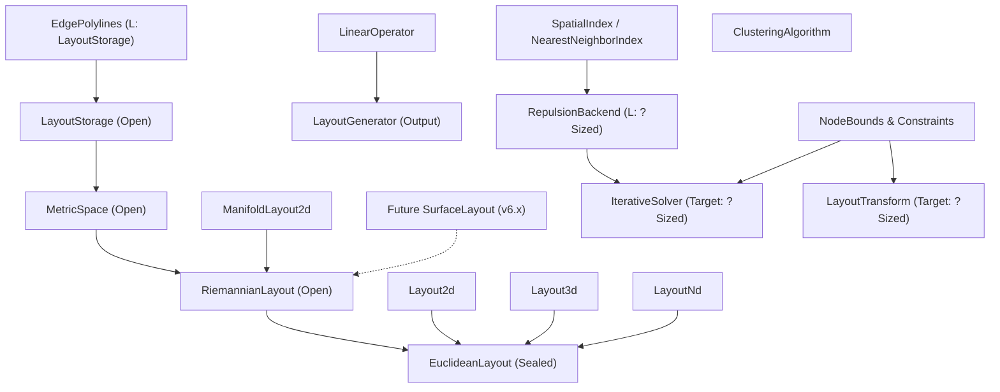
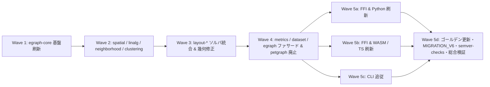

# `egraph` v6.0.0 GA 向け API 固定化・Trait 再設計仕様書

**策定日**: 2026-11-27 / **ベースライン**: `v6.0.0-alpha.8`（27 クレート構成）  
**目的**: `v6.0.0` 正式版（GA）リリースおよび crates.io 公開に先立ち、既存の trait 設計・SemVer ロックイン・Cargo 公開境界・外部依存リーク・Python/WASM バインディング・多様体幾何バグを一括解消し、将来の `v6.x` 拡張（ポリゴン表面グラフ描画 `SurfaceLayout`・新規エッジバンドリング手法・動的制約・3D 描画等）を **破壊的変更ゼロ** で追加できる安定 API 契約を確定する。  
**本書の位置づけ**: 本計画段階では仕様書の確定・レビューのみを行い、ソースコードの実装はまだ開始しない。

> [!IMPORTANT]
> **絶対不変のエンジニアリング原則（全 Wave 共通）**:
> 1. **厳密シングルスレッド・純粋 Rust**: `rayon`, `std::thread`, Web Workers, `SharedArrayBuffer`, GPU/CUDA/WebGPU, C/Fortran FFI を一切導入しない（`ndarray` は `default-features = false`）。
> 2. **決定的明示シード RNG**: `thread_rng()` / `from_entropy()` を禁止し、明示 `u64` シードによる 3 ターゲット（Native / Python / WASM）ビット一致再現性を維持する。
> 3. **タイムレスなドメイン命名**: コード内のクレート名・モジュール名・型名・関数名・テスト名・コメントはすべて機能／ドメイン名のみで命名し、作業計画の Wave 番号やフェーズ識別子を識別子へ持ち込まない。
> 4. **モジュール粒度目安**: 手書きソースファイルは概ね 500 行以内に分割・整理する。

---

## §1. エグゼクティブサマリー & 確定決定一覧（D1〜D18）

`/grill-me` 設計インタビューにより合意・確定した全 18 項目の設計決定を以下に示す。

| No. | 決定領域 | 確定方針 |
|---|---|---|
| **D1** | **全体スコープ** | `v6.0.0` GA 前の包括的 API 固定化として、Rust trait 再設計・SemVer/Cargo 健全化・Python/WASM バインディング刷新・既存 `ManifoldLayout2d` 4 ソルバ幾何修正を一括で実施する。 |
| **D2** | **幾何・ソルバ基本設計** | **完全案 C ＋ `Layout3d<S>` 新設**。4 層幾何 trait（`LayoutStorage` → `MetricSpace` → `RiemannianLayout` → `EuclideanLayout`）と `RepulsionBackend<L>` を GA 前に一括設計し、品質指標・ペアワイズ 6 ソルバ・力学/Maxent/FDEB 5 ソルバをジェネリック実装へ統合する。 |
| **D3** | **幾何 trait の sealed 方針** | **セミオープン**。`LayoutStorage`, `MetricSpace`, `RiemannianLayout`, `RepulsionBackend<L>` は外部実装可能（open）とし、内部最適化（SoA 同時多軸 `&mut` 借用・SIMD パディング・境界検査省略）と密結合する `EuclideanLayout` のみ **sealed**（`Layout2d`, `Layout3d`, `LayoutNd` に限定）とする。 |
| **D4** | **エッジバンドリング表現と反復 trait** | **`EdgePolylines<L>` を新設**（`edge_offsets: Vec<u32>` + `points: L`）し、**`IterativeSolver { type Target: ?Sized }` 1 本に統一**。ノード配置は `Target = Layout*`、反復エッジバンドリング（`FdebSolver` および将来の `Kdeeb`/`Ffteb`/`Deb`）は `Target = EdgePolylines<L>` として駆動する。 |
| **D5** | **ワンショット生成系・変換系の統一** | **構造体＋3 trait 体系へ全面統一**。反復系 `IterativeSolver` に加え、生成系 `LayoutGenerator { type Output }` とインプレース変換系 `LayoutTransform { type Target: ?Sized }` を新設し、`PivotMds`, `ClassicalMds`, `Hde`, `RdMds`, `KorenSpectral`, `CoarseBackbone`, `SfcLayout`, `PfsPrimeOverlapRemoval`, `TwinDeclutterer` を構造体化、重複自由関数を撤去する。 |
| **D6** | **ソルバ集約粒度** | **1 アルゴリズム = 1 ソルバ型** へ統一。`FieldLayoutSolver` → `TFdpSolver` + `IbUmapSolver` へ分割、`ContinuousFdp` を廃止、`SgdSolver` から Stress/Barrier 系以外の 6 手法（`Sgd2Solver`, `PacmapGraphSolver`, `LargeVisSolver`, `DrGraphSolver`, `GraphCneSolver`, `SnapTFdpSolver`）を独立ソルバ型へ分離する。 |
| **D7** | **`IterativeSolver` ライフサイクル契約** | 最小・厳密契約へ刷新。`total_iterations() -> Option<usize>`、`SolverStatus` へ `#[non_exhaustive]` ＋ `Failed` 追加、致命的数値破綻時は `Failed` 遷移・入力検証エラー時は状態不変、`run_steps(target, 0)` でも入力事前検証を実行、`&mut T` / `Box<T>` ブランケット実装を追加する。 |
| **D8** | **メトリクス評価 API & 補助 trait** | 全面統一。`MetricLayout`, `evaluate_metrics_nd*`, 90 超の `*_nd`/`*_manifold` 重複関数を撤去し `MetricSpace`/`EuclideanLayout` 汎用関数へ 1 本化。`MetricReport`/`MetricConfig` は `#[non_exhaustive]`＋`eval-baselines` サブ構造体／メソッド化で feature 加法性を保証し、`np_num_samples`/`np_seed` を `crossing_*` から分離、`MetricInputs<'a, L>` をジェネリック化、`SgdScheduleWindowLayout` を廃止、`TorusLayoutView` を sealed 化・`prelude` 除外・`Layout2d` 無条件実装廃止とする。 |
| **D9** | **`CsrGraph` / `Scalar` / `indptr`** | 純 CSR 統一（`&CsrGraph<W>` 維持、`GraphView` trait は不採用）。無重みコンストラクタおよび 116 箇所の無重み関数から不要な `W: Scalar` 境界を撤去して `CsrGraph<()>` 等に対応し、`indptr: &[u32]` を維持、`Scalar` を `egraph::prelude` から除外する。 |
| **D10** | **追加の周辺 trait・抽象（5 項目採用）** | (1) `SpatialIndex` / `NearestNeighborIndex` trait（`NdSpatialIndex` 解消）、(2) ノード外形・一般制約・固定ノード（ピン留め）抽象、(3) 行列フリー `LinearOperator<S>` trait、(4) クラスタリング共通 trait、(5) オプショナル `serde` feature を本計画に組み込む。 |
| **D11** | **crates.io 公開境界・可視性・MSRV** | 厳格化。内部 `pub mod` を `pub(crate)` に閉じてクレート直下のフラット再エクスポートのみ安定公開パスとし、`egraph::prelude` を基本型・trait 中心に厳選、`egraph-python`/`egraph-wasm`/`egraph-ffi` に `publish = false`・`egraph-cli` をバイナリ特化、ワークスペース `rust-version = "1.88"` を明示する。 |
| **D12** | **SemVer ロックイン解除・カプセル化・API 対称性** | 全面整備。全 31 enum・122 pub フィールド struct へ `#[non_exhaustive]`＋`with_*` ビルダー付与、Config/Report/Stats/Inputs/Result/Stage 系 74 構造体から `Copy` 撤去＋`TsNetConfig` 可変段数化、`SparseProbabilities`/`Sparse12HopPairs`/`PackedSymPair` カプセル化、`Layout2d`/`Layout3d`/`LayoutNd`/`InterleavedLayout2d` 対称化、`&[T]` スライス入力統一、レイヤ・クラスタ ID を `u32` 統一とする。 |
| **D13** | **外部依存・feature 整理（`rand`/`petgraph`/`delaunay`）** | (a) `DeterministicRng` から `as_rng_core_mut()` と `impl RngCore` を撤去・`prelude` 除外し `ChaCha8Rng` を完全隠蔽、(b) ワークスペース全体から `petgraph` 依存を完全削除（`crates/petgraph` 廃止・`dataset` 純 CSR 統一・`CsrGraphBuilder` 追加検討）、(c) フォールバック全廃のもと `delaunay` feature を廃止し `spade` を標準必須依存へ統一する。 |
| **D14** | **Python バインディング** | 全面刷新。非座標系 27 箇所の長大位置引数（`SpatialIntruderRefiner` 13 引数等）を `*` キーワード専用化、`.pyi` へ `Protocol`/`TypedDict`/`Literal` 導入、拡張余地の大きい位置 `tuple`（39 件）/非型付け `dict`（34 件）を Result クラス／`TypedDict` 化、`ValueError` サブクラスによる細分類例外階層、新構造体・クラス体系へ追従する。 |
| **D15** | **WASM / TypeScript バインディング** | 全面刷新＋`camelCase` 統一。34 位置引数関数のオプションオブジェクト化、15 種超の文字列リテラルユニオンを `camelCase` 統一、`seed: number | bigint` 対応、`ErrorKind` 由来 `.code` 付き構造化エラー、TS `IterativeSolver`/`Layout`/`EdgePolylines`/`LayoutGenerator`/`LayoutTransform` interface・`Layout3d`・新クラス体系へ追従する。 |
| **D16** | **WASM `CsrGraph` `weightDtype` 契約** | WASM は `f32` 専用契約として明確化し、`weightDtype` オプションを廃止（または `"float32"` 以外を明示エラーにして `weightDtype: "float64"` サイレント無視バグを根絶・`.wasm` 肥大を防止）する。 |
| **D17** | **対象範囲と検証ゲート** | `egraph-rs` 内で完結（ゴールデンフィクスチャ更新、`docs/MIGRATION_V6.md` 全面改訂、CI へ `cargo semver-checks` 導入）。`diffusion-kernel-experiments` 側の追従は新 Python ホイール検証時の別タスクとする。 |
| **D18** | **進め方** | 本仕様書を確定・レビュー可能な状態で保存した上で、Rust-core-first の 5 段階 Wave（`egraph-core` → 基盤 → ソルバ → メトリクス/データセット/ファサード → バインディング/CLI/CI）で段階的に実装する。 |

---

## §2. コア Trait・データ型アーキテクチャ仕様

### 2.1 全体構成図



### 2.2 4 層幾何 Trait 階層とセミオープン最適化機構

#### (1) 公開幾何 trait（`egraph-core`）

```rust
pub trait LayoutStorage {
    type Scalar: Scalar;

    fn len(&self) -> usize;
    fn is_empty(&self) -> bool {
        self.len() == 0
    }
    fn validate_finite(&self) -> CoreResult<()>;
}

pub trait MetricSpace: LayoutStorage {
    /// Pairwise distance in the embedding metric (always accumulated in f64).
    fn distance(&self, i: usize, j: usize) -> f64;
}

pub trait RiemannianLayout: MetricSpace {
    fn tangent_dim(&self) -> usize;

    /// Writes tangent vector log_i(j) into `out` (length >= tangent_dim()).
    fn log_map_into(&self, i: usize, j: usize, out: &mut [f64]) -> CoreResult<()>;

    /// Updates vertex `i` via exponential map exp_i(delta).
    fn exp_map(&mut self, i: usize, delta: &[f64]) -> CoreResult<()>;

    /// Parallel-transports `vec` along the geodesic step `delta` starting at vertex `i`.
    fn parallel_transport_into(
        &self,
        i: usize,
        delta: &[f64],
        vec: &mut [f64],
    ) -> CoreResult<()>;

    /// Fast-path simultaneous pairwise SGD move along the geodesic connecting `i` and `j`.
    fn move_pair_toward(
        &mut self,
        i: usize,
        j: usize,
        target_dist: f64,
        step_weight_i: f64,
        step_weight_j: f64,
    ) -> CoreResult<()> {
        // Default fallback implementation via log_map_into + exp_map;
        // Layout2d / Layout3d / LayoutNd / ManifoldLayout2d override for zero-overhead hot loops.
        ...
    }
}
```

#### (2) `EuclideanLayout`（Sealed＋ゼロコスト内部ストレージビュー）

`EuclideanLayout` を sealed にすることで、公開 trait を肥大化させずに「複数軸への同時 `&mut` 借用」および将来の SIMD アライメント／バッチカーネル導入の自由度を完全に保持する。

```rust
mod sealed {
    pub trait Sealed {}
    impl<S: super::Scalar> Sealed for super::Layout2d<S> {}
    impl<S: super::Scalar> Sealed for super::Layout3d<S> {}
    impl<S: super::Scalar> Sealed for super::LayoutNd<S> {}
}

pub trait EuclideanLayout: RiemannianLayout + sealed::Sealed {
    fn dims(&self) -> usize;
    fn coord(&self, node: usize, axis: usize) -> CoreResult<f64>;
    fn set_coord(&mut self, node: usize, axis: usize, value: f64) -> CoreResult<()>;

    #[doc(hidden)]
    fn as_euclidean_storage(&self) -> EuclideanStorageRef<'_, Self::Scalar>;
    #[doc(hidden)]
    fn as_euclidean_storage_mut(&mut self) -> EuclideanStorageMut<'_, Self::Scalar>;
}

// `pub(crate)` または `#[doc(hidden)]`（workspace 内の高速パス専用・非公開契約）
pub enum EuclideanStorageRef<'a, S: Scalar> {
    Soa2d { x: &'a [S], y: &'a [S] },
    Soa3d { x: &'a [S], y: &'a [S], z: &'a [S] },
    FlatNd { coords: &'a [S], num_nodes: usize, dims: usize },
}

pub enum EuclideanStorageMut<'a, S: Scalar> {
    Soa2d { x: &'a mut [S], y: &'a mut [S] },
    Soa3d { x: &'a mut [S], y: &'a mut [S], z: &'a mut [S] },
    FlatNd { coords: &'a mut [S], num_nodes: usize, dims: usize },
}
```

- **メリット**: `ArenaQuadtree2d`（2D）、`ArenaOctree3d`（3D）、`IbFft2d`（2D）、`AmgPcgSolver`（各軸一括solve）が `EuclideanStorageRef/Mut` 経由で直接 SoA スライス・`&mut` 同時借用を取得でき、ジェネリックソルバ化しても 2D/3D ホットループの性能低下がゼロになる。

#### (3) `RepulsionBackend<L>`（力学・t-SNE/Maxent 系バックエンド抽象）

```rust
pub trait RepulsionBackend<L: LayoutStorage + ?Sized> {
    /// Accumulates repulsive forces/gradients into `forces` (row-major `len * dim`)
    /// and returns optional scalar objective contribution (e.g., Z / log-sum-exp).
    fn accumulate_repulsion(
        &mut self,
        layout: &L,
        forces: &mut [f64],
    ) -> CoreResult<Option<f64>>;
}
```

- 2D では `ArenaQuadtree2d` / `FitField2d` / `IbFft2d` / Exact、3D では `ArenaOctree3d` / Exact、ND では Exact（または `StaticKdTree`）をバックエンド実装として提供し、外部クレート（将来の表面用 Barnes-Hut 等）からも実装可能にする。

### 2.3 新設データ型（`Layout3d<S>`・`EdgePolylines<L>`）と `CsrGraph<W>` 整理

#### (1) `Layout3d<S: Scalar = f64>`

- **格納形式**: SoA `{ x: Vec<S>, y: Vec<S>, z: Vec<S> }`。`ArenaOctree3d::build_xyz` / `compute_*_xyz` および WebGL 3D ゼロコピービューと完全整合する。
- **対称 API（`Layout2d` / `Layout3d` / `LayoutNd` 共通）**:
  - `zeros(num_nodes) -> Self`（または `try_zeros` 統一、`LayoutNd::zeros(num_nodes, dims) -> CoreResult<Self>`）
  - `init(num_nodes, seed, scale) -> CoreResult<Self>`（`scale: f64` 統一）
  - `from_xyz` / `from_flat` / `from_flat_slice`
  - `num_nodes(&self) -> usize`, `len(&self) -> usize`, `is_empty(&self) -> bool`
  - `get(&self, node) -> CoreResult<...>`, `set(&mut self, node, ...) -> CoreResult<()>`（全設定パスで有限値チェックを統一、2D `copy()` 冗長メソッドは `Clone` へ整理）
  - `center_and_normalize_to_std(&mut self, target_std: f64)`（`S` ではなく `f64` 統一、および定義を明文化）

#### (2) `EdgePolylines<L: LayoutStorage>`

```rust
#[derive(Debug, Clone, PartialEq)]
pub struct EdgePolylines<L: LayoutStorage> {
    edge_offsets: Vec<u32>, // length = num_edges + 1
    points: L,              // contiguous control-point coordinates matching target space L
}
```

- 不変条件（`edge_offsets.first() == 0`, 単調非減少、`edge_offsets.last() == points.len()`）を構築時に検証し、フィールドは非公開・ゲッタ経由とする。
- `EdgePolylines::straight_line_from_graph(graph, layout)` / `with_subdivisions(...)` を提供し、FDEB や将来の KDEEB/FFTEB/HEB/MINGLE・直交ルーティング・ポリライン品質評価（自己交差・曲率・バンドリング集中度）がすべて同一データ構造を授受できるようにする。

#### (3) `CsrGraph<W = f64>` と `Scalar` の切り離し（D9）

- **構造体定義**: `CsrGraph<W = f64>` と `indptr(&self) -> &[u32]` は維持。
- **`W: Scalar` 境界の撤去**:
  - `CsrGraph<W>::from_csr`, `from_edges`, `from_flat_edges` を無重み版（`from_unweighted_csr`, `from_unweighted_edges` または `W: Copy + PartialEq`）と重み付き版に整理し、`CsrGraph<()>` を構築可能にする。
  - ワークスペース全体で `&CsrGraph<W>` を取る 227 公開関数のうち、重みを使わない **116 箇所**（`remove_cycles`, `transitive_reduction`, `generate_layered_constraints`, `assign_layers`, `bfs_single_source`, `all_pairs_bfs`, トポロジ系メトリクス等）から `<W: Scalar>` を削除し `<W>` のみへ変更する。
- **`CsrGraphBuilder<W>` の追加検討（D13b）**: `petgraph` 廃止後の逐次構築ユースケース向けに、簡易な `CsrGraphBuilder::new(directed)`（`add_node`, `add_edge`, `build(sanitize)`）を `egraph-core` へ追加する。
- **`Scalar` の整理**: `egraph::prelude` から `Scalar` 直接再エクスポートを外す（必要側が `egraph::core::Scalar` を明示インポートする形にし、利用側コードでの `abs`/`sqrt`/`clamp` 等のメソッド名衝突を防ぐ）。

### 2.4 3 つのアルゴリズム Trait と厳密ライフサイクル契約

```rust
/// Execution lifecycle status for cooperative IterativeSolver execution.
#[non_exhaustive]
#[derive(Debug, Copy, Clone, PartialEq, Eq, Hash)]
pub enum SolverStatus {
    Initialized,
    Running,
    Converged,
    Completed,
    Failed,
}

impl SolverStatus {
    #[inline]
    pub fn is_finished(self) -> bool {
        matches!(self, Self::Converged | Self::Completed | Self::Failed)
    }
}

/// Cooperative iterative process mutating `Self::Target` one step at a time.
pub trait IterativeSolver {
    type Target: ?Sized;

    fn step(&mut self, target: &mut Self::Target) -> CoreResult<SolverStatus>;

    /// Executes up to `steps` iterations. Even when `steps == 0`, implementations must
    /// validate `target` compatibility (length/dims/finiteness) before returning.
    fn run_steps(&mut self, target: &mut Self::Target, steps: usize) -> CoreResult<SolverStatus> {
        self.validate_target(target)?;
        for _ in 0..steps {
            if self.status().is_finished() {
                break;
            }
            let status = self.step(target)?;
            if status.is_finished() {
                break;
            }
        }
        Ok(self.status())
    }

    fn run(&mut self, target: &mut Self::Target) -> CoreResult<SolverStatus> {
        self.validate_target(target)?;
        while !self.status().is_finished() {
            let status = self.step(target)?;
            if status.is_finished() {
                break;
            }
        }
        Ok(self.status())
    }

    fn validate_target(&self, target: &Self::Target) -> CoreResult<()>;
    fn status(&self) -> SolverStatus;
    fn iteration(&self) -> usize;
    fn total_iterations(&self) -> Option<usize>;
}

/// One-shot generator producing a new layout or edge polyline buffer.
pub trait LayoutGenerator {
    type Output;
    fn generate(&mut self) -> CoreResult<Self::Output>;
}

/// In-place one-shot transformation (e.g., overlap removal, decluttering, polyline smoothing).
pub trait LayoutTransform {
    type Target: ?Sized;
    fn apply(&mut self, target: &mut Self::Target) -> CoreResult<()>;
}
```

- **ブランケット実装**: `impl<T: IterativeSolver + ?Sized> IterativeSolver for &mut T` および `Box<T>`（同様に `LayoutGenerator`, `LayoutTransform` にも提供）を実装し、`dyn IterativeSolver<Target = ...>` の合成性を確保する。
- **エラー時の状態遷移契約**:
  - **事前検証エラー**（`DimensionMismatch`, `NonFiniteValue`, `InvalidInput`）: `status()` および `target` を一切変更せず `Err` を返す（`run_steps(target, 0)` も `validate_target` で検証する）。
  - **計算中の致命的破綻**（`NumericalBreakdown` 等）: ソルバを `SolverStatus::Failed` へ遷移させた上で `Err` を返し、以降の `step()` 呼び出しが壊れた状態で続行しないことを保証する。

### 2.5 メトリクス統一・補助 Trait の整理（D8）

- **`MetricLayout` 廃止 → `MetricSpace` / `EuclideanLayout` 直接統一**:
  - 既存の `evaluate_metrics_nd*` 4 関数および 90 超の `*_nd` / `*_manifold` 重複関数（`neighborhood_preservation_2hop_nd`, `scale_normalized_stress_manifold` 等）を撤去し、汎用関数（例：`scale_normalized_stress<W, L: MetricSpace>(graph, layout)`、`neighborhood_preservation_2hop<L: EuclideanLayout>(graph, layout)` 等）へ統合する。
  - `MetricInputs<'a, L: ?Sized = Layout2d<f64>>` へ一般化し、`original_layout: Option<&'a L>` で `Layout2d` / `Layout3d` / `LayoutNd` すべての歪み評価を可能にする。
- **`MetricReport` / `MetricConfig` の feature 加法性確保と設定分離**:
  - `MetricReport` と `MetricConfig` に `#[non_exhaustive]` を付与し、`#[cfg(feature = "eval-baselines")]` による `pub` フィールド増減を廃止する。代わりに `eval-baselines` 指標は専用メソッド／不透過サブレポート `pub fn baseline_metrics(&self) -> Option<&ClusterBaselineReport>` としてアクセスさせ、他クレートによる feature unification が既存コードのコンパイルを破壊しない設計とする。
  - `MetricConfig` で `crossing_num_samples` / `crossing_seed` が `SampledNp1` / `SampledNp2` に流用されていた欠陥を解消し、`np_num_samples` / `np_seed` を独立フィールドとして分離する。
- **既存補助 trait の整理**:
  - `SgdScheduleWindowLayout<S>`: `SgdSolver<L: RiemannianLayout>::run_schedule_window` への統合に伴い **廃止** する。
  - `TorusLayoutView<S>`: `#[doc(hidden)]` または sealed 化し、`egraph::prelude` から除外する。通常の `Layout2d<S>` への無条件実装（暗黙 `[0, 1)^2` ラップ）を廃止し、`ManifoldLayout2d`（`ManifoldKind::Torus2d`）または明示ラッパ `TorusView::new(&layout, lx, ly)` のみを受け付けるようにする。

### 2.6 追加の周辺 5 Trait・抽象仕様（D10）

1. **`SpatialIndex` / `NearestNeighborIndex` trait（`egraph-spatial-trees`）**:
   - `StaticKdTree<const D, S>` と `DynamicKdTree<S>` を統一し、9 バリアントの `#[doc(hidden)] pub enum NdSpatialIndex`（[`nd_index.rs`](../crates/metrics-geometry/src/nd_index.rs#L12-L22)）を撤去する。将来の非ユークリッド空間木（Ball-Tree / VP-Tree / Cover Tree）も同一 trait で実装可能になる。
   ```rust
   pub trait NearestNeighborIndex {
       fn dims(&self) -> usize;
       fn len(&self) -> usize;
       fn query_knn(&self, point: &[f64], k: usize, out: &mut Vec<(usize, f64)>) -> CoreResult<()>;
       fn query_radius(&self, point: &[f64], radius: f64, out: &mut Vec<(usize, f64)>) -> CoreResult<()>;
   }
   ```
2. **ノード外形・一般制約・固定ノード（ピン留め）抽象**:
   - 乱立していた `half_widths/half_heights`, `GibBox`, `Rect2d<S>`, `sprawlter_half_*` を共通の外形表現（`NodeShape2d` / `NodeExtents` 参照ビュー＋バリデーション）へ揃える。
   - `LayoutTransform` / `ConstraintProjector` が 1D `SeparationConstraint` だけでなく、**固定ノードマスク（ピン留め制約）** や将来の線形／境界制約（`beta.1` 予定の `LinearConstraintProjector`）を受け入れられる設計にする。反復ソルバにも `.with_pinned_nodes(&[bool])` 等を非破壊で追加しやすい構造にする。
3. **行列フリー `LinearOperator<S>` trait（`egraph-linalg`）**:
   - `LanczosEigen`, `AmgPcgSolver`, `ChebyshevDogKernel`, `SubspaceEigen` が `CsrMatrix` だけでなく任意の行列ベクトル積 `apply(&mut self, x: &[f64], y: &mut [f64]) -> CoreResult<()>`（例：ポリゴン表面の離散ラプラシアンや部分空間作用素）を受け取れる `LinearOperator` trait を導入する。
4. **クラスタリング共通 trait（`egraph-clustering`）**:
   - `Louvain`, `Leiden`, `SpectralClustering`, `LabelPropagation`, `KMeansPlusPlus` を同一の `CommunityDetector` / `Clusterer` 契約で束ね、統一 `ClusterResult`（`labels: Vec<u32>`, 品質スコア）または共通アクセス trait を定義する。
5. **オプショナル `serde` feature**:
   - `egraph-core` / `egraph` に `serde` feature（既定オフ、WASM フルバンドルには含めず軽量性を維持）を設け、`CsrGraph`, `Layout2d`, `Layout3d`, `LayoutNd`, `ManifoldLayout2d`, `EdgePolylines`, 主要 Config / Result 型に `Serialize` / `Deserialize` を付与する。

---

## §3. ソルバ再編・バグ修正・Manifold 幾何修正仕様

### 3.1 現行 27 ソルバ → 新型マッピング全表（D5 / D6）

1 アルゴリズム = 1 型原則および 3 trait 体系に基づき、全 27 型を以下の通り再編する。

| 現行型（`crates/layout-*`） | 新型・trait 区分 | `Target` / `Output` 範囲 | 主な変更点 |
|---|---|---|---|
| `SgdSolver` | `IterativeSolver` | `L: RiemannianLayout`（Stress / Barrier 系） | `Sgd2`, `PacmapGraph`, `LargeVis`, `DrGraph`, `GraphCne`, `SnapTFdp` の 6 手法を分離、`ActiveLayoutKind` 削除、`run_schedule_window` 内包 |
| *(上記から分離 6 型)* | `Sgd2Solver`, `PacmapGraphSolver`, `LargeVisSolver`, `DrGraphSolver`, `GraphCneSolver`, `SnapTFdpSolver`（`IterativeSolver`） | `L: RiemannianLayout` | 各手法固有の設定・状態のみを保持する軽量構造体へ分離（単一構造体内での 6 状態混在・ダミー値返却を解消） |
| `FieldLayoutSolver`（alias `FieldLayout`） | `TFdpSolver`, `IbUmapSolver`（`IterativeSolver`） | `L: EuclideanLayout` / `Layout2d<S>` | 2 型へ分割（Python/WASM と完全一致）。`ab()`/`a()`/`b()` の `Option` 返却とダミー `current_rho()` を廃止 |
| `ContinuousFdp` | **廃止** | — | `ForceAtlas2Solver` / `YifanHuSolver` を直接使用 |
| `ForceAtlas2Solver` | `IterativeSolver` | `L: EuclideanLayout` | `EuclideanStorageRef/Mut` + `RepulsionBackend` 統合（2D/3D/ND 混在バグ根治） |
| `YifanHuSolver` | `IterativeSolver` | `L: EuclideanLayout` | 同上 |
| `LinLogSolver` | `IterativeSolver` | `L: EuclideanLayout` | 同上 |
| `MaxentStressSolver` | `IterativeSolver` | `L: EuclideanLayout` | 同上（2D 側の `nd_dims` 未検査バグ根治） |
| `TsNetSolver` | `IterativeSolver` | `L: RiemannianLayout`（Exact）/ `L: EuclideanLayout`（BarnesHut/FFT） | `L` に応じたバックエンド型安全化、固定 3 段配列撤去、Manifold 平行移動適用 |
| `GuMapSolver` | `IterativeSolver` | `L: RiemannianLayout` | `RiemannianLayout` 汎用実装へ統一 |
| `KamadaKawaiSolver` | `IterativeSolver` | `L: RiemannianLayout` | `RiemannianLayout` 統一＋Manifold 正定値ヘッセ行列修正 |
| `StressMajorizationSolver` | `IterativeSolver` | `L: EuclideanLayout`（線形連立版）/ `L: RiemannianLayout`（勾配版） | `EuclideanLayout` と `RiemannianLayout` を型安全に実装 |
| `FruchtermanReingoldSolver` | `IterativeSolver` | `L: RiemannianLayout`（Exact）/ `L: EuclideanLayout`（Grid/Tree） | 同上 |
| `FdebSolver` | `IterativeSolver` | **`EdgePolylines<L>`**（`L: EuclideanLayout`） | 偽の `&mut Layout` を廃止し `&mut EdgePolylines<L>` を書き換える設計へ刷新 |
| `GripSolver` | `IterativeSolver` | `Layout2d<S>`（または `L: EuclideanLayout`） | 初期座標を上書き生成する反復ソルバであることを API 契約・docstring に明記 |
| `GemSolver` | `IterativeSolver` | `Layout2d<S>` | `IterativeSolver<Target = Layout2d<S>>` |
| `SelLayoutSolver` | `IterativeSolver` | `Layout2d<S>` | 内部ソルバ設定公開 |
| `BackboneSolver` | `IterativeSolver` | `Layout2d<S>` | 固有 `status`/`iteration`/`total_iterations` 整理 |
| `ClusterRefineSolver` | `IterativeSolver` | `Layout2d<S>` | 同上 |
| `GroupInABoxSolver` | `IterativeSolver` | `Layout2d<S>` | 入力スライス `&[u32]` 対応 |
| `PrismOverlapRemoval` | `IterativeSolver` | `Layout2d<S>` | `IterativeSolver<Target = Layout2d<S>>` |
| `GTreeOverlapRemoval` | `IterativeSolver` | `Layout2d<S>` | 同上 |
| `ForbidOverlapRemoval` | `IterativeSolver` | `Layout2d<S>` | 同上 |
| `SpatialIntruderRefiner` | `IterativeSolver` | `Layout2d<S>` | 同上 |
| `ScreenedPoissonRefiner` | `IterativeSolver` | `Layout2d<S>` | 同上 |
| `SfcLayoutSolver` → `SfcLayout` | **`LayoutGenerator`** | `Output = Layout2d<S>` | 生成時計算＋ダミー `step()` を廃止し `LayoutGenerator` へ移行 |
| `PfsPrimeOverlapRemoval` | **`LayoutTransform`** | `Target = Layout2d<S>` | `total_iterations == 1` の 1 発実行を `LayoutTransform` へ移行 |
| `TwinDeclutterer` | **`LayoutTransform`** | `Target = Layout2d<S>` | ステートレス後処理を `LayoutTransform` へ移行 |

加えて、従来の自由関数初期化群（`pivot_mds`, `classical_mds`, `hde`, `rd_mds`, `koren_spectral_init`, `coarse_backbone_init`）を `PivotMds`, `ClassicalMds`, `Hde`, `RdMds`, `KorenSpectral`, `CoarseBackbone` 構造体（`LayoutGenerator<Output = L>`）へ統合する。

### 3.2 6 ソルバの 2D/ND 混在状態破損バグの根治

現行コードでは 1 つのソルバ型に `Layout2d` と `LayoutNd` の 2 つの `IterativeSolver` 実装を持たせた結果、多レイアウト対応 12 ソルバ中 6 ソルバ（`MaxentStressSolver`, `LinLogSolver`, `ForceAtlas2Solver`, `YifanHuSolver`, `FdebSolver`, およびラップしている `ContinuousFdp`）において、**`Layout2d` と 2D `LayoutNd` を交互に渡すと `active_dims == 2` を共有して内部 scratch・力履歴・ポリライン状態が壊れるバグ**が発生していた。

`IterativeSolver { type Target }` によりソルバ型構築時点で対象レイアウト型 `L` をコンパイル時に確定させる（例：`ForceAtlas2Solver<Layout2d<f64>>` vs `ForceAtlas2Solver<Layout3d<f64>>` vs `ForceAtlas2Solver<LayoutNd<f64>>`）ことで：
- 4 クレートに重複存在した `ActiveLayoutKind` 列挙型を **完全撤去**
- コンパイル時に異種レイアウト混用を **100% 防止**
- 未使用の 2D / ND 双方の scratch フィールドを 1 つの構造体に抱えるメモリ無駄を **解消**

### 3.3 `ManifoldLayout2d` 4 ソルバの幾何学的正当性修正（D1）

将来の `SurfaceLayout` と `ManifoldLayout2d` を共通の `RiemannianLayout` 実装へ統合するにあたり、既存 `ManifoldLayout2d` 実装に残存していた 4 箇所の非幾何的処理を `v6.0.0` GA 前に修正し、ゴールデンテストを更新する：

1. **`KamadaKawaiSolver`（正定値ヘッセ行列ガード修正）**:
   - 現行 [`kamada_kawai/manifold.rs`](../crates/layout-stress/src/kamada_kawai/manifold.rs#L129) の `det.abs() <= HESSIAN_DET_TOL || (det > 0.0 && (hxx + hyy) <= 0.0)` は `det < 0.0`（鞍点）を Newton ステップで通過させるバグがある。
   - **修正**: 正定値判定 `det <= HESSIAN_DET_TOL || hxx <= 0.0`（および必要に応じて `hyy <= 0.0`）へ改め、鞍点では確実に最急降下フォールバックへ分岐させる。
2. **`TsNetSolver`（速度ベクトルの Levi-Civita 平行移動）**:
   - 現行 [`ts_net/manifold.rs`](../crates/layout-neighbor/src/ts_net/manifold.rs#L338-L352) では座標更新後に `(vel_x, vel_y)` を平行移動せず次のステップへ引き継いでいる。
   - **修正**: `RiemannianLayout::exp_map` による移動後に `parallel_transport_into` で速度ベクトルを新しい接空間へ輸送する（`Euclidean` / `Torus2d` では恒等変換）。
3. **`PacmapGraphSolver`（回転不変 Riemannian Adam＋平行移動）**:
   - 現行 [`manifold_sampling_variants.rs`](../crates/layout-sgd/src/sgd/manifold_sampling_variants.rs#L110-L136) では軸別 2 次モーメント `(v_x, v_y)` と平行移動なしの `(m_x, m_y)` を用いており、接空間の正規直交基底選択に対して回転不変でない。
   - **修正**: スカラー勾配ノルム二乗を用いた Riemannian Adam（スカラー 2 次モーメント `v`）＋ 1 次モーメント `m` の `parallel_transport_into` へ統一する。
4. **`Sgd2Solver`（SO(2) 不変対角前処理）**:
   - 現行 [`manifold_variants.rs`](../crates/layout-sgd/src/sgd/manifold_variants.rs#L239-L241) の軸別曲率 `cx`, `cy` は接空間座標軸の回転に依存する。
   - **修正**: SO(2) 不変な等方トレースまたは 2×2 接空間ヘッセ行列による前処理へ統一する。

---

## §4. SemVer ロックイン解除・Cargo 公開境界・外部依存整理

### 4.1 `#[non_exhaustive]` と `Copy` 撤去・ビルダー整備（D12）

- **全公開 `enum`（31 個＋新規）への `#[non_exhaustive]` 付与**: `CoreError`, `ErrorKind`（`#[repr(u32)]`）, `SolverStatus`, `RepulsionBackend` 群, 設定／目的関数／サンプリング種別 enum すべて。
- **全公開フィールド付き `struct`（122 個＋新規）への `#[non_exhaustive]` ＋ビルダー付与**:
  - 構造体リテラル構築（`FooConfig { field: ..., ..Default::default() }`）を廃止し、`FooConfig::default().with_field(...)` 形式のビルダーメソッドを全 Config へ統一装備する（既存の `SgdScheduleConfig` に倣う）。
  - `MetricReport`, `MetricConfig`, `MetricInputs`, `FfiError`, 全 `*Result`/`*Stats`/`*Stage` も対象。
- **Config / Report / Stats / Inputs / Result / Stage 系 74 構造体からの `#[derive(Copy)]` 撤去**:
  - `#[derive(Clone)]` のみに改め、将来 `Vec` / `String` / `Option<Box<...>>` 等の動的フィールドを追加可能にする。
  - **具体改善例**: `TsNetConfig` から固定 3 要素配列 `stage_iterations: [usize; 3]` と `lambda_c_stage1..3` を廃止し、`stages: Vec<TsNetStage>` を持つ可変長ステージ構成へ統合する（`TsNetSolver::from_probabilities_with_stages` の別系統コンストラクタも設定統合により整理）。

### 4.2 カプセル化・データ型・API 対称性の是正（D12）

- **内部バッファの生フィールド隠蔽**:
  - `SparseProbabilities`（`perplexity/config.rs`）と `Sparse12HopPairs`（`knn/graph.rs`）の `pub indptr`/`indices`/`values` を非公開化し、検証付きコンストラクタ（`from_csr` 等）と読取スライスアクセサへ統一する（`KnnGraph` と同水準の不変条件保護）。
  - `#[doc(hidden)] pub struct PackedSymPair<S>` が公開関数 `SgdSolver::from_packed_symmetric` の引数に出現し `egraph::layout::sgd::PackedSymPair` として到達可能だった欠陥を解消する（入力スライス型／ビルダーを正式設計するか関数自体を非公開 FFI 専用層へ移す）。
- **所有 `Vec<T>` 値渡しの撤去**: `GroupInABoxSolver::new`, `ClusterRefineSolver::new`, `SgdSolver::from_pairs*`, `LayoutNd::from_flat` 等 30 超の公開関数で所有 `Vec<T>` 要求を `&[T]` スライス受け入れへ統一する（必要に応じてゼロコピー用 `into_*` コンストラクタを別途用意）。
- **整数 ID 型の統一**: 階層レイヤ番号（現行 `usize`：`assign_layers`, `generate_layered_constraints`）とクラスタ／コミュニティ ID（`u32`）を **`u32` へ統一** し、グラフ頂点・辺・レイヤ・クラスタのすべてでメモリ効率と Python/WASM ゼロコピーを一致させる。

### 4.3 クレート公開境界・モジュール可視性・MSRV（D11）

- **公開クレート vs 内部・バインディングクレート境界**:
  - `egraph-python`, `egraph-wasm`, `egraph-ffi` には `publish = false` を明記する。
  - `egraph-cli` はバイナリ専用クレートとし、`crates/cli/src/lib.rs` のライブラリ公開（`Cli`, `Commands` 等 20 超の型）を最小限または `publish = false` へ整理する。
  - crates.io 公開時は `egraph` ファサードを再エクスポートの安定エントリーポイントとし、サブクレートの個別パスに依存させないドキュメント規約を明記する。
- **内部モジュール `pub mod` の封鎖**:
  - 20/24 ライブラリクレートおよびアンブレラクレートが内部モジュール（`pub mod chebyshev`, `pub mod sgd` 等）を丸ごと公開していた構成を改め、原則 `mod ...;` に閉じてクレート直下のフラットな `pub use` のみを安定パスとする。これにより 500 行分割やファイル再編が完全に非破壊になる。
- **`egraph::prelude` の厳選**:
  - 250 超シンボルの一括投入を止め、基本データ型・trait・主要エラー・基本プリミティブ（`CsrGraph`, `Layout2d`, `Layout3d`, `LayoutNd`, `ManifoldLayout2d`, `EdgePolylines`, `CoreError`, `CoreResult`, `SolverStatus`, 主要 trait 群）に絞る。`VisitStamp`, `#[doc(hidden)]` 関数、`Scalar`, `TorusLayoutView`, `DeterministicRng`、`egraph::linalg::crate_version` 等の混入を撤去する。
- **MSRV 明示**: ルート `Cargo.toml` の `[workspace.package]` に `rust-version = "1.88"` を明示する（`edition = "2024"`、`slice::as_chunks`, `usize::is_multiple_of`, `let` chains の実使用と一致）。

### 4.4 外部依存の完全整理（D13）

| 対象依存 / feature | 現行の問題 | GA 前改修方針 |
|---|---|---|
| **`rand_chacha` / `rand_core`** | `DeterministicRng::as_rng_core_mut() -> &mut ChaCha8Rng` と `impl RngCore`（0.6 世代）が `egraph-core` 公開 API にリーク | 両者を撤去し、`ChaCha8Rng` を完全非公開の内部実装詳細に隔離。`DeterministicRng` は固有メソッドのみで完結させ、`egraph::prelude` からも除外 |
| **`petgraph` (`0.8`)** | `crates/petgraph` が具象 `Graph` に固定、`egraph-dataset` が `default = ["petgraph"]` で無印関数が `petgraph::Graph` を返却、`egraph` の `full` が有効化 | **ワークスペース全体から `petgraph` を完全削除**（`crates/petgraph` 廃止、`egraph`/`egraph-dataset` の `petgraph` feature・依存撤去、データセット無印関数を `CsrGraph` 返却に統一、`CsrGraphBuilder` 追加、移行ガイドに `petgraph` からの変換コード例を記載） |
| **`delaunay` (`spade`)** | クレート間でデフォルト有効/無効が不揃い、かつ `coarse_backbone`/`gtree`/`prism` が無効時に `StaticKdTree` へサイレントフォールバック | フォールバックを全廃し、**`delaunay` feature を廃止して `spade` を標準必須依存へ統一**（全 `#[cfg(feature = "delaunay")]` 削除） |

---

## §5. Python / WebAssembly / TypeScript / FFI バインディング仕様

### 5.1 Python (`crates/python`, `python/egraph/*.pyi`)（D14）

1. **長大位置引数の `*` キーワード専用化**:
   - 座標組等以外の **27 箇所**（`SpatialIntruderRefiner.__new__` の 13 位置引数、`spectral_clustering` 7、`build_gumap_12hop_priority_csr` 7、`SgdSolver.from_pairs_with_hinges` 7、`SgdSolver.from_packed_symmetric` 6、`kmeans_plus_plus` 6、`louvain_communities` 5、`LayoutNd.init` 5、`generate_weighted_graph` 5、`ScreenedPoissonField2d.evaluate_in_bounds` 5 等）について、必須コア引数（例：`graph`, `num_nodes`）の直後に `*` を挿入してキーワード専用引数へ整理し、将来の引数追加を 100% 非破壊にする。
2. **`.pyi` 型スタブの近代化**:
   - 現在ゼロの `Protocol` / `TypedDict` / `Literal` を全面導入する（`LayoutProtocol`, `IterativeSolverProtocol`, `LayoutGeneratorProtocol`, `LayoutTransformProtocol`、バックエンド・スケジューリング指定用の厳密 `Literal[...]`）。
   - CI での `mypy --strict` および `stubtest` 検証を必須化する。
3. **拡張可能な構造化戻り値（`tuple` / 非型付け `dict` の解消）**:
   - 拡張時にアンパック互換が壊れる位置 `tuple` 返却（39 箇所）と非型付け `dict[str, Any]`（34 箇所）を整理し、今後のフィールド追加が予想される関数（`coarsen_graph`, `project_psd_spectral_filter`, `spectral_moment_stats`, `layout_degeneracy`, `minimum_angle_summary` 等）は専用 Result クラスまたは `TypedDict` を返す形式へ移行する。
4. **例外階層の細分類（`ValueError` 後方互換維持）**:
   - `CoreError` の各種エラーを素の `ValueError` に潰すのではなく、`class EgraphError(ValueError)` を基底に `DimensionMismatchError`, `InvalidCsrError`, `NonFiniteValueError`, `UnsupportedOperationError`, `NumericalBreakdownError` を定義する（`except ValueError:` と互換を保ちつつ細かい `except` が可能）。
5. **新 Rust 体系との完全パリティ**:
   - `Layout3d`（ゼロコピー `(N, 3)` NumPy ビュー、`dtype="float32"|"float64"`）・`EdgePolylines` クラスを追加。
   - `TFdpSolver` / `IbUmapSolver`、`SgdSolver` 分離 6 クラス、`PivotMds` / `Hde` / `ClassicalMds` / `KorenSpectral` / `CoarseBackbone` / `SfcLayout` 生成系クラス、`PfsPrimeOverlapRemoval` / `TwinDeclutterer` 変換クラスを Python に揃える。

### 5.2 WebAssembly / TypeScript (`crates/wasm`, `scripts/assemble/*.mjs`)（D15 / D16）

1. **オプションオブジェクト化（34 位置引数関数の解消）**:
   - オプションオブジェクトを受け取らない 5 引数以上の 34 関数（`dog_varadhan`, `js_chebyshev_dog_jl_embedding_matrix`, `js_build_hybrid_adaptive_knn`, `js_graph_12hop_row_normalized_probabilities_with_options`, `js_rta_*` 6 関数等）を `{ ...options }` 形式のオプション引数オブジェクト受け渡しへ統一する。
2. **文字列リテラルユニオンの `camelCase` 完全統一**:
   - `SolverStatus`, `SuggestedGeometry`, `TsNetBackend`, `TwoHopSamplingMode`, `SgdScheduleKind`, `BarrierSymmetry`, `FieldRepulsionBackend`, `LayeringMethod`, `CoarseEdgeLengthMode`, `CoarseDistanceBackend`, `DensityFieldKernel`, `LeidenObjective`, `LinLogRepulsion`, `FrBackend`, `BackboneLayoutMode`, `ClusterRefineMethod`, `GibBoxLayoutMode`, `GibIntraLayoutMode`, `ForbidVariant` ほか全文字列ユニオン型で混在していた `snake_case`（`"edge_repulsion"`, `"barnes_hut"`, `"two_step_random_walk"` 等）を廃止し、JS/TS 標準の **`camelCase` へ 100% 統一** する。
3. **64-bit シードパリティ（`seed?: number | bigint`）**:
   - `parse_seed_u64` を `JsValue` 経由で `number`（非負安全整数 `<= 2^53 - 1`）と **`bigint`（`0n .. 2^64 - 1`）の両対応** へ改め、Rust / Python との完全な 64-bit シードパリティを確保する。
4. **`f32` 専用 `CsrGraph` 契約の厳格化（D16）**:
   - `CsrGraph` の `weightDtype: "float64"` を検証後に無視して `CsrGraph<f32>` を作っていたバグを根絶し、`weightDtype` オプションを廃止する（または `"float32"` 以外の指定を明示エラーで拒否する）。
5. **構造化エラーと TS 共通インターフェース**:
   - `ErrorKind` を JS `Error` の `.code`（例：`"DimensionMismatch"`, `"NumericalBreakdown"`）または専用エラーサブクラスとして公開し、素の `JsError` 平坦化を廃止する。
   - `.d.ts` に `LayoutStorage`, `IterativeSolver<TTarget>`, `LayoutGenerator<TOutput>`, `LayoutTransform<TTarget>` interface を定義し、`runProgressive` が `Layout2d` / `Layout3d` / `LayoutNd` / `ManifoldLayout2d` / `EdgePolylines` すべてを型安全に駆動できるようにする。
   - `Layout3d`（`coordsView(): Float32Array`）と `EdgePolylines`（`edgeOffsetsView(): Uint32Array`, `pointsView(): Float32Array`）に `memory.grow` 安全なゼロコピービューを実装する。

### 5.3 `egraph-ffi` 整理

- `ErrorKind`（`#[repr(u32)]`）および `FfiError` に `#[non_exhaustive]` を付与し、将来のエラー分類追加に備える。
- `Layout3d`・`EdgePolylines` のフラット配列ビュー検証ヘルパを追加し、`publish = false` とする。

---

## §6. クレート別影響マトリクス（27 クレート → 26 クレート）

| 現行クレート | 区分 / 公開方針 | 主な変更内容 | 担当 Wave |
|---|---|---|---|
| `egraph-core` | Core (`publish = true`) | 4 層幾何 trait、`RepulsionBackend<L>`、`Layout3d`、`EdgePolylines`、`IterativeSolver`/`LayoutGenerator`/`LayoutTransform`、`CsrGraph` `W: Scalar` 撤去＋`CsrGraphBuilder`、`DeterministicRng` 隔離、`CoreError`/`SolverStatus` `#[non_exhaustive]`、オプショナル `serde` feature、内部 `pub mod` 閉鎖 | Wave 1 |
| `egraph-spatial-trees` | Spatial (`publish = true`) | `NearestNeighborIndex`/`SpatialIndex` trait、`delaunay` feature 廃止・`spade` 必須化、`EuclideanStorageRef/Mut` 連携、`#[non_exhaustive]`、内部 `pub mod` 閉鎖 | Wave 2 |
| `egraph-spatial-fft` | Spatial (`publish = true`) | `Layout2d`/`EuclideanStorageRef` 連携、Config/Stats `#[non_exhaustive]` + `Copy` 撤去、内部 `pub mod` 閉鎖 | Wave 2 |
| `egraph-spatial-crossings` | Spatial (`publish = true`) | `TorusLayoutView` sealed 化＋`Layout2d` 無条件実装廃止、Crossing 系型 `#[non_exhaustive]`、内部 `pub mod` 閉鎖 | Wave 2 |
| `egraph-spatial` | Umbrella (`publish = true`) | `delaunay` feature 分岐削除、再エクスポート整理 | Wave 2 |
| `egraph-linalg` | Linalg (`publish = true`) | 行列フリー `LinearOperator<S>` trait、`CsrGraph<W>` 無重み関数の `W: Scalar` 撤去、Config/Result `#[non_exhaustive]` + `Copy` 撤去、内部 `pub mod` 閉鎖 | Wave 2 |
| `egraph-linalg-amg` | Linalg (`publish = true`) | `LinearOperator<S>` 統合、Config/Result `#[non_exhaustive]` + `Copy` 撤去、内部 `pub mod` 閉鎖 | Wave 2 |
| `egraph-linalg-mds` | Linalg (`publish = true`) | `PivotMds`, `ClassicalMds`, `Hde`, `RdMds`, `KorenSpectral` を構造体（`LayoutGenerator`）化、重複自由関数整理、Config `#[non_exhaustive]`、内部 `pub mod` 閉鎖 | Wave 2 |
| `egraph-neighborhood` | Neighborhood (`publish = true`) | `SparseProbabilities`/`Sparse12HopPairs` カプセル化（フィールド非公開）、Enum/Config `#[non_exhaustive]` + `Copy` 撤去、内部 `pub mod` 閉鎖 | Wave 2 |
| `egraph-clustering` | Clustering (`publish = true`) | クラスタリング共通 trait、Config/Result `#[non_exhaustive]` + `Copy` 撤去、`u32` ID 統一、`&[T]` 入力、内部 `pub mod` 閉鎖 | Wave 2 |
| `egraph-layout-sgd` | Solvers (`publish = true`) | `SgdSolver` 分離（`Sgd2Solver`/`PacmapGraphSolver`/`LargeVisSolver`/`DrGraphSolver`/`GraphCneSolver`/`SnapTFdpSolver`）、`RiemannianLayout` 統一、`CoarseBackbone` 構造体化、`ActiveLayoutKind`・`SgdScheduleWindowLayout`・`PackedSymPair` リーク撤去、Manifold 2 ソルバ幾何修正、`delaunay` feature 削除 | Wave 3 |
| `egraph-layout-neighbor` | Solvers (`publish = true`) | `FieldLayoutSolver` → `TFdpSolver` + `IbUmapSolver` 分割、`TsNetConfig` 可変段数化（`Copy` 撤去）、`RiemannianLayout`/`EuclideanLayout` + `RepulsionBackend` 統一、`TsNetSolver` 平行移動修正 | Wave 3 |
| `egraph-layout-stress` | Solvers (`publish = true`) | `KamadaKawai`/`StressMajorization`/`MaxentStress` の幾何 trait 統一、`ActiveLayoutKind` 削除＋`Maxent` 2D/ND 混在バグ根治、`KamadaKawai` ヘッセ行列正定値修正 | Wave 3 |
| `egraph-layout-force` | Solvers (`publish = true`) | `ContinuousFdp` 廃止、`ForceAtlas2`/`YifanHu`/`LinLog`/`FR` の `EuclideanLayout`＋`RepulsionBackend`（2D Quadtree / 3D Octree / Exact）統一、`FdebSolver` の `EdgePolylines<L>` 移行、混在バグ根治 | Wave 3 |
| `egraph-layout-constraints` | Solvers (`publish = true`) | `PfsPrimeOverlapRemoval`/`TwinDeclutterer` → `LayoutTransform` 化、`NodeBounds`・一般制約・ピン留め抽象、`delaunay` feature 削除、無重み `W: Scalar` 撤去、レイヤ ID `u32` 統一 | Wave 3 |
| `egraph-layout-multilevel` | Solvers (`publish = true`) | `SfcLayoutSolver` → `SfcLayout`（`LayoutGenerator`）、`GripSolver` 契約明記、`GroupInABox` 等 `&[u32]`/`NodeBounds` 対応、`Backbone`/`ClusterRefine`/`Refiner` 整理 | Wave 3 |
| `egraph-layout` | Umbrella (`publish = true`) | 新設・分割クレート再エクスポート、`ContinuousFdp`/`FieldLayout`/`SgdScheduleWindowLayout` 削除、`delaunay` feature 廃止、内部モジュール露出閉鎖 | Wave 3 |
| `egraph-metrics-geometry` | Metrics (`publish = true`) | `NdSpatialIndex` 廃止（`NearestNeighborIndex` 利用）、90 超の `*_nd`/`*_manifold` 重複を `MetricSpace`/`EuclideanLayout` 汎用関数へ統合、`EdgePolylines` 指標余地確保 | Wave 4 |
| `egraph-metrics-cluster` | Metrics (`publish = true`) | `MetricSpace` / `EuclideanLayout` 統合、`eval-baselines` 型整形、`#[non_exhaustive]`、内部 `pub mod` 閉鎖 | Wave 4 |
| `egraph-metrics` | Metrics (`publish = true`) | `MetricLayout`/`evaluate_metrics_nd*` 廃止、`MetricReport`/`MetricConfig` feature 非加法性解消、`np_num_samples`/`np_seed` 分離、`MetricInputs<'a, L>` 汎用化 | Wave 4 |
| `egraph-dataset` | Dataset (`publish = true`) | `petgraph` 依存・feature 完全削除、無印関数を `CsrGraph` 返却へ統一、`W: Scalar` 不要箇所整理 | Wave 4 |
| `egraph-petgraph` | **廃止（削除）** | `crates/petgraph` ディレクトリとワークスペースメンバーを削除（移行ドキュメントに変換例を記載） | Wave 4 |
| `egraph` | Facade (`publish = true`) | `petgraph` / `delaunay` feature 削除、`serde` feature 追加、`egraph::prelude` 厳選（汚染 4 種＋過剰再エクスポート整理）、モジュール露出整理 | Wave 4 |
| `egraph-ffi` | Internal (`publish = false`) | `ErrorKind` / `FfiError` `#[non_exhaustive]`、`Layout3d` / `EdgePolylines` ビュー検証追加 | Wave 5 |
| `egraph-python` | PyPI (`publish = false`) | 27 位置引数の `*` キーワード専用化、`.pyi` `Protocol`/`TypedDict`/`Literal`、構造化戻り値、`ValueError` サブクラス例外、`Layout3d`/`EdgePolylines`/新クラス体系 | Wave 5 |
| `egraph-wasm` | npm (`publish = false`) | 34 位置引数オプションオブジェクト化、全文字列 `camelCase` 統一、`BigInt` シード、`f32` 専用 `CsrGraph` 契約、`.code` 構造化エラー、`Layout3d`/`EdgePolylines`/TS interface | Wave 5 |
| `egraph-cli` | Binary (`publish = false` 検討) | ライブラリ露出縮小・新 API 追従（`EdgePolylines` JSON 出力・`Layout3d`・分離ソルバ／ジェネレータ対応） | Wave 5 |

---

## §7. Rust-Core-First 段階的 Wave 実行計画・検証ゲート・スコープ外事項

### 7.1 Wave 構成と依存フロー



| Wave | 対象クレート | 主な完了条件（Exit Gate） |
|---|---|---|
| **Wave 1** | `egraph-core`, ルート `Cargo.toml` | `rust-version = "1.88"` 設定、4 層幾何 trait・`RepulsionBackend<L>`・`Layout3d`・`EdgePolylines<L>`・3 種アルゴリズム trait・`CsrGraph` `W: Scalar` 撤去＋`CsrGraphBuilder`・`DeterministicRng` 隔離・`serde` feature 完了。`./scripts/verify.sh --fast --crate egraph-core --invariants` 緑。 |
| **Wave 2** | `spatial-*`, `linalg-*`, `neighborhood`, `cluster` | `NearestNeighborIndex`・`LinearOperator`・クラスタリング trait 実装、ジェネレータ構造体化、`spade` 必須化（`delaunay` feature 削除）、`SparseProbabilities`/`Sparse12HopPairs` カプセル化、`TorusLayoutView` 整理、内部 `pub mod` 閉鎖。対象クレートのユニットテスト＋`--invariants` 緑。 |
| **Wave 3** | `layout-*`（6 クレート＋アンブレラ） | 全 27 型再編（1 手法 1 型・`ActiveLayoutKind` 削除・6 混在バグ解消・`FdebSolver`→`EdgePolylines`・`Sfc`/`PfsPrime`/`TwinDeclutterer`→`LayoutGenerator`/`LayoutTransform`）、`Layout2d`/`Layout3d`/`LayoutNd`/`ManifoldLayout2d` 統合、Manifold 4 ソルバ幾何修正、`NodeBounds`・ピン留め抽象、`#[non_exhaustive]`＋`Copy` 撤去。`./scripts/verify.sh --rust --invariants` 緑。 |
| **Wave 4** | `metrics-*`, `dataset`, `egraph`（`petgraph` 削除） | メトリクス汎用化（90 超の重複削減）、`MetricReport`/`MetricConfig` 非加法性解消、`egraph-dataset` 純 CSR 化、`crates/petgraph` 完全削除、`egraph::prelude` 厳選と全クレート `publish` 境界整理。Rust 全ワークスペーステスト＋`--mode strict`＋WASM コンパイル緑。 |
| **Wave 5** | `ffi`, `python`, `wasm`, `cli`, `docs/`, `.github/` | FFI 確定後に Python（5a）・WASM/TS（5b）・CLI（5c）を並行実装し、3 ターゲットパリティ（`parity_harness.py`）、`mypy`/`stubtest`、`tsc`、ゴールデンフィクスチャ更新、`docs/MIGRATION_V6.md` 改訂、CI への `cargo semver-checks` 組込を実施。最終的に `./scripts/verify.sh --all --build-wasm --docs` および `./scripts/check_invariants.sh --mode strict` を完全通過させる。 |

### 7.2 スコープ外の明示的後続タスク

- **`diffusion-kernel-experiments` の追従移行**: 本仕様書の実装・新 Python ホイールビルド確認後、別タスクとして同リポジトリ側の実験スクリプト群（`TsNetSolver`, `SgdSolver` 分離クラス、キーワード引数、`MetricReport` 等）を更新する。
- **`SurfaceLayout`（ポリゴン表面グラフ描画本体）の実装**: 本仕様書で整地したオープンな `RiemannianLayout` / `MetricSpace` / `RepulsionBackend<L>` 上に、`v6.0.0` GA 後も **破壊的変更ゼロ**（`egraph-surface` クレート等の純追記）で導入する。
