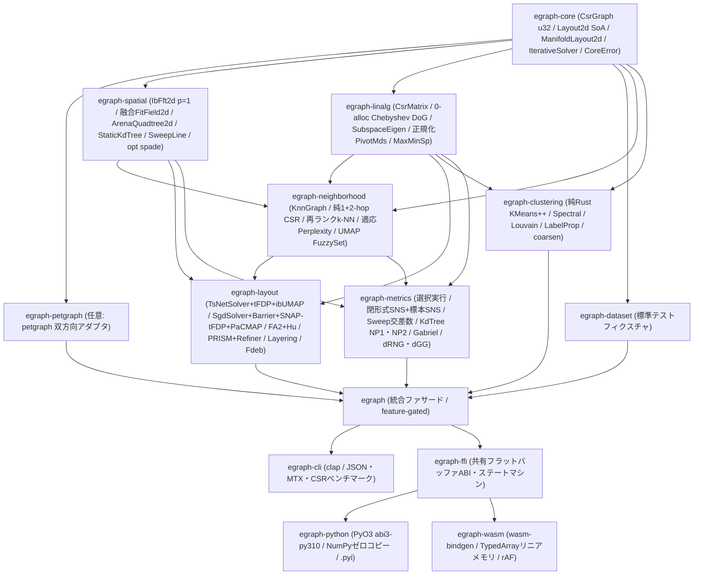

# `egraph` v6.0.0-alpha.4 アーキテクチャ刷新 & PyPI / npm リリース計画書

**策定日**: 2026-11-22 / **今回の目標リリース**: `v6.0.0-alpha.4`（PyPI `6.0.0a4` & npm `6.0.0-alpha.4`）  
**対象ブランチ**: `feat/np2-improvement` $\to$ `master` 統合後、M0〜M6 全作業完了時点で `v6.0.0-alpha.4` タグ発行（それ以降の `beta` / `rc` / `v6.0.0` GA 等は作業完了後に別途検討）  
**実行環境制約**: Native Rust / Python (PyO3) / WebAssembly (`wasm-bindgen`) の三者を対象とし、**厳密にシングルスレッド・プレーン CPU 実行**（`rayon`・`std::thread`・Web Workers・`SharedArrayBuffer` 不使用、GPU / CUDA / WebGPU 不使用、C/Fortran FFI 非依存の純粋 Rust コア）を厳守する。

---

## 1. エグゼクティブサマリー & 確定方針一覧

本計画は、[`Cargo.toml`](../Cargo.toml)・[`crates/python/pyproject.toml`](../crates/python/pyproject.toml)・[`crates/wasm/package.json`](../crates/wasm/package.json) の `v6` 開発ラインにおいて、現行の抜本的アーキテクチャ刷新・実験実証済みアルゴリズム群（Track A / B）・2022〜2026 年統合力学モデル（M4）・3 ターゲット完全パリティ・ドキュメント/デモ・総合回帰（M0〜M6）をすべて完了させた上で、**PyPI `egraph 6.0.0a4` および npm `egraph@6.0.0-alpha.4`（`--tag next`）をリリースする** ための全体実行計画である。なお、`v6.0.0-alpha.4` 完了後の `beta` / `rc` / `v6.0.0` GA および crates.io 公開の進め方は、本計画のすべての作業完了後に改めて検討・決定する。

インタビューにより確定した 10 項目の基本方針を以下に固定する。

| No. | 決定領域 | 確定方針 |
|---|---|---|
| D1 | **今回の作業スコープとバージョン** | ワークスペース抜本再編・Track A/B SOTA 原生移植（M2〜M3）・統合力学モデル（`t-FDP`, `SNAP-tFDP`, `ibUMAP`, `PaCMAP-Graph`, `ForceAtlas2`, `Yifan Hu`, `PRISM`, `(SGD)^2`: M4）・完全パリティ/文書（M5）・総合回帰（M6）の **全範囲を完了し、`v6.0.0-alpha.4` のバージョンを付与して公開** する。 |
| D2 | **破壊的変更・互換方針** | **`v6` 刷新ライン（`v6.0.0-alpha.4`）でクリーンブレイク刷新** を行う。Rust コアからホストオブジェクト（`Py<PyAny>` / `JsValue`）および `petgraph` 直接結合を排し、トポロジ＋数値重み特化の CSR API へ統一する。誤記 `OverwrapRemoval` 改名、分散 `TsNet` 群一本化、および `v5` / 旧 `v6-alpha` $\to$ `v6` 移行ガイドを提供する。 |
| D3 | **デフォルト浮動小数点精度** | **WASM 既定 `f32`**（WebGL・2〜4 GiB 上限適合）、**Python 既定 `f64`**（NumPy 標準互換）＋ **`dtype="float32"` 第一級サポート**、**Native は汎用 `S: Scalar`** とする。ただし Chebyshev 漸化・Lanczos/Subspace 固有値・Perplexity/$\lambda$-rescaling 二分探索・`SNS` アキュムレータ内部は **`f64` 保証** とする。 |
| D4 | **周辺機能の保守ティア** | **非ユークリッド空間（双曲 Poincaré 円盤・球面・2D トーラス: `ManifoldLayout2d`）・`Layering`・`Fdeb`** は三者完全パリティの第一級機能として維持する。未完成プレースホルダに留まっていた **`InfoMap` のみ本計画から除外** する。 |
| D5 | **実装順と実験連携** | M2〜M3 で Track A/B SOTA を先に純粋 Rust 化して回帰を固め、続いて M4 で新力学群を統合する。**M1・M2・M3・M4 の各マイルストーン完了ごとに段階的 Python/WASM バインディングをローカルビルド（`maturin develop` / ローカル WASM）で切り出して `diffusion-kernel-experiments` 側スクリプトを逐次検証** し、M6 全完了後に外部公開する。 |
| D6 | **PyPI (`egraph`) 仕様** | 無印 `egraph`、**`abi3-py310`（`requires-python = ">=3.10"`）**、**`numpy` を必須依存**（`scipy` / `networkx` / `igraph` / `matplotlib` は optional extras）。Linux（`manylinux` `x86_64` / `aarch64`）・macOS（`arm64` / `x86_64`）・Windows（`x64`）ホイール＋ `sdist` を配布。 |
| D7 | **npm (`egraph`) 仕様** | 無印 `egraph`、**ESM 専用（`"type": "module"`）** のモダン `"exports"` 構成により **1 本の `.wasm` をブラウザ（`web` / Vite / CDN）と Node.js で共有** し、4 種重複 `dist/*`・`no-modules`・Rollup 2・UMD を廃止する。npm 配布物は **単一フルバンドル**（`wasm-opt -Oz`、`<= 600 KiB` gzip 目安）とし、Rust 側 Cargo feature でカスタム軽量ビルドを可能にする。 |
| D8 | **リリースチャネルと後続検討** | 今回は **PyPI と npm への `v6.0.0-alpha.4` 公開のみを目標** とする（npm は `--tag next` 配布で既存 `latest` へ影響させない）。`beta` / `rc` / `v6.0.0` GA および crates.io 公開を含むそれ以降のリリースは、今回の作業完了後に別途検討する。 |
| D9 | **CI/CD タグと認証** | 統一タグ `v6.0.0-alpha.4`（将来の `v6.0.0` 系にも流用可能な `v6.*` 規約）で PyPI・npm を同期自動公開する。認証は両者とも **GitHub Actions Trusted Publishing (OIDC)** を採用し、長期 API トークンを廃止する。 |
| D10 | **ブランチ・文書・デモ・保存** | 先に **`feat/np2-improvement` を `master` へ統合**（Step 0）してから開発を進める。`v6.0.0-alpha.4` 完了までに Python Sphinx Docs（重複 `netlify.toml` 統合・`doctest` 修復）、`js/examples` デモ修復、TypeScript API Docs（TypeDoc）、`v5` $\to$ `v6` 移行ガイドを完備する。本計画書を `docs/V6_RELEASE_PLAN.md` へ永続保存する。 |

---

## 2. 設計原則・アーキテクチャ要点（`v6.0.0` 刷新サマリー）

### 2.1 不可侵のエンジニアリング原則

1. **厳密シングルスレッド・純粋 Rust**: すべてのクレートで `rayon`、`std::thread`、Web Workers、`SharedArrayBuffer`、CUDA/WebGPU、C/Fortran FFI を禁止する。`ndarray` を使う箇所は `default-features = false` を強制し（現行の `linfa 0.8.1` 経由で `egraph-wasm` にまで `rayon v1.12.0` が混入していた問題を根絶）、CI で `cargo tree -e features` および `clippy.toml` 禁止シンボル検査を実行する。
2. **決定的明示 RNG**: コア内で `rand::thread_rng()` および `StdRng::from_entropy()` を禁止し、すべての確率的 API は明示的な `u64` シード（または `&mut impl RngCore`）のみを受け取る。これによりシード付き実行での WASM `getrandom` OS エントロピー依存を排除し、Native / Python / WASM 間での決定的再現性を保証する。
3. **ゼロコピー・フラット CSR / SoA・無アロケーション反復**:
   - `petgraph` と `HashMap<NodeIndex, usize>` ルックアップをソルバ内部から追放し、`u32` インデックスベースの `CsrGraph<W, u32>`（任意でキャッシュ局所化頂点置換 $\Pi$ をサポート）および SoA 座標配列 `Layout2d<S> { x: Vec<S>, y: Vec<S> }` を採用する。
   - Python/WASM 境界は `egraph-ffi` のフラット配列ビュー（`CsrGraphView`, `DrawingViewMut`）を通過し、ホスト側 `Py<PyAny>` / `JsValue` を Rust コア内に格納しない。
   - 反復ループ内アロケーションをゼロにするため、`VisitStamp`（エポック配列）、Chebyshev 3 ベクトル作業領域、永続 `Fft2dWorkspace`、フラット `ArenaQuadtree2d` を導入する。
4. **協調的ステップ実行（`IterativeSolver::step()`）**: 全反復ソルバ（`TsNetSolver` / `SgdSolver` / `GuMapSolver` / `ContinuousFdp` / `StressMajorization` / `KamadaKawai` / `Fdeb`）が `step()` / `run_steps(k)` / `status()` を実装し、単一スレッドのブラウザメインスレッドを `requestAnimationFrame`（10 ms/フレーム予算）で凍結させずに逐次描画できる。

### 2.2 ワークスペース再編 DAG（現行 22+1 クレート $\to$ 9 ライブラリ＋ファサード＋バインディング）



### 2.3 実証済み SOTA・文献知見の反映サマリー

| 領域 | 採用・統合する技術（根拠） | 廃止・修正する現行負債 |
|---|---|---|
| **Track A** | 純 1+2-hop CSR + 頂点別適応 Perplexity（`c=0.9/1.5`, `pure_2hop` 既定スケジュール `suite30` 平均 NP2 `0.6300`, `tsNET` 比 `83.2x` 高速）+ 2 段階スペクトル再ランク k-NN + `lambda`-rescaling + 行正規化対称化 | 固定 `0.05*N` Perplexity、未正規化 `PivotMds` $U\Sigma^2$（Phase 0 で `3.32x` 改善）、`LTsNet` Stage 3 符号二重反転、4 回重複粒子 FFT（計 10 回 $\to$ 7〜8 回へ削減）、`partial_bfs` 毎頂点確保 |
| **Track B** | R1/R2 PSD 射影済み正則化 Chebyshev DoG + JL $\sqrt{h}(L_{\mathrm{sym}})Z$ ランドマーク + R3 HT 不偏斥力 + `SparseSgd.barrier()`（3 層バリア・片側ヒンジ）+ `GuMap` 1+2-hop 優先 CSR + 2D `StaticKdTree` 空間侵入者リファイン（`--hinge-fp --w-fn 0.0`、`drgraph` `0.5704`） | Hutchinson 対角推定既定値（`T6`）、単体無シフト DoG（`T5` NP2=`0.0497`）、`MultiscaleDiffusionKernel`、固定次数 $M=30$、`NaN.max(min_dist)` 伝搬、`w_fn=0.2` 収縮、AoS 48 B/pair `Sgd`（4M ノードで 3.84 GB $\to$ SoA `f32` `640 MB` / ストリーミング `< 64 MB`） |
| **次世代統合力学 (M4)** | `ibFFT` ($p=1$ 双線形補間 + `G_dual` 非循環畳み込み)、`SNAP-tFDP`（辺付随 $k=3$ 均一負例・98% RAM 削減）、`ibUMAP`（$c_K=4, \tau_t=4\alpha_t, \eta_i$ ハブ減衰）、`PaCMAP-Graph` 3 層損失、`ForceAtlas2`、`Yifan Hu`（`EC+MIVS`）、`PRISM`（$O(N \log N)$ Delaunay + 有界 CG）、`(SGD)^2` | 誤記 `overwrap-removal`（$O(N^2)$）、`bfs_with_distance_matrix` 確定 OOB パニック（[`bfs.rs`](../crates/algorithm/shortest-path/src/bfs.rs#L36-L48)）、`RdMds` ゼロ除算・10 ステップ Hotelling 法、`KamadaKawai` `det==0` 無限ループ、`InfoMap` 未完成実装 |
| **品質指標** | 閉形式最適スケール `Scale-Normalized Stress (SNS)` + $O(kN)$ 標本 `SNS`、Bentley–Ottmann スイープライン交差数 + 標本推定、`StaticKdTree` NP1/NP2/Gabriel、`PRISM` 忠実度・`dRNG`/`dGG`、ターゲット選択的実行 | 未スケーリング `NS`（99.8%–100% で `Random` を勝たせる欠陥 [`stress.rs`](../crates/quality-metrics/src/stress.rs)）、無条件 $O(\lvert E \rvert^2)$ 交差判定、WASM `js_stress` の毎呼び出し $O(N^3)$ `warshall_floyd`（[`quality_metrics.rs`](../crates/wasm/src/quality_metrics.rs#L28-L31)） |

---

## 3. PyPI (`egraph`) v6 パッケージ・ビルド・配布設計

### 3.1 パッケージ構成と [`pyproject.toml`](../crates/python/pyproject.toml) ターゲット仕様

純 Python 補助層（相互変換・型スタブ・ヘルパ）と Rust 拡張 `_core` を組み合わせる **maturin ハイブリッドレイアウト**（`crates/python/python/egraph/`）を採用する。

```text
crates/python/
├── Cargo.toml                  # pyo3 = { version = "0.28", features = ["abi3-py310", "extension-module"] }
├── pyproject.toml              # python-source = "python", module-name = "egraph._core"
├── python/
│   └── egraph/
│       ├── __init__.py         # _core 全公開シンボルの再エクスポート + interop / progressive helpers
│       ├── _core.pyi           # 完全な PEP 484/561 型スタブ（CI で stubtest 検証）
│       ├── py.typed            # PEP 561 マーカー
│       └── interop.py          # from_scipy_csr, to_scipy_csr, from_networkx, to_networkx, from_igraph
├── src/                        # PyO3 バインディング（egraph-ffi / egraph ファサード呼び出しのみ）
└── tests/
```

`pyproject.toml` ターゲット定義（`v6.0.0-alpha.4` 時）:

```toml
[build-system]
requires = ["maturin>=1.7,<2.0"]
build-backend = "maturin"

[project]
name = "egraph"
dynamic = ["version"]
description = "High-performance single-threaded graph drawing and layout library powered by Rust"
readme = "README.md"
requires-python = ">=3.10"
license = { text = "MIT" }
dependencies = [
    "numpy>=1.26",
]
classifiers = [
    "Development Status :: 3 - Alpha",  # 将来の正式 GA 時に "5 - Production/Stable" へ更新
    "Intended Audience :: Science/Research",
    "Intended Audience :: Developers",
    "License :: OSI Approved :: MIT License",
    "Programming Language :: Rust",
    "Programming Language :: Python :: 3",
    "Programming Language :: Python :: 3.10",
    "Programming Language :: Python :: 3.11",
    "Programming Language :: Python :: 3.12",
    "Programming Language :: Python :: 3.13",
    "Programming Language :: Python :: Implementation :: CPython",
    "Operating System :: OS Independent",
]

[project.optional-dependencies]
interop = ["scipy>=1.11", "networkx>=3.0", "igraph>=0.11"]
viz = ["matplotlib>=3.7", "networkx>=3.0"]
dev = ["pytest>=8.0", "mypy>=1.11", "scipy>=1.11", "maturin>=1.7,<2.0"]
docs = ["sphinx>=8.0", "sphinx-rtd-theme>=2.0"]

[tool.maturin]
python-source = "python"
module-name = "egraph._core"
features = ["pyo3/extension-module"]
```

- **現行からの重要修正点**:
  1. [`crates/python/Cargo.toml`](../crates/python/Cargo.toml#L14) の `abi3-py37` と `pyproject.toml` の `>=3.6` 矛盾を **`abi3-py310` + `requires-python = ">=3.10"`** で解消。
  2. 実行時必須の **`numpy`** を `[project.dependencies]` に明記（`numpy` なしの環境での `ImportError` 防止）。
  3. CPython `abi3` により 1 本のプラットフォーム別ホイールで Python 3.10〜3.13+ を単一バイナリでカバーし、CI ビルド時間を最小化。

### 3.2 ホイール配布マトリクス & `sdist`

| OS | アーキテクチャ | ターゲット / ツールチェーン | 備考 |
|---|---|---|---|
| **Linux** | `x86_64` | `manylinux_2_28`（`maturin-action`） | 主力実験・サーバ環境 |
| **Linux** | `aarch64` | `manylinux_2_28`（ネイティブランナーまたは `zig` クロス） | ARM64 クラウド / Docker 対応 |
| **macOS** | `arm64` (`aarch64-apple-darwin`) | Apple Silicon ネイティブ | 開発者ローカル環境（`M1`〜`M4`） |
| **macOS** | `x86_64` (`x86_64-apple-darwin`) | Intel Mac ターゲット | 互換維持 |
| **Windows** | `x64` (`x86_64-pc-windows-msvc`) | MSVC ツールチェーン | Windows ユーザ対応 |
| **Source** | `sdist` (`.tar.gz`) | `maturin sdist` | ワークスペース参照のため CI 上で `sdist` からの `pip install` 展開試験を必須化 |

### 3.3 Python ゼロコピー API・GIL 解放・精度契約

- **CSR 直接構築**: `Graph.from_csr(indptr, indices, weights=None, *, directed=False, sanitize=True)` および `Graph.from_edges(num_nodes, edges, weights=None, *, directed=False)`。従来の `py.None()` $N+M$ 回確保（[`graph/mod.rs`](../crates/python/src/graph/mod.rs#L176-L188)）を全廃。
- **ゼロコピー座標・ペアアクセス**: `Layout2d.coords(copy=False)` が内部 `DrawingBuffer` を所有者オブジェクトに紐付けた書き込み可能 NumPy 配列ビュー（`(N, 2)`）を返す。大規模実験向けに **`dtype="float32"`**（`Layout2d.zeros(n, dtype="float32")`, `SgdSolver(..., dtype="float32")`）を第一級サポートし、標準 `f64` 既定と両立する。
- **GIL 解放**: `step()`, `run_steps(k)`, `run()`, `ChebyshevDog`, `SubspaceEigen`, `SweepLineCrossings` 等の計算本体はすべて `py.detach(...)` 内で実行する。
- **例外安全性**: すべてのレガシー `.unwrap()` / `unimplemented!()` / `panic!`（`kamada_kawai.rs`, `rdmds.rs`, `coarsen.rs`, `separation_constraints.rs`, `schedulers.rs` の `.ok()` 握りつぶし）を廃止し、`CoreError` を `PyValueError` / `PyTypeError` / `PyIndexError` へ変換する。

### 3.4 PyPI Trusted Publishing (OIDC) & PEP 440 バージョニング

- **タグと PyPI バージョンのマッピング**（`maturin` は `Cargo.toml` の SemVer プレリリース文字列を自動で PEP 440 へ正規化するが、タグ整合検査スクリプトで事前検証する）:
  - **今回の目標リリース**: `v6.0.0-alpha.4` $\to$ `Cargo.toml: "6.0.0-alpha.4"` $\to$ PyPI **`6.0.0a4`**（M0〜M6 全作業完了時）
  - **作業完了後に別途検討する将来リリース（参考）**: `v6.0.0-beta.1` $\to$ `6.0.0b1` / `v6.0.0-rc.1` $\to$ `6.0.0rc1` / `v6.0.0` $\to$ `6.0.0`（タグ整合 CI 自体は将来の `v6.*` にも対応させておく）
- **Trusted Publishing 設定手順（初回リリース前チェック）**:
  1. PyPI（および検証用 TestPyPI）の `egraph` プロジェクト管理画面で Trusted Publisher を登録（Owner: `likr` / Repo: `egraph-rs` / Workflow: `release.yml` / Environment: `pypi-release`）。
  2. GitHub リポジトリ Settings $\to$ Environments で `pypi-release` を作成し、デプロイブランチ／タグ制限（`v6.*` タグのみ許可＋手動承認ゲート任意）を設定。
  3. ワークフローでは `id-token: write` 権限のみ付与し、`MATURIN_PYPI_TOKEN` シークレットを廃止（`PyPA/gh-action-pypi-publish` または `maturin upload --non-interactive` OIDC 連携）。

---

## 4. npm (`egraph`) v6 パッケージ・ビルド・配布設計

### 4.1 ESM 専用 [`crates/wasm/package.json`](../crates/wasm/package.json) ターゲット仕様

現行の 4 種重複 `.wasm` 出力（`dist/bundler`, `dist/no-modules`, `dist/nodejs`, `dist/web`）＋ 5 本目 `umd/egraph_bg.wasm`（Rollup 2 経由）を完全廃止し、**単一 `.wasm` バイナリを共有する純 ESM パッケージ** へ刷新する。

ビルド構成:
- 共通バイナリ生成: `wasm-pack build --target web --release -d pkg crates/wasm` で `pkg/egraph_wasm_bg.wasm` とブラウザ用 ESM ローダを生成し、`pkg/egraph_wasm.node.js`（Node.js 用極薄 ESM ローダ: `node:fs/promises` + `import.meta.url` 経由で同一の `./egraph_wasm_bg.wasm` を `WebAssembly.instantiate` へ渡して `initSync` 相当で初期化）と高水準 TypeScript ラッパ `pkg/index.js` + `pkg/index.d.ts` を配置する。
- `wasm-opt -Oz --enable-bulk-memory --enable-nontrapping-float-to-int` をビルドパイプラインに組み込む（`--enable-threads` や atomics は一切使用しない）。

`crates/wasm/package.json` ターゲット定義（`v6.0.0-alpha.4` 時）:

```json
{
  "name": "egraph",
  "version": "6.0.0-alpha.4",
  "description": "Fast single-threaded graph drawing and layout library in Rust and WebAssembly.",
  "license": "MIT",
  "type": "module",
  "sideEffects": false,
  "files": [
    "pkg/index.js",
    "pkg/index.d.ts",
    "pkg/egraph_wasm.js",
    "pkg/egraph_wasm.d.ts",
    "pkg/egraph_wasm.node.js",
    "pkg/egraph_wasm_bg.wasm",
    "README.md",
    "LICENSE"
  ],
  "main": "./pkg/egraph_wasm.node.js",
  "types": "./pkg/index.d.ts",
  "exports": {
    ".": {
      "node": {
        "types": "./pkg/index.d.ts",
        "default": "./pkg/egraph_wasm.node.js"
      },
      "browser": {
        "types": "./pkg/index.d.ts",
        "default": "./pkg/index.js"
      },
      "default": {
        "types": "./pkg/index.d.ts",
        "default": "./pkg/index.js"
      }
    },
    "./egraph_wasm_bg.wasm": "./pkg/egraph_wasm_bg.wasm"
  },
  "engines": {
    "node": ">=18.0.0"
  }
}
```

- **バンドル設計上のポイント**:
  - **単一フルバンドル配布**: npm 上では 1 つの完全版 `.wasm` のみ配布し、Vite・Webpack 5・esbuild・素のブラウザ `<script type="module">`・`esm.sh` / `jsDelivr`・Node.js 18+ のすべてで `import init, { Graph, Layout2d, TsNetSolver } from "egraph"` が追加プラグインなしで動作する。
  - **Cargo フィーチャ維持**: [`crates/wasm/Cargo.toml`](../crates/wasm/Cargo.toml) 内部には `[features]`（`default = ["full"]`、および選択用 `layout-sgd`, `layout-ts-net`, `layout-gumap`, `layout-mds`, `layout-classic`, `edge-bundling`, `clustering`, `algorithms`, `delaunay`, `metrics-full`）を定義しておき、特定の Rust/WASM 開発者が `--no-default-features` でカスタム軽量ビルドできるようにする。
  - **サイズ目標**: ルート [`Cargo.toml`](../Cargo.toml) に `[profile.release]`（`opt-level = "z"`, `lto = "thin"`, `codegen-units = 1`, `panic = "abort"`, `strip = "symbols"`）を設定し、`linfa` / `rayon` / `serde` / `serde-wasm-bindgen` を削除した上で、フル構成 `.wasm` を **gzip 後 `<= 600 KiB`**（理想 `<= 450 KiB`）に収める。

### 4.2 WASM ゼロコピー・リニアメモリ & `rAF` 逐次描画契約

- **バルク構築**: `Graph.fromCsr(indptr: Uint32Array, indices: Uint32Array, weights?: Float32Array, options?: { directed?: boolean, sanitize?: boolean })` および `Graph.fromEdgeList(numNodes: number, edges: Uint32Array, weights?: Float32Array)`。
- **リニアメモリ直接ビュー**: `Layout2d`（既定 `f32`）は `coordsPtr()` / `coordsLen()` を公開し、TypeScript ラッパ `layout.coordsView()` が呼び出し毎に `cachedBuffer !== wasmMemory().buffer` を $O(1)$ で検査（`memory.grow` に伴う `ArrayBuffer` detach 事故を完全防止）しながら `Float32Array` ビューを返す。これにより [`js/examples/`](../js/examples) の毎フレーム $2N$ 回 FFI 呼び出しが消滅する。
- **`rAF` 協調実行**:
  ```ts
  await init();
  const session = new TsNetSolver(graph, { preset: "pure2hop" });
  const layout = Layout2d.init(graph, { method: "pivotMds", seed: 42n });
  await runProgressive(session, layout, () => {
    const xy = layout.coordsView(); // ゼロコピー Float32Array -> WebGL / Canvas2D
    renderer.draw(xy);
  }, { frameBudgetMs: 10 });
  ```
- **既存 WASM バグの完全解消**: `js_fdeb` の値渡し解放バグ（[`edge_bundling.rs`](../crates/wasm/src/edge_bundling.rs#L26)）を参照渡し＋フラット `(edgeOffsets: Uint32Array, pointsXY: Float32Array)` へ置換、`js_stress` の毎呼び出し $O(N^3)$ `warshall_floyd` を廃止、コールバック引数返却形式を単一数値または事前計算配列へ統一、`is_empty` 等の snake_case 漏れを camelCase へ統一し、全 `.unwrap()` トラップを `Result<T, JsError>` へ変換する。

### 4.3 npm Trusted Publishing (OIDC) & dist-tag 運用

- **公開ディストリビューションタグ（`dist-tag`）規約**:
  - **今回の目標リリース（`v6.0.0-alpha.4`）**: **`npm publish --provenance --access public --tag next`** により公開する（`npm install egraph` の既存 `latest` を上書きせず、`npm install egraph@next` または `npm install egraph@6.0.0-alpha.4` で明示取得できるようにする）。
  - **将来の正式版（`v6.0.0` GA 検討後）**: `release.yml` ではタグ名にハイフンを含まない正式 SemVer タグに対し自動で `--tag latest` を切り替える設計にしておき、`alpha.4` 完了後の判断へ備える。
- **npm Trusted Publishing (OIDC) 設定チェック**:
  1. npmjs.com 上の `egraph` パッケージ Settings $\to$ Trusted Publisher に GitHub リポジトリ（`likr/egraph-rs`、Workflow `release.yml`、Environment `npm-release`）を登録。
  2. GitHub Actions のリリースジョブで **Node 22+（Trusted Publishing / OIDC 対応の npm CLI >= 11.5.1、必要に応じ `npm install -g npm@latest`）** と `permissions: id-token: write` を設定し、`NPM_TOKEN` シークレットなしで `--provenance` 付き公開を実行する。

---

## 5. 段階的開発マイルストーン & リリース計画（Step 0 / M0〜M6 $\to$ `v6.0.0-alpha.4`）

決定 D5・D8 に基づき、**M1・M2・M3・M4 の各段階では Python / WASM バインディングを同時拡張しつつローカルビルド（`maturin develop --release` / ローカル WASM）で `diffusion-kernel-experiments` 側スクリプトを逐次切替検証し、M5 で完全パリティ・文書/デモを揃え、M6 の総合回帰・実機スモーク通過をもって今回の作業完了リリース `v6.0.0-alpha.4` を PyPI / npm へ公開する**。それ以降の `beta` / `rc` / `v6.0.0` GA / crates.io 公開は、`v6.0.0-alpha.4` 完了後に別途検討する。

```mermaid
flowchart LR
    S0["Step 0: feat/np2-improvement を master へ統合"]
    M0["M0: Workspace刷新・egraph-core/ffi・CI骨格"]
    M1["M1: spatial & metrics (SNS/Sweep/KD・ローカル検証)"]
    M2["M2: linalg & neighborhood (DoG/1+2hop・ローカル検証)"]
    M3["M3: layout中核 (Track A/B+Refiner) & clustering (ローカル検証)"]
    M4["M4: 統一力学 (t-FDP/SNAP/ibUMAP/FA2/Hu/PRISM/Fdeb)"]
    M5["M5: 統合ファサード・3ターゲット100%パリティ・文書/デモ"]
    M6["M6: 総合回帰(suite30/drgraph/4M)・スモーク -> v6.0.0-alpha.4 公開"]
    POST["完了後検討: beta / rc / v6.0.0 GA / crates.io"]

    S0 --> M0
    M0 --> M1
    M1 --> M2
    M2 --> M3
    M3 --> M4
    M4 --> M5
    M5 --> M6
    M6 -. "作業完了後に検討" .-> POST
```



### 5.1 マスター・リリーストレイン一覧

| マイルストーン | Git タグ | PyPI (`egraph`) | npm (`egraph`) & `dist-tag` | `diffusion-kernel-experiments` 逐次切替範囲 | 必須ゲート要約 |
|---|---|---|---|---|---|
| **Step 0** | — | — | — | 現状維持（旧 `alpha` 参照ベースライン記録） | `feat/np2-improvement` の `master` マージ・全既存テスト緑 |
| **M0** | *(内部マイルストーン)* | *(CI 試作のみ)* | *(CI 試作のみ)* | 基準ベンチマーク固定 | `edition=2024`・`rayon/linfa/std::thread=0`・`egraph-core/ffi` WASM & PyO3 骨格通過 |
| **M1** | *(ローカル検証)* | *(ローカル `maturin`)* | *(ローカル WASM)* | `utils/metrics.py` の `SNS` / `SweepLine` / `StaticKdTree` NP1/NP2 切替・検証 | `FitField2d` 粒子 FFT 半減、`Random` 逆転 0%、M1 バインディング疎通 |
| **M2** | *(ローカル検証)* | *(ローカル `maturin`)* | *(ローカル WASM)* | `utils/hybrid_knn.py`, `utils/dog_kernel.py`, `utils/pivots.py`, `utils/tsnet_cli.py`, `utils/data.py` 切替・検証 | `Chebyshev` 誤差 $<10^{-8}$、`SubspaceEigen` 主角度 $>0.999$、`extract_1hop_2hop_csr` $\ge 5\times$ 高速化 |
| **M3** | *(ローカル検証)* | *(ローカル `maturin`)* | *(ローカル WASM)* | Track A/B 全主要 `scripts/draw_*.py` & `utils/spatial_refinement.py` & `utils/sparse_barrier_sgd.py` 切替・実測 | `suite30` Track A $\ge 0.628$（$\le 3.5\mathrm{s}$）、Track B $\ge 0.525$（$\le 1.2\mathrm{s}$）、Tier 3 Refiner $\le 10\mathrm{s}$ |
| **M4** | *(ローカル検証)* | *(ローカル `maturin`)* | *(ローカル WASM)* | 新規検証スクリプト追加（`t-FDP`, `SNAP-tFDP`, `ibUMAP`, `PaCMAP`, `FA2`, `Hu`, `PRISM`） | `SNAP-tFDP` 4M ノード Peak RSS `< 1.6 GiB`、`PRISM` $\ge 50\times$ 高速・重なり 0 |
| **M5** | *(ローカル検証・API 凍結準備)* | *(ローカル `maturin`)* | *(ローカル `npm pack`)* | 全 `utils/`・`scripts/` 互換検証完了、Python 重複実装整理 | **3 ターゲット機能 100% パリティ達成**、`.wasm <= 600 KiB` gzip、`rAF <= 10 ms`、Sphinx / TypeDoc / `js/examples` 完備 |
| **M6（今回完了点）** | **`v6.0.0-alpha.4`** | **`6.0.0a4`** | **`6.0.0-alpha.4`** (`next`) | 実験リポジトリ回帰最終署名 | `suite30` / `drgraph` / `com-LiveJournal` (Peak RSS `< 4 GiB`, `<= 250s`)・3 OS/ブラウザスモーク・**PyPI/npm OIDC 公開** |
| **M6 完了後（別途検討）** | *(完了後決定)* | *(完了後決定)* | *(完了後決定)* | 公開後フィードバック反映 | `v6.0.0-alpha.4` 完了・公開後に `beta` / `rc` / `v6.0.0` GA・crates.io 公開を改めて計画 |

---

### 5.2 各ステップ・マイルストーン詳細

#### Step 0: ブランチ統合と v6 開発ベースライン確立
- **作業内容**:
  - 現在作業中の `feat/np2-improvement` ブランチを精査し、`master` へ統合（PR マージまたは fast-forward）。
  - 既存の Python / Rust / WASM テストと [`diffusion-kernel-experiments`](../../diffusion-kernel-experiments) の現行ベースライン（`suite30`, `tsnet_ref5`, `drgraph` Phase 4 数値）をタグ前リファレンスとして確定する。
- **終了基準**: `master` 上で `cargo test --workspace` および `crates/python/tests` が通過し、作業ツリーがクリーンであること。

#### M0: ワークスペース衛生・`egraph-core` / `egraph-petgraph` / `egraph-ffi`・CI 基盤
- **作業内容**:
  - **Native**: ルート [`Cargo.toml`](../Cargo.toml) に `[workspace.package]`（`edition = "2024"`, `version = "6.0.0-alpha.4"`）・`[workspace.dependencies]`・`[profile.release]`（`opt-level="z"`, `lto="thin"`, `codegen-units=1`, `panic="abort"`, `strip="symbols"`）を設定。死蔵 `crates/layout/random` を削除。`egraph-core`（`Scalar`, `CsrGraph<W, u32>`, `Layout2d<S>`, `LayoutNd<S>`, `ManifoldLayout2d<S>`, `VisitStamp`, `CoreError`, `IterativeSolver`, `DeterministicRng`）、`egraph-petgraph`（双方向アダプタ）、`egraph-dataset`（共通フィクスチャ）、および共有 ABI 層 `egraph-ffi` を新設。既存 [`bfs.rs`](../crates/algorithm/shortest-path/src/bfs.rs#L36-L48) OOB パニックも即時修正。
  - **Python / WASM 骨格**: `crates/python` をハイブリッドレイアウト＋`abi3-py310`＋`requires-python = ">=3.10"`＋`numpy>=1.26` へ更新。`crates/wasm/package.json` を `version: "6.0.0-alpha.4"` の ESM 専用単一 `.wasm` 構造（Rollup/UMD/重複 `dist/*` 廃止）へ刷新し、最小 `CsrGraph.fromCsr` + `Layout2d.coordsView()` の疎通テストを構築。
  - **CI 刷新**: 死蔵 [`crates/python/.github/workflows/CI.yml`](../crates/python/.github/workflows/CI.yml) を削除し、`.github/workflows/ci.yml`（Rust fmt/clippy/test + `cargo tree` `rayon/linfa` 非混入検査 + `clippy.toml` `std::thread/Worker/wgpu` 禁止検査 + 3 OS Python テスト + WASM Node/Playwright）および厳格なタグ発動型 `release.yml` の原型を配置。
- **終了基準**: `cargo check -p egraph-core -p egraph-ffi --target wasm32-unknown-unknown` 警告ゼロ、`cargo tree` 上で `rayon` / `linfa` / 非シード `getrandom` が **0 件**、3 ターゲット最小 `CsrGraph` + `Layout2d` 往復テスト緑。

#### M1: `egraph-spatial` + `egraph-metrics` & ローカル実験切替検証
- **作業内容**:
  - **Native**: `egraph-spatial`（$p=1$ 既定・`G_dual` 非循環対応 `IbFft2d<S>`、C1+C2 粒子順方向 FFT 共有の融合 `FitField2d<S>`、`ArenaQuadtree2d<S>`、`StaticKdTree<const D, S>`、`SweepLineCrossings`、`RectangleOverlapSweep`、`--features delaunay` `Delaunay2d`）および `egraph-metrics`（選択ディスパッチャ、閉形式 `SNS`・標本 `SNS`、スイープライン交差数・`crossing_edges_torus`、`StaticKdTree` NP1/NP2/Gabriel/NodeResolution、`AspectRatio`・`AngularResolution`・`EdgeAngle`・`IdealEdgeLengths`、`PRISM` $\sigma_{\mathrm{dist}}/\sigma_{\mathrm{disp}}$、`dRNG`/`dGG`）を実装。
  - **Python / WASM バインディング**: `egraph._core` と `egraph-wasm` に新 `Layout2d` と全 `egraph-metrics` API を露出（WASM の `js_stress` $O(N^3)$ `warshall_floyd` 強制計算を完全廃止、`linfa-nn`/`rayon` を両バインディングから完全に追放）。`_core.pyi` / `.d.ts` の M1 分を整備。
  - **`diffusion-kernel-experiments` 逐次切替**: ローカル `maturin develop --release` ビルドを用い、`utils/metrics.py` の交差数・NP1・NP2・新規 `SNS` 評価を新 API 呼び出しへ切替・検証（従来 `O(|E|^2)` や Python `BallTree` との速度・数値一致比較）。
- **終了基準**: `FitField2d` 粒子側順方向 2D FFT 回数 50% 削減（4 回 $\to$ 2 回、総 `fft_2d` 10 回 $\to$ 7〜8 回）、`SweepLineCrossings` で `GION_3`・`bcsstk31` が単一スレッド `<= 5s`、`SNS` の `Random` 逆転 0%、CI 上の Python/WASM ビルドテスト通過。

#### M2: `egraph-linalg` + `egraph-neighborhood` & ローカル実験切替検証
- **作業内容**:
  - **Native**: `egraph-linalg`（ゼロ確保 3 ベクトル `ChebyshevWorkspace<S>`・適応次数 $M \ge \max(40, \lceil 3.5t+30 \rceil)$・正則化 DoG R1/R2・DCT-II $\sqrt{h}$・JL 埋め込み、純粋 Rust SpMV `SubspaceEigen`/`Lanczos`・`RdMds` ゼロガード、組込 `std=1.0` 正規化 `PivotMds`、Koren 次数正規化スペクトル初期配置、Core-First `MaxMinSp`、`BfsWorkspace`/`DijkstraWorkspace`）および `egraph-neighborhood`（純 1+2-hop 非重複 CSR `extract_1hop_2hop_csr`、頂点別適応 Perplexity、`lambda`-rescaling、行正規化対称化、2 段階スペクトル再ランク k-NN & Hybrid Adaptive k-NN、`partial_bfs`、`fuzzy_simplicial_set` + `curve_fit`、DoG Varadhan ランドマーク＋R3 HT $\gamma_{\mathrm{eff}}$＋`GuMap` 1+2-hop 優先 CSR）。Hutchinson 既定値と `MultiscaleDiffusionKernel` 系統を廃止。
  - **Python / WASM バインディング**: PyO3（`py.detach` 付き）と WASM に正規化 `PivotMds`、Koren 初期配置、`ChebyshevDogKernel`、各種 CSR k-NN ビルダーを露出。
  - **`diffusion-kernel-experiments` 逐次切替**: ローカル `maturin develop --release` ビルドで `utils/hybrid_knn.py`, `utils/dog_kernel.py`, `utils/pivots.py`, `utils/tsnet_cli.py`, `utils/data.py`（LCC/自己ループ除去）を段階移行し、既存 `12` 開発グラフ上で Python/SciPy 版との同一シード数値比較・5 倍以上の前処理高速化を検証。
- **終了基準**: `ChebyshevWorkspace` 相対誤差 $< 10^{-8}$（$t \le 32$）、`SubspaceEigen` 主角度余弦 $> 0.999$、`PivotMds` 単体標準偏差 `1.0 ± 1e-5`、`extract_1hop_2hop_csr` + DoG 構築が Python/SciPy 比 `>= 5x` 高速。

#### M3: `egraph-layout` 中核（Track A/B 完全ネイティブ）+ `egraph-clustering` & ローカル実測
- **作業内容**:
  - **Native**: `TsNetSolver<S>`（`TsNet`/`BhTsNet`/`FitTsNet`/`LTsNet` 統合＋`pure_2hop` 既定プリセット＋`IterativeSolver::step()`）、`SgdSolver<S>`（`u32` SoA＋3 層スパースバリア＋ストリーミング負例＋`FullSgd`/`RandomPairSgd`/`Omega`＋**`ManifoldLayout2d` 双曲/球面/トーラス更新**）、`GuMapSolver<S>`（`dist_sq.powf(b)` 最適化＋`step()`）、`SpatialIntruderRefiner<S>`（`--hinge-fp --w-fn 0.0` 既定）、`StressMajorization`（`PcgWorkspace`）、`KamadaKawai`（`det==0` ガード＋上限修正）、`egraph-clustering`（純粋 Rust `KMeans++`, `Spectral`, `Louvain`, `LabelPropagation`, `coarsen` / `project_clustered_layout`、`InfoMap` 除外、`DiGraph` 構造化エラー統一）。
  - **Python / WASM バインディング**: 全 Track A/B レイアウト・非ユークリッド SGD・クラスタリング・`LayoutSession.step()` / `runSteps(k)` を PyO3 と WASM に露出（`ts-net` / `GuMap` / `SparseSgd.barrier()` の WASM 欠落をこの時点で解消）。
  - **`diffusion-kernel-experiments` 逐次切替**: ローカルビルドを用いて Track A/B 主要スクリプト（`draw_pure_2hop_fit_tsnet.py`, `draw_resistance_fit_tsnet.py`, `draw_native_sparse_barrier_dog_sgd.py`, `draw_native_sparse_barrier_gumap.py`, `refine_spatial_intruders.py`）および `utils/sparse_barrier_sgd.py`, `utils/spatial_refinement.py` を切替し、`suite30` / `drgraph` Tier 3 の実機ベンチマークで検証。
- **終了基準**: `suite30` Track A NP2 $\ge 0.628$（実行時間 `<= 3.5s`）、Track B NP2 $\ge 0.525$（`<= 1.2s`）、`drgraph` Tier 3 `GuMap+Refiner` NP2 $\ge 0.480$ かつ空間リファイン `<= 10s/グラフ`（旧 Python `38〜66s` から大幅短縮）、`step()` 分割と `run()` の一致、WASM 上の非ユークリッド＆クラスタリング全テスト通過。

#### M4: 次世代統一力学モデル・マルチレベル・制約後処理・`Fdeb` 統合
- **作業内容**:
  - **Native**: `FieldLayout` へ **`t-FDP`**・**`ibUMAP`**・$\rho(t)$ スケジュール追加、`SgdSolver` へ **`SnapTFdp`**（辺付随 $k=3$ 負例）・**`PaCMAP-Graph`**・**`(SGD)^2`** 追加、`ContinuousFdp`（**`ForceAtlas2`** + **`Yifan Hu`** `EC+MIVS`）、**`PrismOverlapRemoval`**（`overwrap-removal` 完全置換）、アリーナ化 `SeparationConstraints`、`Layering`、`Fdeb`（参照渡し＋フラット出力＋`IterativeSolver::step()`）。
  - **Python / WASM バインディング**: 全 M4 ソルバ・`Layering`・`Fdeb`・`SeparationConstraints`・`PrismOverlapRemoval` を PyO3 / WASM 双方へ露出（`js_fdeb` 解放バグ完全修正、`.pyi` / `.d.ts` 更新）。
  - **`diffusion-kernel-experiments` 逐次切替**: ローカルビルド上で M4 新アルゴリズム群（`SNAP-tFDP`, `t-FDP`, `ibUMAP`, `PaCMAP-Graph`, `ForceAtlas2`, `Yifan Hu`, `PRISM`）を呼ぶ検証スクリプトを追加し、メモリ（`SNAP-tFDP`）・NP2・`SNS`・$\sigma_{\mathrm{dist}}/\sigma_{\mathrm{disp}}$ を測定。
- **終了基準**: `SNAP-tFDP` 1M 頂点 `< 512 MB` / 4M 頂点 `< 1.6 GiB`、`PRISM` 重なり 0 かつ旧 `overwrap-removal` 比 `>= 50x` 高速、Python 出力が Native と許容差 $10^{-5}$ 以内一致、WASM 上で `SNAP-tFDP` ($N=100\mathrm{k}$) 完走・`ForceAtlas2` / `t-FDP` ($N=5\mathrm{k}$) `<= 10 ms/step`。

#### M5: 統合ファサード・完全パリティ達成・ドキュメント/デモ完備
- **作業内容**:
  - **Native**: 統合 `egraph` ファサードクレート完成（`egraph-cli` の `clap` 移行含む）。
  - **Python**: `python/egraph/interop.py`（`from_scipy_csr`, `to_scipy_csr`, `from_networkx`, `to_networkx`, `from_igraph`）、完全 `_core.pyi` + `py.typed` 検証（`mypy --strict`, `stubtest`）、`diffusion-kernel-experiments` 側の不要となった重複 Python コード整理と互換テスト完了。
  - **WASM / TypeScript**: TS `runProgressive` ヘルパと完全 `.d.ts`、`memory.grow` detach 耐性テスト（Playwright）、無効化されていた WASM JS テスト（`quality_metrics.js`, `clustering.js`）の全アサーション有効化。
  - **ドキュメント & デモ**: 第 7 節記載の Python Sphinx Docs（Netlify 設定一本化＋`doctest` 修復）、[`js/examples/`](../js/examples) Vite デモ全面修復＋新規デモ追加、TypeDoc、および `v5` / 旧 `v6-alpha` $\to$ `v6` 移行ガイドを完成。
- **終了基準**: Native = Python = WASM 機能パリティ **100%**（除外合意済み `InfoMap` 除く）、フル構成 `.wasm`（`wasm-opt -Oz` + gzip）**`<= 600 KiB`**、ブラウザ `N=5,000` `runProgressive` **`<= 10 ms/frame`**、`mypy --strict` / `stubtest` / Sphinx `doctest` / Playwright / `js/examples` Vite ビルド全緑。

#### M6: 総合回帰ゲート・実機スモーク & **`v6.0.0-alpha.4` リリース（今回計画のゴール）**
- **作業内容**:
  - **総合回帰テスト**: `suite30`（30 グラフ × 3 シード）・`tsnet_ref5`・`drgraph`（27 グラフ＋`com-LiveJournal` 4M 頂点）・非ユークリッド/Layering/Fdeb/PRISM ゴールデン一致テストを単一スレッド環境で最終計測し、判明した残課題を修正。
  - **配布スモークテスト**: ローカル生成ホイール（Python 3.10〜3.13）および `npm pack` 生成アーカイブ（クリーン Vite / Node.js / 素の HTML ESM）に対するインストール・実行検証を実施。
  - **`v6.0.0-alpha.4` 正式タグ発行・公開**: 第 8 節 Go/No-Go チェック全通過後に `Cargo.toml` / `crates/wasm/package.json` のバージョンを `6.0.0-alpha.4`、[`pyproject.toml`](../crates/python/pyproject.toml) 分類子を `Development Status :: 3 - Alpha` に揃えてタグ **`v6.0.0-alpha.4`** をプッシュし、OIDC Trusted Publishing で PyPI `egraph 6.0.0a4`・npm `egraph@6.0.0-alpha.4`（`--tag next`）・GitHub Pre-release・更新済み Docs / デモサイトを公開する。公開直後、実レジストリからの `pip install --pre egraph==6.0.0a4` / `npm install egraph@next` 動作確認をもって本計画の全作業を完了とする。
  - **後続リリース（作業完了後検討）**: `beta` / `rc` / `v6.0.0` GA（npm `latest` 昇格）および crates.io 公開の要否・時期は、この `v6.0.0-alpha.4` リリース完了後の運用・実験フィードバックを踏まえて別途検討する。
- **終了基準**: Phase 4 SOTA 水準維持以上（`suite30` Track A $\ge 0.630$, Track B $\ge 0.526$）、`com-LiveJournal`（4M 頂点）単一スレッド **Peak RSS `< 4.0 GiB`**・実行時間 **`<= 250s`**、3 ターゲット同一シード座標/指標一致（許容差 $< 10^{-4}$）、PyPI `6.0.0a4`・npm `6.0.0-alpha.4` の公開レジストリからのクリーン環境インストール検証全通過。

---

## 6. GitHub Actions CI/CD ワークフロー設計

現行の [`maturin.yml`](../.github/workflows/maturin.yml)（Linux 限定・テストなし・任意タグ発火）および誤配置の [`crates/python/.github/workflows/CI.yml`](../crates/python/.github/workflows/CI.yml) を刷新し、以下の 2 本のワークフローを `.github/workflows/` に構築する。

### 6.1 PR / Push 検証ワークフロー（`.github/workflows/ci.yml`）

1. **`rust-core` ジョブ**:
   - `cargo fmt --all -- --check`
   - `cargo clippy --workspace --all-targets --all-features -- -D warnings`
   - `cargo test --workspace`
   - **単一スレッド・依存衛生ゲート**: `cargo tree -e features` による `rayon` / `linfa` 非混入アサーション + `clippy.toml` (`disallowed-types` / `disallowed-methods`) / ソース検査（`std::thread`, `web_sys::Worker`, `wgpu` 禁止）。
2. **`python-matrix` ジョブ（`ubuntu-latest`, `macos-14`, `windows-latest`）**:
   - `maturin build --release` $\to$ `pip install` $\to$ `pytest`（ゼロコピー・異常系・ゴールデン一致）$\to$ `mypy --strict` & `stubtest` $\to$ Sphinx `doctest`（Ubuntu）。
3. **`wasm-pipeline` ジョブ**:
   - `cargo check -p egraph-wasm --target wasm32-unknown-unknown --no-default-features` および全機能チェック。
   - `wasm-pack build --target web --release` + `wasm-opt -Oz` + **`.wasm` gzip サイズ上限チェック（`<= 600 KiB`）** + `wasm-pack test --node` + Playwright Chromium ブラウザテスト（`memory.grow` detach テスト含む）+ `js/examples` Vite ビルド。
4. **`docs-check` ジョブ**: Sphinx HTML ビルド、TypeDoc ビルド、`v5 -> v6` リンクチェック。

### 6.2 同期リリースワークフロー（`.github/workflows/release.yml`）

- **トリガ**: `on: push: tags: ['v6.*']` のみに厳格限定。
- **フロー**:
  1. **`verify-tag-and-version` ジョブ**: Git タグ（`vX.Y.Z` または `vX.Y.Z-{alpha,beta,rc}.N`）を解析し、ワークスペース `Cargo.toml` と `crates/wasm/package.json` のバージョン完全一致を検証、npm の `dist-tag`（プレリリースなら `next`、正式版なら `latest`）を出力。
  2. **ビルド＆テスト並列実行（公開前ファンイン必須）**:
     - `build-wheels`（Linux `x86_64` / `aarch64`, macOS `arm64` / `x86_64`, Windows `x64`）+ 各ホイールでの `pytest` 実行 + `build-sdist`（Ubuntu 上で sdist からの `pip install` 再現試験）。
     - `build-wasm`（`wasm-pack` + Node ローダ生成 + `wasm-opt -Oz` + `.wasm` サイズ検証 + Node/Playwright スモークテスト + `npm pack --dry-run` 検証）。
  3. **`publish-pypi` ジョブ**（`needs: [verify-tag-and-version, build-wheels, build-sdist, build-wasm]`, `environment: pypi-release`, `permissions: id-token: write`）: `pypa/gh-action-pypi-publish@release/v1` で Trusted Publishing (OIDC) によりホイール＋sdist を公開。
  4. **`publish-npm` ジョブ**（`needs: [verify-tag-and-version, build-wheels, build-sdist, build-wasm]`, `environment: npm-release`, `permissions: id-token: write`, Node 22+）: `npm publish --provenance --access public --tag ${{ needs.verify-tag-and-version.outputs.npm_tag }}` で OIDC 公開。
  5. **`github-release` ジョブ**: `softprops/action-gh-release` で変更履歴・パッケージリンク・`.wasm` サイズ実績付きの GitHub Release を作成。

---

## 7. ドキュメント・デモ・移行ガイド整備計画

| 対象 | 現状の課題 | `v6.0.0-alpha.4` 公開までの整備内容 |
|---|---|---|
| **Python Sphinx Docs** (`egraph-py-docs.netlify.app`) | [`crates/python/netlify.toml`](../crates/python/netlify.toml) と [`crates/python/docs/netlify.toml`](../crates/python/docs/netlify.toml) が競合、[`crates/python/README.md`](../crates/python/README.md) の例が動作不能（存在しない NetworkX 連携記載・引数不整合） | `crates/python/docs/netlify.toml` を削除し `crates/python/netlify.toml` に一本化。`sphinx>=8.0` 準拠、`from_csr` / `from_scipy_csr` / `from_networkx` / `pure_2hop` / `regularized_dog` / `SNAP-tFDP` の実働サンプル刷新と CI `doctest` 常時通過。 |
| **Web インタラクティブデモ** (`egraph.likr-lab.com` / [`js/examples/`](../js/examples)) | `new FullSgd(g, fn)` 等が現行 WASM API と不整合で動作不能、旧 `dist/web` 直参照、毎フレーム $2N$ 回 FFI 呼出し | `egraph` ESM パッケージ直接利用へ移行。全ページを `coordsView()` + `runProgressive` (`rAF`) 化。既存の古典レイアウト・非ユークリッド・FDEB・重なり除去（`PRISM`）を修復し、さらに **Track A (`pure_2hop`) / `t-FDP` / `ForceAtlas2` / `GuMap` のライブデモページを追加**。 |
| **TypeScript API Docs** | `.d.ts` が未整備で Web 向け API リファレンスが存在しない | 手書き・CI 検証済み `pkg/index.d.ts` から **TypeDoc** を生成し、デモサイト配下（`/docs/` 等）または GitHub Pages へ同時公開。 |
| **`v5` / 旧 `v6-alpha` $\to$ `v6` 移行ガイド** | 破壊的変更の対応表がない | `docs/MIGRATION_V6.md`（および Sphinx / npm README 内リンク）を作成し、(1) `Graph` へのオブジェクト重み廃止 $\to$ ホスト側配列分離、(2) `OverwrapRemoval` $\to$ `PrismOverlapRemoval`、(3) `TsNet`/`BhTsNet`/`FitTsNet`/`LTsNet` $\to$ `TsNetSolver`、(4) `stress` の `NS` $\to$ `SNS` 変更、(5) WASM `fromCsr`/`coordsView`/`runProgressive` 移行例を完全網羅。 |

---

## 8. Go / No-Go 最終チェックリスト & ロールバック手順

### 8.1 `v6.0.0-alpha.4` 出荷判定チェックリスト

- [ ] **Rust & 単一スレッド衛生**: `cargo fmt --check`, `cargo clippy -- -D warnings`, `cargo test --workspace` 全緑、`cargo tree` 上に `rayon` / `linfa` なし、`std::thread` 参照 0 件。
- [ ] **バージョン整合**: `Cargo.toml`（全クレート）・`crates/wasm/package.json`（`6.0.0-alpha.4`）・リリースノート・Git タグ（`v6.0.0-alpha.4`）が一致し、`pyproject.toml` に `requires-python = ">=3.10"`、`numpy`、および `Development Status :: 3 - Alpha` が記載済み。
- [ ] **PyPI 実環境スモーク**: 公開（またはローカル生成）ホイールをクリーンな Python 3.10 / 3.12 仮想環境（Linux / macOS arm64 / Windows）で `pip install --pre egraph==6.0.0a4` 相当として検証し、C コンパイラ・Rust なしで動作、SciPy/NetworkX 連携と `mypy --strict` を通過。
- [ ] **npm 実環境スモーク**: `npm install egraph@6.0.0-alpha.4`（または `@next` / ローカル `npm pack`）をクリーンディレクトリで実施し、(a) Vite + React バンドル、(b) 素のブラウザ `<script type="module">`、(c) Node 18+ ESM の 3 環境すべてで動作、`egraph_wasm_bg.wasm` gzip サイズ `<= 600 KiB`、`N=5,000` `rAF` 描画 `<= 10 ms/frame`。
- [ ] **研究ベンチマーク回帰**: `suite30`・`tsnet_ref5`・`drgraph`・`com-LiveJournal`（4M 頂点 `< 4 GiB`, `<= 250s`）で Phase 4 SOTA 水準を維持・凌駕。
- [ ] **ドキュメント・デモ**: Netlify (`egraph-py-docs.netlify.app`, `egraph.likr-lab.com`) のプレビュー確認・TypeDoc・`MIGRATION_V6.md` 公開準備完了。

### 8.2 公開後インシデント・ロールバック手順

1. **原則**: PyPI・npm ともに公開済みバージョンへの上書き再公開や Git 公開済みタグの強制移動（`git push -f`）は絶対に行わない。
2. **重大バグ判明時の初動**:
   - **PyPI**: 該当プレリリース（`6.0.0a4`）を直ちに **Yank**（新規自動解決から除外）し、重大セキュリティ／クラッシュ時はプロジェクト説明にも注意喚起を追記。
   - **npm**: `alpha.4` は `--tag next` 配布のため既存 `latest` への影響はない。必要に応じ `npm dist-tag add egraph@<旧nextまたは安定版> next` または `npm deprecate egraph@6.0.0-alpha.4 "..."` で即時無効化する。
3. **パッチまたは後続リリース**: 修正 PR を `master` へ取り込み、CI 全ゲートおよび再現回帰テストを追加・通過させた上で、後続タグ（例: 緊急修正なら `v6.0.0-alpha.5`、計画どおり次に進む場合は作業完了後検討で決定する `beta` 等）から Trusted Publishing パイプライン経由で同期公開する。
